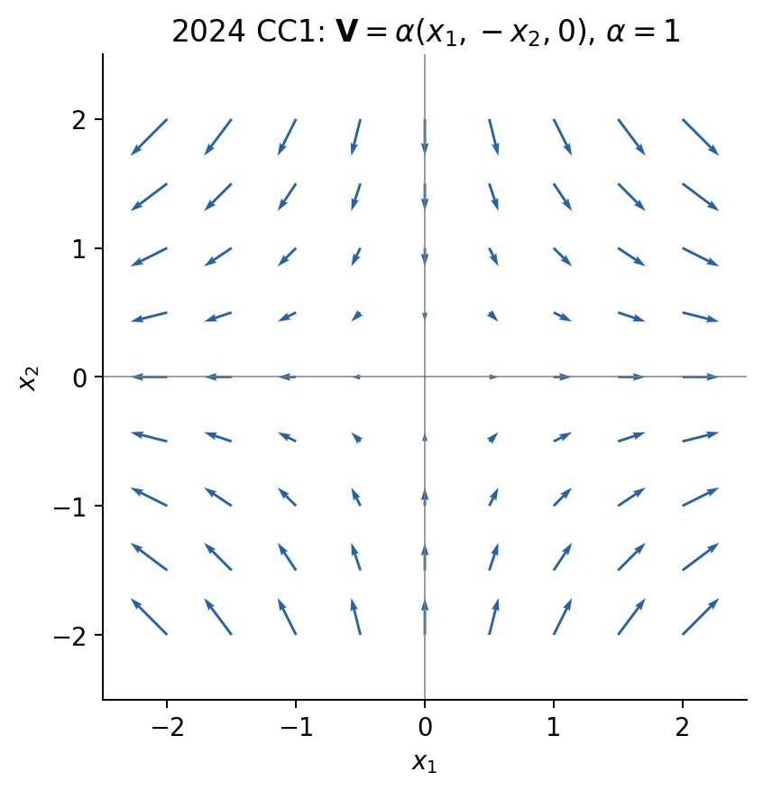
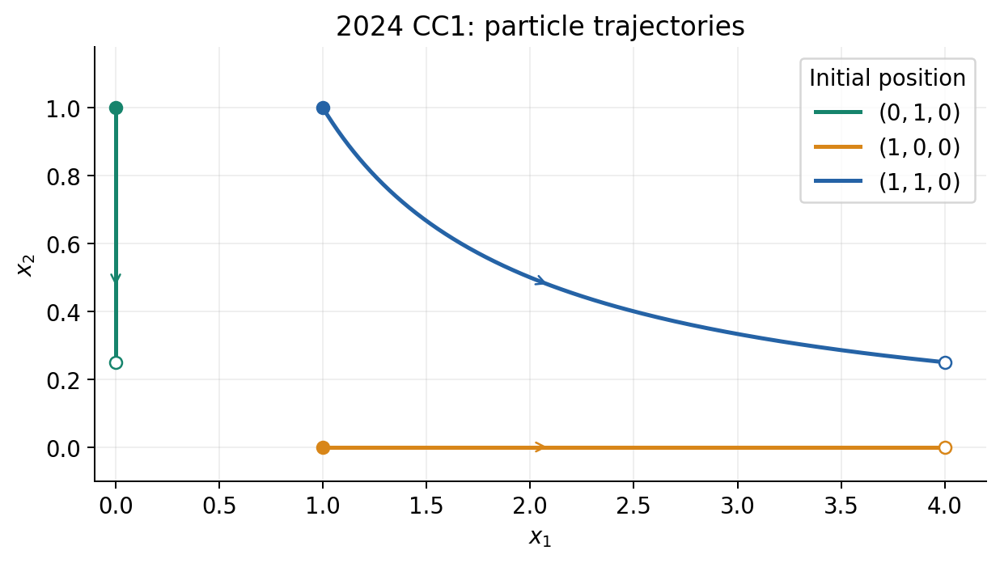

# CC1：2024 年 10 月 23 日考试题与中法对照解答

**CC1 — 23 octobre 2024. Durée : une heure.** Documents de CM et TD autorisés ; appareils électroniques interdits.

原卷与教师解答：[PDF，9 页](../IMMC_Examen-CC1_2024-10-23_Correction.pdf) · 另一份 CC1：[2025-10-15](CC1_2025-10-15_题目与解答.md)

**查阅路线。** 练习 1 按定义逐项判断；练习 2 从已知速度积分出运动映射，再求变换梯度、应变及运动性质；练习 3 由应力场计算体积力与边界牵引，最后识别自应力。每题保留法语题目和简短法语作答，中文随后解释所用定义、计算步骤和结果含义。

共 26 问：选择题 10 问、运动学 11 问、自应力 5 问。考试时间 1 小时，允许携带 CM 和 TD 资料，禁止计算器、手机、耳机、平板与电脑。

**记号约定。** $X_i$ 是同一粒子的初始坐标，$x_i$ 是它的当前坐标；$\mathbf I$ 是三维单位矩阵，$\mathbf0$ 表示相应的零向量或零张量。$\operatorname{diag}(a,b,c)$ 表示对角元为 $a,b,c$、非对角元全零的矩阵；上标 $\mathsf T$ 表示转置，$[A]$ 表示物理量 $A$ 的单位。

## 练习 1：课程知识与理解（多选题）

原题要求在试卷正面填写姓名或匿名编号、页码；直接勾选正确选项，不写论证；每道题整体答错不扣负分；选择题页须与其他答卷一同提交。

### 问题 1.1：哪些量以欧拉描述给出？

Lister les éléments donnés en description eulérienne ($A$ et $B$ sont des constantes).

$A,B$ 为常量。

- A：$\rho(t,\mathbf M)=Ax_1-Bx_2\rho_0$。
- B：$\mathbf V(t,\mathbf M)=Ax_1\mathbf e_1+Bt\mathbf e_2$。
- C：$\mathbf u(t,\mathbf M_0)=AX_2\mathbf e_1$。
- D：$\boldsymbol\Gamma(t,\mathbf M)=x_1^2\mathbf e_1+x_2^2\mathbf e_2$。

**Réponse :** A, B, D. Les champs eulériens sont repérés par la position courante ; le champ de déplacement C utilise la particule de référence.

**答案：A、B、D。** 先看“用什么位置来标记场”，再看物理量的名称。速度、密度、加速度都可以写成欧拉场，也都可以沿物质粒子来描述。

- A 用 $\rho(t,\mathbf M)$ 和当前坐标 $x_1,x_2$：问的是“当前这个位置的密度”，属于欧拉描述。
- B 用 $\mathbf V(t,\mathbf M)$ 和 $x_1$：问的是“当前这个位置的速度”，也是欧拉描述。
- C 用 $\mathbf M_0,X_2$：$X_2$ 是粒子的初始坐标，相当于给粒子贴上不变的标签，所以是拉格朗日描述。
- D 虽然是加速度，但仍用 $\mathbf M,x_1,x_2$ 表示，依然属于欧拉描述。

因此，**不能把“速度”直接等同于欧拉描述，也不能只凭“位移”这个名称作判断**；本题的依据是自变量 $\mathbf M$ 或 $\mathbf M_0$。

### 问题 1.2：以下运动具有什么性质？

Quelles sont les caractéristiques du mouvement que décrit l’équation suivante ? Les $x_i$ sont les coordonnées courantes et $\omega$ est une constante.

A. Irrotationnel ; B. Stationnaire ; C. Incompressible ; D. Mouvement de corps rigide.

$$\mathbf V(t,M)=\omega(x_2\mathbf e_1-x_1\mathbf e_2),$$

$\omega$ 为常量，$x_i$ 为当前坐标。选项为 A 无旋，B 稳态，C 不可压缩，D 刚体运动。

**Réponse :** B, C, D. Il s’agit d’une rotation rigide stationnaire et incompressible ; son rotationnel est non nul si la vitesse angulaire est non nulle.

**答案：B、C、D。** 将速度写成分量：$V_1=\omega x_2$、$V_2=-\omega x_1$、$V_3=0$。四个性质要分别检查。

| 选项 | 如何判断 | 本题结果 |
|---|---|---|
| A 无旋 | 计算 $\operatorname{rot}\mathbf V$ | 为 $-2\omega\mathbf e_3$；非零 $\omega$ 时有旋，不选 |
| B 稳态 | 固定空间位置，检查 $\partial_t\mathbf V$ | 题中没有显式时间依赖，为零，选 |
| C 不可压缩 | 计算 $\partial_{x_1}V_1+\partial_{x_2}V_2+\partial_{x_3}V_3$ | 三项均为零，选 |
| D 刚体运动 | 检查是否只有转动、没有局部伸缩或剪切 | 见下方，选 |

刚体判断可以直接认出

$$\mathbf V=(-\omega\mathbf e_3)\times\mathbf x,$$

即绕 $\mathbf e_3$ 轴以角速度 $-\omega\mathbf e_3$ 转动。也可以计算速度梯度：

$$\mathbf L=\nabla_x\mathbf V=
\begin{pmatrix}0&\omega&0\\-\omega&0&0\\0&0&0\end{pmatrix},
\qquad
\mathbf D=\frac{\mathbf L+\mathbf L^{\mathsf T}}2=\mathbf0.$$

$\mathbf L$ 的反对称部分表示转动，对称部分为零表示没有变形率。**稳态描述的是固定位置处的速度场不变，并不表示粒子静止**；这里粒子仍沿圆周运动。教师答案按非零角速度讨论；若 $\omega=0$，则退化为静止场。

### 问题 1.3：可变形介质的运动可分解成哪些基本运动？

En quels mouvements élémentaires peut-on décomposer le mouvement d’un milieu déformable ?

A. Une translation ; B. Une symétrie ; C. Une rotation ; D. Une déformation.

A 平移；B 镜像对称；C 转动；D 变形。

**Réponse :** A, C, D. Localement, on distingue translation, rotation et déformation.

**答案：A、C、D。** 看一个足够小的物质邻域，其运动可以分成三部分：

- **平移：** 邻域的基点整体移动，即基点本身的速度。
- **转动：** 邻域围绕基点转动，点之间的距离保持不变。
- **变形：** 邻域内点之间的距离或夹角改变，表现为伸缩、剪切。

若把基点附近的相对位置记为 $\delta\mathbf x$，局部一阶速度展开是

$$\mathbf V(\mathbf x+\delta\mathbf x)
\simeq \mathbf V(\mathbf x)+\boldsymbol\Omega\,\delta\mathbf x
+\mathbf D\,\delta\mathbf x,$$

其中 $\mathbf D=(\mathbf L+\mathbf L^{\mathsf T})/2$，$\boldsymbol\Omega=(\mathbf L-\mathbf L^{\mathsf T})/2$。三项依次对应上述三种运动。B“镜面对称”不属于这一分解中的独立组成。

这里说的是**局部一阶运动学分解**；有限变形的整体分解还需要相应的有限运动学公式。

### 问题 1.4：哪些均匀运动必然保持体积？

Quels mouvements homogènes s’opèrent forcément à volume constant ?

A. Contraction uniaxiale ; B. Extension uniaxiale ; C. Translation ; D. Glissement simple ; E. Dilatation ; F. Rotation.

A 单轴收缩；B 单轴伸长；C 平移；D 简单剪切；E 膨胀；F 转动。

**Réponse :** C, D, F. La translation, le glissement simple et la rotation conservent le volume.

**答案：C、D、F。** “必然保持体积”的判断量是变换梯度的行列式：

$$dv=J\,dV_0,\qquad J=\det\mathbf F.$$

若 $J=1$，物质微元的体积与初始体积相等。

- **C 平移：** 所有点加上同一个位移，$\mathbf F=\mathbf I$，故 $J=1$。
- **D 简单剪切：** 例如 $x_1=X_1+kX_2,\ x_2=X_2,\ x_3=X_3$，有
  $\mathbf F=\begin{pmatrix}1&k&0\\0&1&0\\0&0&1\end{pmatrix}$，故 $J=1$。方块被剪斜，但体积不变。
- **F 转动：** $\mathbf F=\mathbf Q$ 为正常旋转矩阵，$\det\mathbf Q=1$，故体积不变。

A、B 只给出单轴收缩或伸长，不能保证其他方向恰好补偿体积变化；例如只把第一方向放大为 $\lambda$ 倍而另两方向不变，则 $J=\lambda$。E 的各向同性膨胀有 $\mathbf F=\lambda\mathbf I$、$J=\lambda^3$，也不保持原体积。

**等体积并不等于无变形。** 简单剪切正是体积保持、形状改变的例子。

### 问题 1.5：1 m 长的杆沿轴向放大到原来的两倍，该方向应变是多少？

Si une barre de 1 m est dilatée d’un facteur 2 selon son axe, que vaut sa déformation dans cette même direction ? Les valeurs proposées sont reprises ci-dessous.

A：1 m；B：2 m；C：1；D：2；E：1%；F：2%；G：100%；H：200%。

**Réponse :** C, G. L’allongement relatif est égal à un, soit cent pour cent. Cette réponse utilise la déformation d’ingénieur.

**教师答案：C、G。** 本题将“déformation”按工程应变，即相对伸长量理解。

原长 $L_0=1\,\mathrm m$，放大到两倍后，**最终长度**为 $L=2\,\mathrm m$，**长度增量**为 $\Delta L=1\,\mathrm m$。相对伸长量要再除以原长：

$$\varepsilon_{\mathrm{eng}}
=\frac{\Delta L}{L_0}
=\frac{2-1}{1}=1=100\%.$$

因此 C、G 是同一个答案的两种写法。A、B 带长度单位，不是应变；D 的 2 是伸长比 $\lambda=L/L_0$；E、F 的 $1\%$、$2\%$ 均不是这里的 $100\%$；H 的 $200\%$ 是最终长度相对于原长的比例，没有减去原来的那一份。

**应变定义要分清。** 若题目明确要求 Green–Lagrange 应变，则

$$E_{11}=\frac{\lambda^2-1}{2}
=\frac{2^2-1}{2}=\frac32.$$

工程应变 $\lambda-1$ 与有限应变 $(\lambda^2-1)/2$ 是不同的量。本题伸长很大，不能把它们当成小变形近似下相等的两个数。

### 问题 1.6：下列量可以用哪些单位表示？

Avec $\overrightarrow{OM}$ le vecteur position, $\boldsymbol\sigma$ le tenseur des contraintes et $\mathbf n$ la normale sortante au domaine $\Omega$, en quelles unités peut-on exprimer la quantité suivante ?

$$\overrightarrow{OM}\times[\boldsymbol\sigma(M)\mathbf n(M)],$$

其中 $\mathbf n$ 为外法向。选项为 A Pa，B $\mathrm{Pa\,m^{-1}}$，C $\mathrm{Pa\,m}$，D MPa，E $\mathrm{MPa\,m^{-1}}$，F $\mathrm{MPa\,m}$，G N，H $\mathrm{N\,m^{-1}}$，I $\mathrm{N\,m}$。

**Réponse :** C, F, H. Il s’agit d’une contrainte multipliée par une longueur, sans intégration sur une surface.

**答案：C、F、H。** 按乘积中各因子的单位逐个计算：

$$[\overrightarrow{OM}]=\mathrm m,\qquad
[\mathbf n]=1,\qquad
[\boldsymbol\sigma\mathbf n]=\mathrm{Pa}=\mathrm{N/m^2}.$$

叉乘改变方向关系，不改变单位。因此

$$[\overrightarrow{OM}\times(\boldsymbol\sigma\mathbf n)]
=\mathrm{m}\times\mathrm{Pa}
=\mathrm{Pa\,m}=\mathrm{N/m}.$$

C 的 $\mathrm{Pa\,m}$、F 的 $\mathrm{MPa\,m}$、H 的 $\mathrm{N\,m^{-1}}$ 都具有这个量纲；MPa 与 Pa 只是数值换算不同，其余选项的长度幂次不对。

本题量可理解为**单位面积的力矩贡献**。只有再对表面积分，乘上 $dS$ 的 $\mathrm{m^2}$，才会得到单位为 $\mathrm{N\,m}$ 的合力矩。2025 年卷第 1.6 问多了这个积分，因此两题不能直接套同一组选项。

### 问题 1.7：对于下列应力，哪些说法正确？

Quelles affirmations sont vraies pour cet état de contrainte ?

A. Facette de normale $\mathbf e_1$ : la contrainte normale vaut $\alpha$.

B. Même facette : la contrainte tangentielle vaut $\alpha$.

C. Même facette : la contrainte tangentielle vaut $\gamma$.

D. Facette de normale $\mathbf e_3$ : la contrainte normale vaut $\beta$.

E. Même facette : la contrainte tangentielle vaut $\beta$.

F. Même facette : la contrainte tangentielle vaut $\gamma$.

$$\boldsymbol\sigma=\begin{pmatrix}\alpha&0&\gamma\\0&\alpha&0\\\gamma&0&\beta\end{pmatrix}.$$

A：$\mathbf e_1$ 法向面上，正应力为 $\alpha$；B：该面切应力为 $\alpha$；C：该面切应力为 $\gamma$；D：$\mathbf e_3$ 法向面上，正应力为 $\beta$；E：该面切应力为 $\beta$；F：该面切应力为 $\gamma$。

**Réponse :** A, C, D, F. On calcule le vecteur contrainte puis ses projections normale et tangentielle.

**答案：A、C、D、F。** “法向为 $\mathbf e_1$ 的面”指面的垂直方向为 $\mathbf e_1$。先用 Cauchy 公式求该面上的完整应力向量，再拆成垂直于面和平行于面的部分：

$$\mathbf T=\boldsymbol\sigma\mathbf n,\qquad
\sigma_n=\mathbf n\cdot\mathbf T,\qquad
\mathbf T_t=\mathbf T-\sigma_n\mathbf n.$$

**对 $\mathbf n=\mathbf e_1$：** 矩阵乘 $\mathbf e_1=(1,0,0)^{\mathsf T}$，就是取第一列：

$$\mathbf T=\alpha\mathbf e_1+\gamma\mathbf e_3,\qquad
\sigma_n=\alpha,\qquad
\mathbf T_t=\gamma\mathbf e_3.$$

所以 A 正确，B 错误，C 正确。$\alpha$ 在法向上，$\gamma$ 在该面的切向上。

**对 $\mathbf n=\mathbf e_3$：** 取第三列：

$$\mathbf T=\gamma\mathbf e_1+\beta\mathbf e_3,\qquad
\sigma_n=\beta,\qquad
\mathbf T_t=\gamma\mathbf e_1.$$

所以 D 正确，E 错误，F 正确。题中的“切应力为 $\gamma$”采用相应切向方向上的有符号分量；切向向量的模则为 $|\gamma|$。

### 问题 1.8：以下应力张量有哪些性质？

Que peut-on dire de ce tenseur de contraintes ? Les contraintes principales données sont constantes, strictement positives et distinctes.

A. Il est de traction pure ; B. Il est sphérique ; C. Il est à divergence nulle ; D. Il est de cisaillement pur ; E. Il est déviatorique ; F. Il est biaxial ; G. Il est plan.

$$\boldsymbol\sigma=\operatorname{diag}(\sigma_1,\sigma_2,0),\qquad
\sigma_1>0,\ \sigma_2>0,\ \sigma_1\ne\sigma_2,$$

且两者为空间常量。A 纯单轴拉伸；B 球形应力；C 散度为零；D 纯剪切；E 偏应力；F 双轴应力；G 平面应力。

**Réponse :** C, F, G. L’état est biaxial, plan et uniforme, donc à divergence nulle.

**答案：C、F、G。** 给定矩阵已在主方向基底中对角化，主应力为 $\sigma_1,\sigma_2,0$，前两者严格为正且不相等。

| 选项 | 判断依据 | 结论 |
|---|---|---|
| A 纯单轴拉伸 | 按本课程术语，单轴拉伸只能有一个非零主应力；本题有两个 | 不选 |
| B 球形应力 | 球形应力要求三个主应力全部相等 | 不选 |
| C 散度为零 | 题中分量为空间常量，所有空间导数均为零 | 选 |
| D 纯剪切 | 非零纯剪切有一正一负且等大的主应力；本题两个均正 | 不选 |
| E 偏应力 | 偏应力要求迹为零；本题迹为 $\sigma_1+\sigma_2>0$ | 不选 |
| F 双轴应力 | 有两个非零主应力 | 选 |
| G 平面应力 | 第三行、第三列均为零，$\mathbf e_3$ 法向面没有牵引 | 选 |

这里“平面应力”并不要求两个面内应力相等，也不要求应力张量整体为零。判断 C 时还用到了“常量”这一条件；单凭矩阵对角化不能推出散度为零。

### 问题 1.9：对称二阶张量的偏量就是把其对角线都改为零，是否正确？

Le déviateur d’un tenseur symétrique du second ordre est un tenseur dont on a remplacé les termes diagonaux par des zéros.

A. Vrai ; B. Faux.

A 正确；B 错误。

**Réponse :** B. Faux : on soustrait le tiers de la trace multiplié par l’identité.

**答案：B，错误。** 偏量的定义是从每个对角分量中减去同一个“平均正应力”，而不是把各对角分量直接清零：

$$p=\frac{\operatorname{tr}\mathbf A}{3},\qquad
\operatorname{dev}\mathbf A=\mathbf A-p\mathbf I.$$

例如

$$\mathbf A=\operatorname{diag}(6,3,0),\qquad p=3,$$

则

$$\operatorname{dev}\mathbf A=\operatorname{diag}(3,0,-3).$$

结果的迹为 $3+0-3=0$，但对角分量并非全零。若原矩阵还有非对角分量，减去 $p\mathbf I$ 不改变那些分量。

所以应记住的是**偏量的迹为零**，而不是“偏量的对角线为零”。

### 问题 1.10：固体边界上压力为 $p$，应怎样表达边界条件？

Comment se traduit une condition aux limites en pression $p$ en chaque point $M$ de la surface $\partial\Omega$ d’un solide ? Les quatre expressions mathématiques proposées figurent ci-dessous.

A：$\boldsymbol\sigma=-p\mathbf I$；B：$\boldsymbol\sigma=p\mathbf I$；C：$\boldsymbol\sigma\mathbf n=-p\mathbf n$；D：$\boldsymbol\sigma\mathbf n=p\mathbf n$。

**Réponse :** C. La traction imposée est opposée à la normale sortante.

**答案：C。** 外法向 $\mathbf n$ 从材料指向外部。压力 $p>0$ 把表面向内推，因此外界施加的面力密度是

$$\mathbf T_{\mathrm{imposée}}=-p\mathbf n.$$

边界上的应力必须提供相同的牵引，而 Cauchy 公式为 $\mathbf T=\boldsymbol\sigma\mathbf n$，于是

$$\boxed{\boldsymbol\sigma\mathbf n=-p\mathbf n}.$$

- C 同时给出了正确的受力对象、方向和大小。
- D 的正号表示沿外法向拉出，与压力方向相反。
- A 的 $\boldsymbol\sigma=-p\mathbf I$ 确实能满足这个边界条件，但它要求三个方向都处于同样的静水应力，**比在给定边界法向上规定牵引更强**，不是一般压力边界条件。
- B 不仅同样过强，符号也与压缩相反。

例如在法向为 $\mathbf e_3$ 的平面上，只需第三列为 $(0,0,-p)^{\mathsf T}$；其他面内应力不能仅凭这一条压力条件确定。

## 练习 2：欧拉描述与拉格朗日描述

**Descriptions eulérienne et lagrangienne.** Le mouvement plan est défini par $\mathbf V(M)=\alpha(x_1\mathbf e_1-x_2\mathbf e_2)$, avec $\alpha>0$ constant. Les $X_i$ sont les coordonnées initiales à $t=0$. Le domaine est $x_1>0,x_2>0$, avec $x_3$ quelconque ; les points sur les axes sont étudiés par prolongement de la même transformation.

给定平面速度场

$$\mathbf V(M)=\alpha(x_1\mathbf e_1-x_2\mathbf e_2)
=\begin{pmatrix}\alpha x_1\\-\alpha x_2\\0\end{pmatrix},\qquad\alpha>0.$$

初始坐标为 $(X_1,X_2,X_3)$，当前坐标为 $(x_1,x_2,x_3)$，参考时刻 $t=0$。介质区域为 $x_1>0,x_2>0$，$x_3$ 任意。下方原题也要求画坐标轴上的示例点，可把它们理解为该运动映射延拓到区域边界后的轨迹。

### 问题 2.1：$\alpha$ 的单位是什么？哪些物理量有相同单位？

Quelle est l’unité de la constante $\alpha$ ? Quelles quantités s’expriment dans cette unité ?

**Réponse :** $[\alpha]=\mathrm{s^{-1}}$, comme une fréquence ou un taux de déformation.

从 $V_1=\alpha x_1$ 出发，先写量纲：

$$[\alpha]=\frac{[V_1]}{[x_1]}
=\frac{\mathrm{m/s}}{\mathrm m}=\mathrm{s^{-1}}.$$

因此 $\alpha$ 不是一个长度或应变，而是一个**每单位时间的变化尺度**；频率、应变率、角速度都可具有这一单位。

本题后面会出现 $e^{\alpha t}$。指数必须无量纲，$[\alpha t]=1$，这也能反过来检查单位是否正确。

### 问题 2.2：画速度场，说明可能对应哪类运动或现象

Tracer, dans le plan $(O,\mathbf e_1,\mathbf e_2)$, la forme du champ des vitesses à l’instant $t$. À quel type de mouvement ou phénomène cela peut-il correspondre ?

**Réponse :** Le champ correspond à une extension selon la première direction et une contraction selon la deuxième.

速度场作图是在同一时刻，对多个**当前空间位置**画速度箭头。先分别看两个分量：

$$V_1=\alpha x_1,\qquad V_2=-\alpha x_2.$$

因为 $\alpha>0$，第一象限内的箭头向右、向下。在 $x_1$ 轴上只有水平分量，远离原点；在 $x_2$ 轴上只有竖直分量，朝向原点。在全平面延拓后，左右两侧沿第一方向分开，上下两侧沿第二方向靠拢。

例如取 $\alpha=1\,\mathrm{s^{-1}}$，在 $(1,0)$、$(0,1)$、$(1,1)$ 处依次画 $(1,0)$、$(0,-1)$、$(1,-1)$ 的箭头，再按坐标的符号和大小补全其他位置。

这对应第一方向伸长、第二方向收缩的平面伸缩流，也称这里的纯伸缩式剪切。它可示意拉伸流或停滞点附近的鞍形流动。图中的箭头表示速度，不是粒子已经走过的轨迹；粒子轨迹要由第 2.5、2.6 问确定。

### 问题 2.3：求散度，并判断物质域从 0 到 $t$ 的体积变化

Calculer $\operatorname{div}\mathbf V$. Que peut-on en déduire concernant la variation de volume d’un domaine matériel $\omega(t)$ contenu dans $\Omega(t)$ entre les instants $0$ et $t$ ?

**Réponse :** La divergence est nulle ; le mouvement conserve le volume. La divergence est un taux relatif de variation du volume.

散度取的是“第 $i$ 个速度分量对第 $i$ 个空间坐标的导数”之和：

$$\operatorname{div}\mathbf V
=\frac{\partial(\alpha x_1)}{\partial x_1}
+\frac{\partial(-\alpha x_2)}{\partial x_2}
+\frac{\partial 0}{\partial x_3}
=\alpha-\alpha=0.$$

第一方向在拉开，第二方向在压缩，二者的局部体积变化率正好抵消。要从这个**瞬时结论**得到“从 $0$ 到 $t$ 体积不变”，可用物质微元的关系

$$\frac{d(dv)}{dt}=(\operatorname{div}\mathbf V)\,dv=0.$$

所以每个随粒子运动的微小体积始终保持初始值，任意有限随体区域的体积也不变。等价地，

$$\dot J=J\,\operatorname{div}\mathbf V=0,\qquad J(0)=1
\quad\Longrightarrow\quad J(t)=1.$$

这里 $J=dv/dV_0$ 是当前体积与初始体积之比。结论是**运动不可压缩、变换等体积，但允许形状改变**。

教师解答 (*2.2) 将 $\operatorname{div}\mathbf V$ 与 $J-1$ 直接连等；两者一般不能相等：散度单位为 $\mathrm{s^{-1}}$，$J-1$ 无量纲。本题两者恰好都为零；应记住上面的导数关系，而不是该连等式。

### 问题 2.4：求变形率 $\mathbf D$，其分量单位是什么？

Calculer le taux de déformation $\mathbf D$. Quelles sont les unités de ses composantes ?

**Réponse :** Le gradient de vitesse est symétrique ; il est donc égal au taux de déformation. Ses composantes sont en inverse de seconde.

变形率 $\mathbf D$ 描述的是“现在每单位时间发生多少局部伸缩或剪切”。从欧拉速度求它，要先算对当前坐标的梯度：

$$L_{ij}=\frac{\partial V_i}{\partial x_j},\qquad
\mathbf L=
\begin{pmatrix}
\alpha&0&0\\
0&-\alpha&0\\
0&0&0
\end{pmatrix}.$$

例如 $L_{11}=\partial_{x_1}(\alpha x_1)=\alpha$，$L_{12}=\partial_{x_2}(\alpha x_1)=0$，其他项同理。

再取对称部分：

$$\mathbf D=\frac12(\mathbf L+\mathbf L^{\mathsf T})
=\alpha\operatorname{diag}(1,-1,0).$$

由于 $\mathbf L$ 已经对称，这一步不改变矩阵。$D_{11}>0$ 表示第一方向的瞬时伸长率，$D_{22}<0$ 表示第二方向的瞬时收缩率，第三方向不变。其单位是速度除以长度，即 $\mathrm{s^{-1}}$。

反对称部分 $\boldsymbol\Omega=(\mathbf L-\mathbf L^{\mathsf T})/2=\mathbf0$，说明没有局部刚体旋转率；这不妨碍 $\mathbf D$ 非零。

### 问题 2.5：求拉格朗日运动映射 $x_i=f_i(\mathbf X,t)$

Déterminer la représentation lagrangienne du mouvement, c’est-à-dire les fonctions $f_i$ telles que $x_i=f_i(X_1,X_2,X_3,t)$.

**Réponse :** On intègre les équations de mouvement particulaires et on utilise les positions initiales pour déterminer les constantes.

要得到拉格朗日描述，就要跟踪**同一个粒子**，把它在初始时刻的位置 $\mathbf X$ 当作固定标签。它的当前位置满足“位置对时间的导数等于该处的速度”：

$$\dot x_1=\alpha x_1,\qquad
\dot x_2=-\alpha x_2,\qquad
\dot x_3=0,\qquad \mathbf x(0)=\mathbf X.$$

第一式可分离变量：$dx_1/x_1=\alpha\,dt$，积分后 $x_1=C_1e^{\alpha t}$。代入 $x_1(0)=X_1$ 得 $C_1=X_1$。第二式同理，只是指数符号相反；第三式说明第三坐标保持初值。因此

$$\boxed{x_1=X_1e^{\alpha t},\qquad
x_2=X_2e^{-\alpha t},\qquad x_3=X_3.}$$

这是整个运动映射，不是某一个点的特殊轨迹；代入不同的 $\mathbf X$，就得到不同粒子的轨迹。坐标轴上的 $X_1=0$ 或 $X_2=0$ 也可直接代入这个结果，不需要对零取对数。

最后做两个检查：令 $t=0$ 应恢复 $\mathbf x=\mathbf X$；固定 $\mathbf X$ 求时间导数，应恢复题给速度场。

### 问题 2.6：画初始点 $(0,1,0),(1,0,0),(1,1,0)$ 的轨迹

Tracer la trajectoire des points initialement situés en $(0,1,0)$, $(1,0,0)$ et $(1,1,0)$.

**Réponse :** Les deux premières trajectoires sont portées par les axes ; la troisième est une branche d’hyperbole.

把三个初始位置分别代入上一问的映射：

| 初始点 | 参数轨迹 $(x_1(t),x_2(t),x_3(t))$ | 从 $t=0$ 开始的运动方向 |
|---|---|---|
| $(0,1,0)$ | $(0,e^{-\alpha t},0)$ | 沿正 $x_2$ 轴接近原点，有限时间内不到原点 |
| $(1,0,0)$ | $(e^{\alpha t},0,0)$ | 沿正 $x_1$ 轴远离原点 |
| $(1,1,0)$ | $(e^{\alpha t},e^{-\alpha t},0)$ | 向右下方运动 |

第三个粒子的参数 $t$ 可以消去：

$$x_1x_2=e^{\alpha t}e^{-\alpha t}=1,
\qquad x_2=\frac1{x_1}.$$

因此它走的是双曲线；对 $t\ge0$，只走从 $(1,1)$ 出发、$x_1\ge1$ 的那一段。作图时应标起点和方向，不能只画完整双曲线而不指出走哪一段。

图取 $\alpha=1\,\mathrm{s^{-1}}$、$0\le t\le\ln4\,\mathrm s$。实心点是起点，空心点是该绘图时间段的终点，不是粒子最终停止的位置。

### 问题 2.7：求变换梯度 $\mathbf F$，据此证明粒子密度不随时间改变

Déterminer le tenseur gradient de la transformation $\mathbf F$. En déduire que la masse volumique d’une particule reste constante au cours du temps.

**Réponse :** Le gradient de transformation est diagonal, de déterminant unité. La conservation de la masse impose alors une densité constante le long de chaque particule.

变换梯度对的是**参考坐标** $\mathbf X$，不是当前坐标：

$$F_{ij}=\frac{\partial x_i}{\partial X_j},\qquad
\mathbf F=
\begin{pmatrix}
e^{\alpha t}&0&0\\
0&e^{-\alpha t}&0\\
0&0&1
\end{pmatrix}.$$

每个 $x_i$ 只依赖相应的 $X_i$，所以非对角项为零。对角矩阵的行列式是对角元的乘积：

$$J=e^{\alpha t}e^{-\alpha t}\times1=1.$$

要由体积联系到密度，必须再使用质量守恒。对同一物质微元，

$$\underbrace{\rho_0(\mathbf X)\,dV_0}_{\text{初始质量}}
=\underbrace{\rho(t,\mathbf x(t,\mathbf X))\,dv}_{\text{当前质量}},
\qquad dv=J\,dV_0.$$

消去 $dV_0$，得到 $\rho J=\rho_0$；由于本题 $J=1$，

$$\rho(t,\mathbf x(t,\mathbf X))=\rho_0(\mathbf X).$$

因此**同一个粒子的密度随时间保持不变**。这不要求不同粒子的密度相等：若初始密度分布不均匀，各粒子只是各自保持原来的密度。

### 问题 2.8：求 Green–Lagrange 应变，说明 $\mathbf F,\mathbf E$ 的单位

Calculer le tenseur des déformations de Green–Lagrange $\mathbf E$. Quelles sont les unités des composantes de $\mathbf F$ et $\mathbf E$ ?

**Réponse :** $\mathbf E=(\mathbf F^T\mathbf F-\mathbf I)/2$ ; ses composantes et celles de $\mathbf F$ sont sans dimension. Les composantes sont calculées ci-dessous.

从定义开始：

$$\mathbf C=\mathbf F^{\mathsf T}\mathbf F,\qquad
\mathbf E=\frac12(\mathbf C-\mathbf I).$$

$\mathbf F$ 已经是对角矩阵，转置后不变，相乘只需把各对角元平方：

$$\mathbf C=\operatorname{diag}(e^{2\alpha t},e^{-2\alpha t},1).$$

再逐个对角元减去 1、除以 2：

$$\boxed{\mathbf E=\frac12
\begin{pmatrix}
e^{2\alpha t}-1&0&0\\
0&e^{-2\alpha t}-1&0\\
0&0&0
\end{pmatrix}.}$$

对 $t>0$，第一方向伸长，故 $E_{11}>0$；第二方向收缩，故 $E_{22}<0$；第三方向不变，故 $E_{33}=0$。令 $t=0$，三个应变都应为零，这也是检查式子是否漏了“减 1”的办法。

$F_{ij}$ 是长度对长度的导数，单位为 $\mathrm m/\mathrm m=1$；$\mathbf E$ 由它相乘、减单位阵得到，因此 $\mathbf F$、$\mathbf E$ 均无量纲。

### 问题 2.9：不作计算，给出一个主应变和主方向

Donner, sans passer par des calculs, une déformation principale et une direction principale de déformation.

**Réponse :** La troisième direction est principale et sa déformation principale est nulle.

主应变的定义是 $\mathbf E\mathbf n=E_{\mathrm{pr}}\mathbf n$：沿主方向 $\mathbf n$ 的线元，在应变算子的作用下不混入其他方向。

本题不必求特征多项式。由运动映射 $x_3=X_3$，第三方向既不伸缩，也不和第一、第二方向耦合。因此

$$\mathbf E\mathbf e_3=\mathbf0=0\mathbf e_3,$$

可直接给出：**主方向为 $\mathbf e_3$，对应主应变为 0。**

上一问的矩阵已经对角化，所以其余两条坐标轴也都是主方向，对应主应变就是另外两个对角元。$t=0$ 时 $\mathbf E=\mathbf0$，任意方向都可作为主方向。

### 问题 2.10：何时可以线性化应变？求线性化应变并比较 $\mathbf D,\boldsymbol\varepsilon$

Pour quelles valeurs de $t$ peut-on utiliser la forme linéarisée du tenseur des déformations ? En déduire $\boldsymbol\varepsilon$ avec ces simplifications. Comparer les expressions de $\mathbf D$ et de $\boldsymbol\varepsilon$.

**Réponse :** L’HPP exige un gradient de déplacement petit. Au premier ordre en temps, la dérivée de la déformation linéarisée coïncide ici avec le taux de déformation.

先区分两个步骤：**用位移梯度写线性化应变**，以及**把本题位移中的指数函数对小时间展开**。

位移是“当前位置减初始位置”：

$$\mathbf u=\mathbf x-\mathbf X
=\bigl((e^{\alpha t}-1)X_1,\ (e^{-\alpha t}-1)X_2,\ 0\bigr).$$

所以

$$\mathbf H=\nabla_X\mathbf u=\mathbf F-\mathbf I
=\operatorname{diag}(e^{\alpha t}-1,e^{-\alpha t}-1,0).$$

小扰动假设（HPP）要求位移梯度的各项足够小，故应有 $|\alpha t|\ll1$，即 $|t|\ll1/\alpha$。此时

$$e^{\alpha t}\simeq1+\alpha t,\qquad
e^{-\alpha t}\simeq1-\alpha t.$$

保留一阶项，得到

$$\boldsymbol\varepsilon
=\frac12(\mathbf H+\mathbf H^{\mathsf T})
\simeq \alpha t\,\operatorname{diag}(1,-1,0).$$

它与第 2.4 问的 $\mathbf D=\alpha\operatorname{diag}(1,-1,0)$ 相比，多了一个时间因子：

$$\boxed{\boldsymbol\varepsilon\simeq t\mathbf D,\qquad
\dot{\boldsymbol\varepsilon}\simeq\mathbf D.}$$

这对应“累计伸长量”和“每秒伸长多少”的区别。$\boldsymbol\varepsilon$ 无量纲，$\mathbf D$ 的单位是 $\mathrm{s^{-1}}$，不能把两者直接写成相等。上述简单关系用到了本题 $\mathbf D$ 为常量和小扰动近似。

若暂不对指数展开，则 $\operatorname{sym}\mathbf H$ 的对角元仍是 $e^{\pm\alpha t}-1$；只有进入小参数近似后，才得到上面的 $\pm\alpha t$。教师另写的 $\ln2/\alpha$ 是同阶时间尺度提示，不应当作统一的误差界限。

### 问题 2.11：求速度场旋度，列出运动性质

Calculer le rotationnel du champ de vitesse eulérien $\mathbf V(M)$ et donner toutes les caractéristiques de ce mouvement.

**Réponse :** Le mouvement est irrotationnel, incompressible et stationnaire, mais il comporte une déformation.

旋度要用交叉偏导，而散度用对角偏导。对本题，

$$\operatorname{rot}\mathbf V=
\begin{pmatrix}
\partial_{x_2}V_3-\partial_{x_3}V_2\\
\partial_{x_3}V_1-\partial_{x_1}V_3\\
\partial_{x_1}V_2-\partial_{x_2}V_1
\end{pmatrix}
=\begin{pmatrix}0\\0\\0\end{pmatrix}.$$

原因是 $V_1$ 只依赖 $x_1$、$V_2$ 只依赖 $x_2$，所有交叉偏导均为零。将已有结果并列：

| 结果 | 对应性质 |
|---|---|
| $\partial_t\mathbf V=\mathbf0$，固定 $\mathbf x$ 求导 | 稳态 |
| $\operatorname{div}\mathbf V=0$ | 不可压缩 |
| $\operatorname{rot}\mathbf V=\mathbf0$ | 无旋 |
| $\mathbf D=\alpha\operatorname{diag}(1,-1,0)\ne\mathbf0$ | 有变形，不是刚体运动 |

因此**无旋只排除了局部旋转，并没有排除伸长和收缩**。同样，稳态也没有排除粒子随时间移动、材料不断变形。

## 练习 3：圆柱中的自应力场

**Champ d’autocontraintes.** Un cylindre droit de hauteur $h$ et de rayon $R$, d’axe $O\mathbf e_z$, est en équilibre statique. Les composantes supérieures du tenseur des contraintes dans le repère cartésien sont données par le paramètre $A$ dans la matrice partagée ci-dessous.

直圆柱半径 $R$、高度 $h$，轴线为 $O\mathbf e_z$，处于静力平衡。直角坐标下给定应力上三角部分：

$$\boldsymbol\sigma=\begin{pmatrix}
A(R^2-x^2-3y^2)&2Axy&0\\
\text{待补}&A(R^2-3x^2-y^2)&0\\
\text{待补}&\text{待补}&0
\end{pmatrix}.$$

### 问题 3.1：补全应力张量

Compléter la forme du tenseur $\boldsymbol\sigma$.

**Réponse :** Le tenseur des contraintes est symétrique, en l’absence de couples internes indépendants.

普通 Cauchy 连续介质在没有独立内偶力的假设下，角动量平衡要求

$$\sigma_{ij}=\sigma_{ji}.$$

所以关于主对角线对称的位置必须相等：$\sigma_{yx}=\sigma_{xy}=2Axy$，$\sigma_{zx}=\sigma_{xz}=0$，$\sigma_{zy}=\sigma_{yz}=0$。补全为

$$\boldsymbol\sigma=A
\begin{pmatrix}
R^2-x^2-3y^2&2xy&0\\
2xy&R^2-3x^2-y^2&0\\
0&0&0
\end{pmatrix}.$$

“应力张量对称”不代表它已对角化；本题的 $\sigma_{xy}=\sigma_{yx}$ 一般非零。第三行、第三列为零则表示这是相对于 $z$ 方向的平面应力场。

### 问题 3.2：常数 $A$ 的单位

Dans quelle unité s’exprime la constante $A$ ?

**Réponse :** $[A]=\mathrm{Pa/m^2}=\mathrm{N/m^4}$.

例如从 $\sigma_{xx}=A(R^2-x^2-3y^2)$ 检查。括号中各项都是长度平方，能相加，单位为 $\mathrm{m^2}$；而 $\sigma_{xx}$ 是应力，单位为 Pa。因此

$$[A]=\frac{\mathrm{Pa}}{\mathrm{m^2}}
=\frac{\mathrm{N/m^2}}{\mathrm{m^2}}
=\mathrm{N/m^4}.$$

同样检查非对角分量 $2Axy$，其中 $xy$ 也是长度平方，结果一致。参数 $A$ 本身不是应力；需要乘上长度平方才成为应力。

### 问题 3.3：求作用在圆柱上的体积力密度并说明

Calculer la densité volumique de force $\mathbf f_v$ s’appliquant sur le solide $\Omega$. Commenter.

**Réponse :** La divergence du champ de contrainte est nulle : aucune force volumique n’est nécessaire.

“体积力密度”$\mathbf f_v$ 指每单位体积受到的外力，单位为 $\mathrm{N/m^3}$。本题静止，动量平衡简化为

$$\operatorname{div}\boldsymbol\sigma+\mathbf f_v=\mathbf0,
\qquad \mathbf f_v=-\operatorname{div}\boldsymbol\sigma.$$

对直角坐标下的张量，按行求散度：

$$\begin{aligned}
(\operatorname{div}\boldsymbol\sigma)_x
&=\partial_x\sigma_{xx}+\partial_y\sigma_{xy}+\partial_z\sigma_{xz}\\
&=\partial_x[A(R^2-x^2-3y^2)]+\partial_y(2Axy)+0\\
&=-2Ax+2Ax=0,\\
(\operatorname{div}\boldsymbol\sigma)_y
&=\partial_x\sigma_{yx}+\partial_y\sigma_{yy}+\partial_z\sigma_{yz}\\
&=\partial_x(2Axy)+\partial_y[A(R^2-3x^2-y^2)]+0\\
&=2Ay-2Ay=0,\\
(\operatorname{div}\boldsymbol\sigma)_z&=0.
\end{aligned}$$

因此 $\boxed{\mathbf f_v=\mathbf0}$：这个应力场不需要额外体积力就能满足局部静力平衡。虽然每个应力分量会随位置变化，但它们造成的局部合力恰好抵消；“散度为零”并不等于“应力分量是常量或全为零”。

教师解答在 $\mathbf f_v=-\operatorname{div}\boldsymbol\sigma$ 后展开分量时漏了整体负号；本题结果为零，不受该漏号影响。若计算出非零散度，负号就不能省略。

### 问题 3.4：求不同边界上的面力密度并说明

Calculer la densité surfacique de force $\mathbf T$ s’appliquant sur les différentes frontières du solide $\Omega$. Commenter.

**Réponse :** Les tractions sont nulles sur les deux bases et sur la surface latérale.

面力密度即单位面积的边界牵引，单位为 Pa。它由 $\mathbf T=\boldsymbol\sigma\mathbf n$ 给出，**不同边界必须使用各自的外法向**。

**底面和顶面。** 底面 $z=0$ 的外法向为 $-\mathbf e_z$，顶面 $z=h$ 的外法向为 $\mathbf e_z$。矩阵乘 $\pm\mathbf e_z$ 就是取第三列并加相应符号；本题第三列全零，所以

$$\mathbf T_{z=0}=\mathbf T_{z=h}=\mathbf0.$$

**圆柱侧面。** 侧面满足 $x^2+y^2=R^2$，外法向是从轴线向外的单位径向量：

$$\mathbf n=\frac{x\mathbf e_x+y\mathbf e_y}{R}
=\begin{pmatrix}x/R\\y/R\\0\end{pmatrix}.$$

相乘后，先合并同类项，再使用侧面方程：

$$\begin{aligned}
T_x&=\sigma_{xx}\frac xR+\sigma_{xy}\frac yR
=\frac{Ax}{R}(R^2-x^2-3y^2+2y^2)\\
&=\frac{Ax}{R}(R^2-x^2-y^2)=0,\\
T_y&=\sigma_{yx}\frac xR+\sigma_{yy}\frac yR
=\frac{Ay}{R}(2x^2+R^2-3x^2-y^2)\\
&=\frac{Ay}{R}(R^2-x^2-y^2)=0,\qquad T_z=0.
\end{aligned}$$

所以圆柱**全部外表面都没有牵引力**。注意，$x^2+y^2=R^2$ 只在侧面成立，不能先把它代入整个体内应力场再去求空间导数。

边界上牵引为零也不表示该点的所有应力分量为零。例如侧面点 $(R,0,z)$ 上，$\sigma_{yy}=-2AR^2$ 可以非零，但外法向为 $\mathbf e_x$，应力第一列为零，故该面的牵引仍为零。

### 问题 3.5：这个应力场有什么特殊之处？

Quelle est la particularité du champ de contraintes au sein de ce solide ?

**Réponse :** C’est un champ d’autocontraintes : les contraintes intérieures peuvent être non nulles alors que les efforts extérieurs sont nuls. La compatibilité constitutive reste à examiner.

把前两问合起来看：体内 $\mathbf f_v=\mathbf0$，外边界 $\boldsymbol\sigma\mathbf n=\mathbf0$，但当 $A\ne0$ 时，体内 $\boldsymbol\sigma$ 并不为零。例如圆柱轴线上 $x=y=0$，有

$$\boldsymbol\sigma=\operatorname{diag}(AR^2,AR^2,0)\ne\mathbf0.$$

因此这是**自应力场（champ d’autocontraintes）**：没有外加体积力和表面牵引，内部应力仍可相互平衡。材料经过不均匀塑性变形、焊接或热处理后留下的残余应力，是理解这种现象的常见例子。

“没有外载荷”约束的是外界作用，并不直接要求每一处内部应力为零。本题验证了这个场在静力学上能自平衡；若还要说明具体材料为何具有该应力，需结合本构、初始应变或加工历史。考试作答的核心是指出“**外力为零而内部应力非零**”并命名为自应力场。

## 原卷附录：直角坐标公式

对标量 $f$、向量 $\mathbf U$ 和对称二阶张量 $\mathbf T$：

$$\nabla f=(f_{,x},f_{,y},f_{,z}),\qquad
(\nabla\mathbf U)_{ij}=U_{i,j},\qquad
\operatorname{div}\mathbf U=U_{x,x}+U_{y,y}+U_{z,z},$$

$$\operatorname{rot}\mathbf U=(U_{z,y}-U_{y,z},\ U_{x,z}-U_{z,x},\ U_{y,x}-U_{x,y}),$$

$$\operatorname{div}\mathbf T=
\begin{pmatrix}
T_{xx,x}+T_{xy,y}+T_{xz,z}\\
T_{xy,x}+T_{yy,y}+T_{yz,z}\\
T_{xz,x}+T_{yz,y}+T_{zz,z}
\end{pmatrix}.$$

上面的公式已足够完成本卷。逐行求张量散度时，第一行分别对 $x,y,z$ 求导后相加，再依次处理第二、三行。完整原公式图及中文使用说明见 [微分算子表](../../CM/中文补充/微分算子表.md)。
