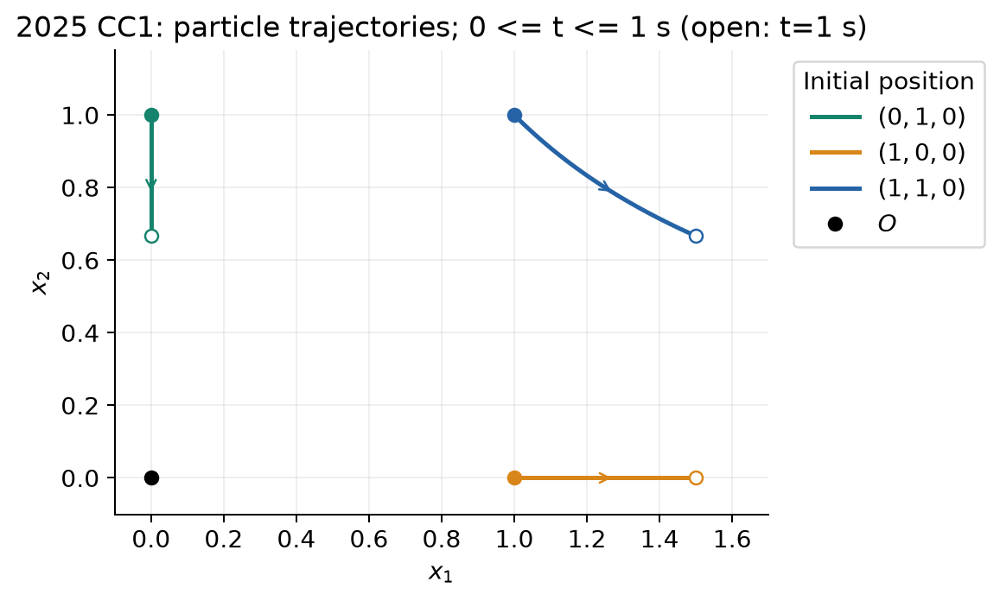
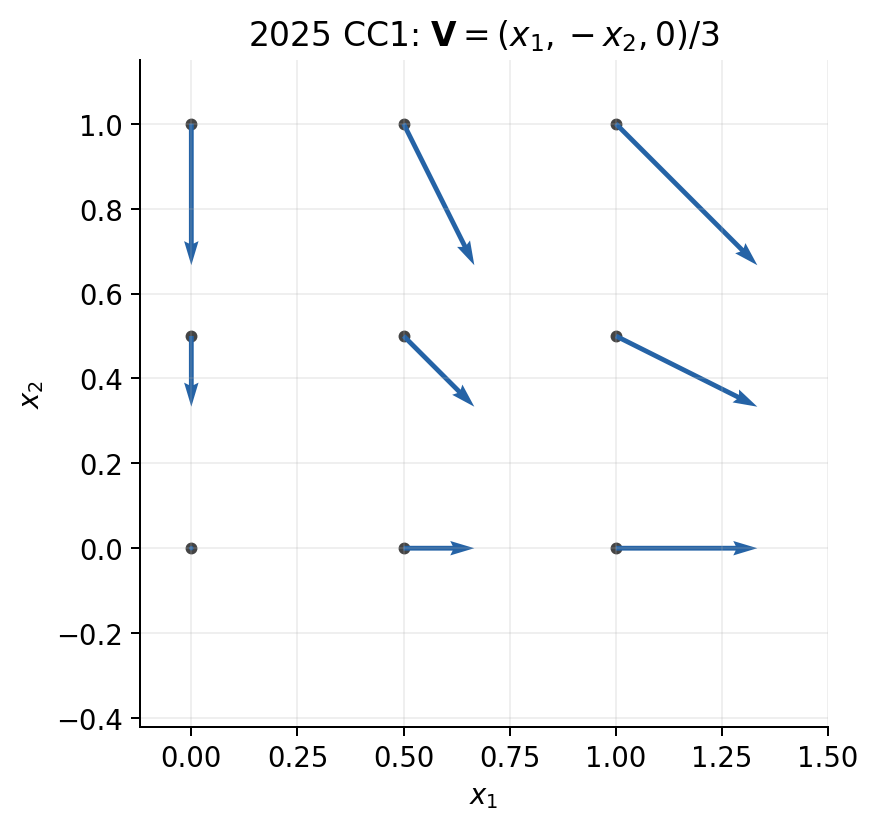

# CC1：2025 年 10 月 15 日考试题与中法对照解答

**CC1 — 15 octobre 2025. Durée : une heure.** Documents de CM et TD, fiches et formulaires inclus, autorisés ; appareils électroniques interdits.

原卷：[题目，6 页](../IMMC_Examen-CC1_2025-10-15_Sujet.pdf) · [教师解答，11 页](../IMMC_Examen-CC1_2025-10-15_Correction.pdf) · 另一份 CC1：[2024-10-23](CC1_2024-10-23_题目与解答.md)

**查阅路线。** 练习 1 按定义逐项判断；练习 2 从运动映射求变换梯度和应变，讨论小扰动近似后，再转成欧拉速度并求变形率、旋转率；练习 3 先说明平面应力和边界条件，再由柱坐标平衡求环向应力，最后比较三个主应力得到 Tresca 等效应力。每题保留法语题目和简短法语作答，中文随后展开理由与计算。

共 25 问：选择题 10 问、运动学 11 问、带孔圆盘 4 问。考试时间 1 小时，原卷允许 CM、TD、公式表等资料，禁止计算器、手机、耳机、平板与电脑。选择题直接勾选，不要求论证，整体答错不扣负分。学号和页码写在每页指定区域。

**记号约定。** $X_i$ 是同一粒子的初始坐标，$x_i$ 是它的当前坐标；$\mathbf I$ 是三维单位矩阵，$\mathbf0$ 表示相应的零向量或零张量。$\operatorname{diag}(a,b,c)$ 表示对角元为 $a,b,c$、非对角元全零的矩阵；上标 $\mathsf T$ 表示转置，$[A]$ 表示物理量 $A$ 的单位。

## 练习 1：课程概念与理解（多选）

### 问题 1.1：哪些场用拉格朗日描述给出？

Lister les champs donnés en description lagrangienne ($A,B,C,D,E$ sont des constantes).

常量为 $A,B,C,D,E$。选项：A：$\mathbf V(t,\mathbf M_0)=AX_1\mathbf e_1+BX_2\mathbf e_2$；B：$T(t,\mathbf M)=C(x_1+x_2)$；C：$\mathbf u(t,\mathbf M_0)=DX_1t\mathbf e_2$；D：$\mathbf A(t,\mathbf M)=Et\mathbf I$。

**Réponse :** A, C. Ces champs sont exprimés à partir de la position de référence de la particule.

**答案：A、C。** 拉格朗日描述用“这是谁”来标记场，标签是同一个粒子的初始位置 $\mathbf M_0$ 或坐标 $\mathbf X$；欧拉描述用“现在在哪里”来标记场，使用当前位置 $\mathbf M$ 或坐标 $\mathbf x$。

| 选项 | 使用的位置变量 | 判断 |
|---|---|---|
| A 速度 $\mathbf V(t,\mathbf M_0)$ | 初始粒子坐标 $X_1,X_2$ | 拉格朗日，选 |
| B 温度 $T(t,\mathbf M)$ | 当前坐标 $x_1,x_2$ | 欧拉，不选 |
| C 位移 $\mathbf u(t,\mathbf M_0)$ | 初始粒子坐标 $X_1$ | 拉格朗日，选 |
| D 张量场 $\mathbf A(t,\mathbf M)$ | 标记为当前点 $\mathbf M$ | 欧拉，不选 |

D 的公式恰好不随位置改变，但题目仍明确把它写成以当前点为自变量的场。不要仅凭公式里有没有空间坐标、或物理量是不是速度来分类。

### 问题 1.2：$\mathbf V(t,M)=\gamma t x_1\mathbf e_2$ 具有哪些性质？

Quelles sont les caractéristiques du mouvement décrit ci-dessous ? Les coordonnées sont courantes et $\gamma$ est une constante.

A. Stationnaire ; B. Incompressible ; C. Irrotationnel ; D. Mouvement de corps rigide.

A 稳态；B 不可压缩；C 无旋；D 刚体运动。

**Réponse :** B. La divergence est nulle. Le champ dépend du temps et possède en général un rotationnel et un taux de déformation non nuls.

**答案：B。** 写成分量后，$V_1=0$、$V_2=\gamma t x_1$、$V_3=0$。按题意讨论非零 $\gamma$ 的运动。

**A 稳态：不选。** 稳态要求固定空间位置时速度不随时间变化，但

$$\partial_t\mathbf V=\gamma x_1\mathbf e_2\not\equiv\mathbf0.$$

**B 不可压缩：选。** 散度只对“同编号坐标”求导：

$$\operatorname{div}\mathbf V
=\partial_{x_1}V_1+\partial_{x_2}V_2+\partial_{x_3}V_3
=0+0+0=0.$$

特别注意，$V_2$ 虽然含 $x_1$，但散度中要计算的是 $\partial_{x_2}V_2$，不是 $\partial_{x_1}V_2$。

**C 无旋：不选。** 旋度的第三分量恰好需要这个交叉偏导：

$$\operatorname{rot}\mathbf V
=(\partial_{x_1}V_2-\partial_{x_2}V_1)\mathbf e_3
=\gamma t\mathbf e_3.$$

**D 刚体运动：不选。** 相邻的两层若有不同 $x_1$，沿 $\mathbf e_2$ 的速度就不同，材料会被剪斜。计算上，

$$\mathbf L=\begin{pmatrix}0&0&0\\\gamma t&0&0\\0&0&0\end{pmatrix},
\qquad
\mathbf D=\frac{\gamma t}{2}
\begin{pmatrix}0&1&0\\1&0&0\\0&0&0\end{pmatrix},$$

一般不为零。$t=0$ 时速度和变形率恰好为零，只是一个瞬时情况，不能据此把整个运动判成刚体运动；若 $\gamma=0$，才整体退化为静止。

### 问题 1.3：刚体运动的性质

Le mouvement d’un corps rigide est :

A. Forcément incompressible ; B. Forcément stationnaire ; C. Forcément composé d’une rotation ; D. Forcément composé d’une translation ; E. Forcément composé d’une déformation ; F. Potentiellement composé d’une rotation ; G. Potentiellement composé d’une translation ; H. Potentiellement composé d’une déformation.

A 必定不可压缩；B 必定稳态；C 必含转动；D 必含平移；E 必含变形；F 可以含转动；G 可以含平移；H 可以含变形。

**Réponse :** A, F, G. Une translation et une rotation peuvent composer un mouvement rigide, sans déformation.

**答案：A、F、G。** 刚体运动的核心条件是**任意两个物质点之间的距离保持不变**。一般可以写成

$$\mathbf x(t,\mathbf X)=\mathbf c(t)+\mathbf Q(t)\mathbf X,$$

其中 $\mathbf c(t)$ 给出整体平移，$\mathbf Q(t)$ 为旋转矩阵。

| 选项 | 为什么 |
|---|---|
| A 必定不可压缩 | 正确。刚体不改变形状和尺寸，当然不改变体积 |
| B 必定稳态 | 错误。刚体可以整体加速平移，其速度场会随时间变化 |
| C 必含转动 | 错误。纯平移也是刚体运动 |
| D 必含平移 | 错误。绕固定轴、固定点的纯转动也是刚体运动 |
| E 必含变形 | 错误。与刚体定义相反 |
| F 可以含转动 | 正确 |
| G 可以含平移 | 正确 |
| H 可以含变形 | 错误。只要物质点间距离发生改变，就不再是刚体运动 |

这里要区分法语的 **forcément（必定）** 和 **potentiellement（可以）**。平移和转动可以组合，但不要求两部分都非零。

### 问题 1.4：哪些量的单位为 $\mathrm{s^{-1}}$？

Quels champs sont exprimés en $\mathrm{s^{-1}}$ ?

A. Le tenseur gradient de transformation $\mathbf F$ ; B. Le tenseur de déformation de Green–Lagrange $\mathbf E$ ; C. Le tenseur taux de déformation $\mathbf D$ ; D. Le tenseur taux de rotation $\boldsymbol\Omega$.

A 变换梯度 $\mathbf F$；B Green–Lagrange 应变 $\mathbf E$；C 变形率 $\mathbf D$；D 旋转率 $\boldsymbol\Omega$。

**Réponse :** C, D. Les deux autres tenseurs sont sans dimension.

**答案：C、D。** 用定义判断单位，比单凭名称记忆可靠：

| 量 | 定义 | 单位 |
|---|---|---|
| A $\mathbf F$ | $\partial\mathbf x/\partial\mathbf X$ | 长度除以长度，无量纲 |
| B $\mathbf E$ | $(\mathbf F^{\mathsf T}\mathbf F-\mathbf I)/2$ | 无量纲 |
| C $\mathbf D$ | $(\nabla_x\mathbf V+(\nabla_x\mathbf V)^{\mathsf T})/2$ | 速度除以长度，$\mathrm{s^{-1}}$ |
| D $\boldsymbol\Omega$ | $(\nabla_x\mathbf V-(\nabla_x\mathbf V)^{\mathsf T})/2$ | 同样为 $\mathrm{s^{-1}}$ |

$\mathbf E$ 表示相对于参考构形已经产生的应变，$\mathbf D$ 表示当前每单位时间的变形程度。名称中的“taux”在这里表示变化率，因而多了一个时间倒数的单位。

### 问题 1.5：哪些条件必然表示存在变形或变形过程？

Quelles équations impliquent forcément une déformation du milieu ?

A：$\mathbf F\ne\mathbf I$；B：$\mathbf C\ne\mathbf I$；C：$\mathbf E\ne0$；D：$\mathbf E\ne\mathbf I$；E：$\mathbf u\ne0$；F：$\operatorname{div}\mathbf V\ne0$；G：$\mathbf D\ne0$；H：$\boldsymbol\Omega\ne0$。

**Réponse :** B, C, F, G. Une rotation rigide ou une simple translation ne suffit pas à garantir une déformation.

**答案：B、C、F、G。** 先记住两个关系：

$$\mathbf C=\mathbf F^{\mathsf T}\mathbf F,\qquad
\mathbf E=\frac12(\mathbf C-\mathbf I).$$

$\mathbf C$ 记录线元长度与夹角的变化，因而 $\mathbf C=\mathbf I$、$\mathbf E=\mathbf0$ 才对应局部没有有限应变。逐项检查：

| 选项 | 能否保证变形 | 理由或反例 |
|---|---|---|
| A $\mathbf F\ne\mathbf I$ | 不能 | 刚体旋转也有 $\mathbf F=\mathbf Q\ne\mathbf I$，但 $\mathbf Q^{\mathsf T}\mathbf Q=\mathbf I$，没有应变 |
| B $\mathbf C\ne\mathbf I$ | 能 | 至少有线元长度或夹角相对于参考构形发生改变 |
| C $\mathbf E\ne\mathbf0$ | 能 | 由定义，与 B 完全等价 |
| D $\mathbf E\ne\mathbf I$ | 不能 | 完全未变形时 $\mathbf E=\mathbf0$，同样满足 $\mathbf E\ne\mathbf I$ |
| E $\mathbf u\ne\mathbf0$ | 不能 | 整体平移有非零位移，但点与点的相对距离不变 |
| F $\operatorname{div}\mathbf V\ne0$ | 能说明当前在变形 | 体积正在改变，所以不可能只是刚体运动 |
| G $\mathbf D\ne\mathbf0$ | 能说明当前在变形 | 存在局部伸缩或剪切的变化率 |
| H $\boldsymbol\Omega\ne\mathbf0$ | 不能 | 纯刚体旋转就有非零旋转率，而无变形率 |

B、C 判断相对于参考构形的应变状态；F、G 判断当前的变形过程。例如从未变形状态开始拉伸的初始瞬间，可以同时有 $\mathbf E=\mathbf0$、$\mathbf D\ne\mathbf0$。所以不要把有限应变和变形率当成同一个量。

### 问题 1.6：边界力矩积分可以用哪些单位表达？

Avec $\overrightarrow{OM}$ le vecteur position, $\boldsymbol\sigma$ le tenseur des contraintes et $\mathbf n$ la normale sortante au domaine, en quelles unités peut-on exprimer l’intégrale surfacique suivante ?

$$\int_{\partial\Omega}\overrightarrow{OM}\times[\boldsymbol\sigma(M)\mathbf n(M)]\,dS.$$

选项依次为 A Pa，B $\mathrm{Pa\,m^{-1}}$，C $\mathrm{Pa\,m}$，D $\mathrm{Pa\,m^3}$，E MPa，F $\mathrm{MPa\,m^{-1}}$，G $\mathrm{MPa\,m}$，H $\mathrm{MPa\,m^3}$，I N，J $\mathrm{N\,m^{-1}}$，K $\mathrm{N\,m}$，L $\mathrm{N\,mm^3}$。

**Réponse :** D, H, K. L’intégrale est un moment de forces, homogène à une force multipliée par une longueur.

**答案：D、H、K。** 先辨认积分的物理意义：$\boldsymbol\sigma\mathbf n$ 是单位面积上的面力，乘上 $dS$ 后才是一小块表面上的力；再与力臂 $\overrightarrow{OM}$ 叉乘，得到力矩。

按单位逐步相乘：

$$[\boldsymbol\sigma\mathbf n]=\mathrm{Pa}
=\mathrm{N/m^2},\qquad [dS]=\mathrm{m^2},$$

$$\left[\int_{\partial\Omega}\overrightarrow{OM}\times
(\boldsymbol\sigma\mathbf n)\,dS\right]
=\mathrm m\times\mathrm{Pa}\times\mathrm{m^2}
=\mathrm{Pa\,m^3}=\mathrm{N\,m}.$$

因此 D 的 $\mathrm{Pa\,m^3}$、H 的 $\mathrm{MPa\,m^3}$、K 的 $\mathrm{N\,m}$ 都可表达力矩。MPa 只是压力单位的倍数，例如 $1\,\mathrm{MPa\,m^3}=10^6\,\mathrm{N\,m}$，数值换算仍须保留。

A、E 只有应力单位；B、F 的 $\mathrm{Pa/m}$ 等于 $\mathrm{N/m^3}$，是体积力密度的量纲；C、G、J 是 $\mathrm{N/m}$；I 只有力单位。L 的 $\mathrm{N\,mm^3}$ 是“力乘长度三次方”，不是力矩；不能把其中的 $\mathrm{mm^3}$ 误读为 $\mathrm{mm}$。

对照 2024 年第 1.6 问：那一题没有表面积分，结果是 $\mathrm{Pa\,m}=\mathrm{N/m}$；本题多乘了面积，单位才变成 $\mathrm{N\,m}$。

### 问题 1.7：对 $\boldsymbol\sigma=\begin{pmatrix}p&\tau&0\\\tau&0&0\\0&0&0\end{pmatrix}$，哪些说法正确？

Quelles affirmations sont vraies avec le champ de contraintes suivant ?

A. Facette de normale $\mathbf e_1$ : la contrainte normale vaut $p$ ; B. Même facette : la contrainte tangentielle vaut $p$ ; C. Même facette : la contrainte tangentielle est nulle ; D. Facette de normale $\mathbf e_2$ : la contrainte normale est nulle ; E. Même facette : la contrainte normale vaut $p$ ; F. Même facette : la contrainte tangentielle vaut $\tau$.

A：$\mathbf e_1$ 面正应力为 $p$；B：该面切应力为 $p$；C：该面切应力为零；D：$\mathbf e_2$ 面正应力为零；E：该面正应力为 $p$；F：该面切应力为 $\tau$。

**Réponse :** A, D, F. Les composantes s’obtiennent par projection du vecteur contrainte.

**答案：A、D、F。** 每次都先算完整应力向量，再分解：

$$\mathbf T(\mathbf n)=\boldsymbol\sigma\mathbf n,\qquad
\sigma_n=\mathbf n\cdot\mathbf T,\qquad
\mathbf T_t=\mathbf T-\sigma_n\mathbf n.$$

**第一种面：$\mathbf n=\mathbf e_1$。** 取应力矩阵第一列：

$$\mathbf T=p\mathbf e_1+\tau\mathbf e_2,\qquad
\sigma_n=p,\qquad \mathbf T_t=\tau\mathbf e_2.$$

所以 A 正确；B 把正应力 $p$ 当成了切应力，错误；C 忽略了非零的剪切项，错误。

**第二种面：$\mathbf n=\mathbf e_2$。** 取第二列：

$$\mathbf T=\tau\mathbf e_1,\qquad
\sigma_n=\mathbf e_2\cdot(\tau\mathbf e_1)=0,\qquad
\mathbf T_t=\tau\mathbf e_1.$$

所以 D 正确，E 错误，F 正确。虽然第二个面的正应力为零，它仍可以受到沿面的切向牵引。选项中的 $\tau$ 表示有符号切向分量，切向力密度的模为 $|\tau|$。

### 问题 1.8：仅有 $\sigma_{12}=\sigma_{21}=\tau$ 的应力属于什么载荷？

À quels types de chargement correspond cet état de contrainte ?

A. Pression hydrostatique ; B. Cisaillement pur ; C. Bitraction ; D. Traction uniaxiale.

A 静水压力；B 纯剪切；C 双轴拉伸；D 单轴拉伸。

**Réponse :** B. Il s’agit d’un cisaillement pur.

**答案：B，纯剪切。** 在 $\mathbf e_1$ 法向面上，牵引是 $\tau\mathbf e_2$；在 $\mathbf e_2$ 法向面上，牵引是 $\tau\mathbf e_1$。两者都沿各自的面切向，因此给定基底中没有正应力，只有剪切应力。

也可以看主应力。对面内 $2\times2$ 矩阵求特征值：

$$\det\begin{pmatrix}-\lambda&\tau\\\tau&-\lambda\end{pmatrix}
=\lambda^2-\tau^2=0.$$

因此三个主应力为 $\tau,-\tau,0$。这表示在相对原轴转过 $45^\circ$ 的两条正交方向上，存在等大的拉伸和压缩。

- A 静水压力要求三个主应力相等，不符合。
- C 双轴拉伸要求两个非零主应力都为正，不符合一正一负的情况。
- D 单轴拉伸要求只有一个非零主应力，也不符合。

本题判断的是应力状态。“纯剪切”在某一组坐标轴上表现为非对角剪应力，换到主轴后可表现为一拉一压；两种写法描述的是同一个张量。

### 问题 1.9：按 von Mises 准则，纯静水压力能使材料发生不可逆塑性变形吗？

D’après le critère de von Mises, est-il possible de générer des déformations irréversibles avec un chargement en pression hydrostatique ?

A. Oui ; B. Non.

A 能；B 不能。

**Réponse :** B. Le déviateur d’une contrainte hydrostatique est nul ; le critère de von Mises n’est donc pas atteint par cette charge seule.

**答案：B。** von Mises 准则只用应力的偏量来判断塑性屈服。静水压力下

$$\boldsymbol\sigma=-p\mathbf I,\qquad
\operatorname{tr}\boldsymbol\sigma=-3p.$$

先计算偏应力：

$$\mathbf s=\boldsymbol\sigma
-\frac{\operatorname{tr}\boldsymbol\sigma}{3}\mathbf I
=-p\mathbf I-(-p)\mathbf I=\mathbf0.$$

再代入 von Mises 等效应力：

$$\sigma_{\mathrm{VM}}
=\sqrt{\frac32\,\mathbf s:\mathbf s}=0.$$

符号 $\mathbf s:\mathbf s=\sum_{i,j}s_{ij}^2$ 表示分量平方和。本题所有分量都为零，因此无法达到正的屈服应力。

物理上，静水压力只提供各方向相同的压缩，没有偏应力。**按本题采用的 von Mises 准则，它不会单独引起塑性屈服**；这不等于“材料没有任何变形”，因为仍可能出现可逆的弹性体积压缩。

### 问题 1.10：自由表面的边界条件是什么？

Comment se traduit une condition aux limites de type surface libre en chaque point $M$ de la frontière $\partial\Omega$, où $\mathbf n$ est la normale sortante ? Les expressions proposées A à D sont reprises ci-dessous.

A：$\boldsymbol\sigma(M)=\mathbf0$；B：所有 $\sigma_{ij}=0$；C：$\boldsymbol\sigma(M)\mathbf n(M)=\mathbf0$；D：仅要求 $(\boldsymbol\sigma\mathbf n)\cdot\mathbf n=0$。

**Réponse :** C. Le vecteur contrainte doit être nul sur la surface libre.

**答案：C。** 自由表面上没有外界施加的面力，因此应为完整牵引向量为零：

$$\boxed{\mathbf T=\boldsymbol\sigma\mathbf n=\mathbf0.}$$

- C 正确，同时排除了正应力和切应力牵引。
- D 只要求 $\sigma_n=\mathbf n\cdot\mathbf T=0$，还可能剩下切向牵引。例如纯剪切状态下，$\mathbf e_2$ 法向面上的 $\mathbf T=\tau\mathbf e_1$ 就满足法向分量为零，却不是自由表面。
- A、B 都要求应力张量整体为零，条件过强。给定法向只约束矩阵乘该法向后的结果，不能因此把其他分量全部清零。

例如自由面法向为 $\mathbf e_3$ 时，要求第三列 $(\sigma_{13},\sigma_{23},\sigma_{33})^{\mathsf T}$ 为零；面内的 $\sigma_{11},\sigma_{22},\sigma_{12}$ 仍可非零。这也正是后面薄圆盘使用平面应力近似的出发点。

## 练习 2：纯剪切式伸缩运动（Glissement pur）

**Mouvement de glissement pur.** La transformation lagrangienne est donnée ci-dessous avec $\alpha>0$. Les $X_i$ sont les coordonnées à $t=0$, les $x_i$ les coordonnées courantes. Pour les tracés et exemples demandés, on prend $t=1\,\mathrm s$ et la valeur numérique $\alpha=1/2$ ; il faut d’abord déterminer l’unité de cette constante.

运动映射为

$$x_1=(1+\alpha t)X_1,\quad x_2=\frac{X_2}{1+\alpha t},\quad x_3=X_3,\qquad\alpha>0.$$

初始时刻为 $t=0$；作图取 $t=1\ \mathrm s$、$\alpha=1/2$。下文记 $a=1+\alpha t$。

### 问题 2.1：$\alpha$ 的单位

En quelle unité s’exprime la constante $\alpha$ ?

**Réponse :** La constante est homogène à l’inverse d’un temps.

$x_1$ 和 $X_1$ 都是长度，因此比例 $x_1/X_1=1+\alpha t$ 必须无量纲。常数 1 无量纲，能与它相加的 $\alpha t$ 也必须无量纲：

$$[\alpha t]=1
\quad\Longrightarrow\quad [\alpha]=\mathrm{s^{-1}}.$$

所以题给的数值应完整写为 $\alpha=0.5\,\mathrm{s^{-1}}$。在 $t=1\,\mathrm s$ 时，

$$a=1+\alpha t=1+\frac12=\frac32,$$

表示第一方向的长度放大到初始的 $3/2$，第二方向缩为初始的 $2/3$。$a$ 是无量纲伸长比，不是一个长度。

### 问题 2.2：画四个初始点的轨迹

Tracer sur le même graphe l’allure des trajectoires des particules initialement en $O=(0,0,0)$, $A_0=(1,0,0)$, $B_0=(0,1,0)$ et $C_0=(1,1,0)$.

**Réponse :** L’origine reste fixe, deux points se déplacent sur les axes et le quatrième décrit une hyperbole.

轨迹由“固定同一个初始位置 $\mathbf X$，让时间变化”得到。把四个初始点依次代入映射：

| 粒子 | 任意时刻的位置 | $t=1\,\mathrm s,\ \alpha=0.5\,\mathrm{s^{-1}}$ 时 |
|---|---|---|
| $O$ | $(0,0,0)$，一直静止 | $(0,0,0)$ |
| $A$ | $(a,0,0)$，沿正 $x_1$ 轴向外 | $(3/2,0,0)$ |
| $B$ | $(0,a^{-1},0)$，沿正 $x_2$ 轴向原点 | $(0,2/3,0)$ |
| $C$ | $(a,a^{-1},0)$，向右下方运动 | $(3/2,2/3,0)$ |

对 $C$ 消去时间，有 $x_1x_2=a\,a^{-1}=1$，所以轨迹是双曲线 $x_2=1/x_1$。对 $t\ge0$，$a\ge1$，只沿从 $(1,1)$ 开始、向右下方的分支前进。

图取 $0\le t\le1\,\mathrm s$；实心点为初始位置，空心点为题目指定的 $t=1\,\mathrm s$ 位置。画轨迹时应标出方向和起点，不要把它画成“同一时刻各位置的速度箭头”。

### 问题 2.3：求 $\mathbf F$ 与行列式，并解释体积

Déterminer l’expression du tenseur gradient de transformation $\mathbf F$ et son déterminant. Que peut-on en déduire sur la variation de volume d’une particule ?

**Réponse :** Le gradient est diagonal et son déterminant vaut un : le volume est conservé.

变换梯度把初始线元映射成当前线元，按参考坐标求导：

$$F_{ij}=\frac{\partial x_i}{\partial X_j}.$$

求这个导数时 $t$ 固定，所以 $a=1+\alpha t$ 对 $\mathbf X$ 来说是常数。由 $x_1=aX_1$、$x_2=X_2/a$、$x_3=X_3$ 得

$$\mathbf F=
\begin{pmatrix}
\partial_{X_1}x_1&\partial_{X_2}x_1&\partial_{X_3}x_1\\
\partial_{X_1}x_2&\partial_{X_2}x_2&\partial_{X_3}x_2\\
\partial_{X_1}x_3&\partial_{X_2}x_3&\partial_{X_3}x_3
\end{pmatrix}
=\begin{pmatrix}a&0&0\\0&a^{-1}&0\\0&0&1\end{pmatrix}.$$

对角矩阵的行列式为对角元乘积：

$$J=\det\mathbf F=a\times a^{-1}\times1=1.$$

因此 $dv=J\,dV_0=dV_0$，每个物质微元的体积严格保持不变。第一方向拉长，第二方向恰好按相反比例缩短，第三方向不变。**保持体积并不表示 $\mathbf F=\mathbf I$，也不表示形状没有改变。**

### 问题 2.4：求 Green–Lagrange 应变

Déterminer l’expression du tenseur de déformation de Green–Lagrange $\mathbf E$.

**Réponse :** On applique la définition du tenseur de Green–Lagrange au gradient diagonal.

Green–Lagrange 应变由参考构形与当前构形的线元长度变化定义。计算时依次做“转置、相乘、减单位阵、除以 2”：

$$\mathbf C=\mathbf F^{\mathsf T}\mathbf F
=\begin{pmatrix}a^2&0&0\\0&a^{-2}&0\\0&0&1\end{pmatrix},$$

$$\boxed{\mathbf E=\frac12(\mathbf C-\mathbf I)
=\frac12\begin{pmatrix}
a^2-1&0&0\\
0&a^{-2}-1&0\\
0&0&0
\end{pmatrix}.}$$

例如原先沿 $\mathbf e_1$ 的单位长度线元，变形后长度为 $a$，长度平方从 1 变成 $a^2$，所以 $E_{11}=(a^2-1)/2$；第二方向同理。

在 $t=0$ 时 $a=1$，应有 $\mathbf E=\mathbf0$。在指定的 $t=1\,\mathrm s$ 时，$a=3/2$，可检查

$$\mathbf E=\operatorname{diag}\left(\frac58,-\frac5{18},0\right).$$

一个方向为正、另一个为负，符合第一方向伸长、第二方向收缩的几何图像。这里求的是有限应变，不能直接用 $\mathbf F-\mathbf I$ 代替。

### 问题 2.5：求主应变与方向

Déterminer les expressions des déformations principales et les directions associées.

**Réponse :** Les directions de la base sont principales et les valeurs principales sont les composantes diagonales. À l’instant initial, les directions ne sont pas uniques.

主应变是应变张量的特征值，方向满足 $\mathbf E\mathbf n=E_{\mathrm{pr}}\mathbf n$。上一问的矩阵已经对角化，因此不必再解特征多项式：每条坐标轴就是一个主方向，对角元就是对应主应变。

将 $a=1+\alpha t$ 展开：

$$\begin{aligned}
E_1&=\frac{a^2-1}{2}
=\frac{\alpha t(2+\alpha t)}2
&&\leftrightarrow\ \mathbf e_1,\\
E_2&=\frac{a^{-2}-1}{2}
=\frac{1-(1+\alpha t)^2}{2(1+\alpha t)^2}
=-\frac{\alpha t(2+\alpha t)}{2(1+\alpha t)^2}
&&\leftrightarrow\ \mathbf e_2,\\
E_3&=0
&&\leftrightarrow\ \mathbf e_3.
\end{aligned}$$

对 $t>0$，有 $E_1>0$、$E_2<0$、$E_3=0$，分别对应伸长、收缩、长度不变。这里下标按坐标方向命名，并未按特征值从大到小排序。

**教师解答勘误：** PDF 式 (*2.3) 的第二个主应变漏了负号。可用两种方式发现：第二方向实际在收缩；或者直接检查 $a>1$ 时 $a^{-2}-1<0$。$t=0$ 时三个主应变都为零，任意方向都可作为主方向。

### 问题 2.6：小扰动有效范围、线性化应变及其迹

Quel est le domaine de validité de l’Hypothèse des Petites Perturbations ? Calculer le tenseur des déformations linéarisées $\boldsymbol\varepsilon$, ainsi que sa trace. Commenter.

**Réponse :** L’HPP est valable pour un temps réduit petit. La trace de la déformation linéarisée est nulle au premier ordre.

**先求位移，再检查能否忽略二阶项。** 位移是当前位置减初始位置。记无量纲小参数 $q=\alpha t$，于是 $a=1+q$，有

$$\mathbf u=\mathbf x-\mathbf X
=\left(qX_1,\ -\frac q{1+q}X_2,\ 0\right),$$

$$\mathbf H=\nabla_X\mathbf u
=\operatorname{diag}\left(q,-\frac q{1+q},0\right).$$

精确有限应变与位移梯度的关系为

$$\mathbf E=\frac12\left(\mathbf H+\mathbf H^{\mathsf T}
+\mathbf H^{\mathsf T}\mathbf H\right).$$

小扰动假设（HPP）要求 $\|\mathbf H\|\ll1$，这样才能忽略最后的二次项。对本题 $t\ge0$，第一项大小为 $q$，另一项的绝对值不超过 $q$，所以条件就是

$$\boxed{\alpha t\ll1,\qquad t\ll1/\alpha.}$$

**线性化应变的定义**是去掉上述二次项后，取

$$\boldsymbol\varepsilon=\frac12(\mathbf H+\mathbf H^{\mathsf T})
=\operatorname{diag}\left(q,-\frac q{1+q},0\right).$$

若将精确位移直接代入这一定义，迹为

$$\operatorname{tr}\boldsymbol\varepsilon
=q-\frac q{1+q}=\frac{q^2}{1+q}.$$

这个数并非严格为零，但它是二阶小量。既然正在保留一阶近似，还可以一致地展开 $(1+q)^{-1}\simeq1-q$，从而

$$\boxed{\boldsymbol\varepsilon
\simeq q\,\operatorname{diag}(1,-1,0),\qquad
\operatorname{tr}\boldsymbol\varepsilon\simeq0.}$$

因此，**“把精确位移代入线性化应变定义”与“将结果进一步截断到 $q$ 的一阶”是两个步骤**。教师解答给出的零迹采用了第二步，不能把它理解成对任意时间的精确等式。

一阶小应变的迹近似表示相对体积变化，因而零迹与本题等体积相符；有限变形下判断体积仍应使用 $\det\mathbf F$。此外，题目给作图用的 $\alpha t=1/2$ 不属于明确的 $\alpha t\ll1$ 范围，作图参数本身不意味着 HPP 成立。

### 问题 2.7：推导欧拉速度

Montrer que le champ eulérien des vitesses s’écrit sous la forme indiquée dans le résultat ci-dessous.

**Réponse :** On dérive la position à particule fixée, puis on remplace les coordonnées de référence par les coordonnées courantes.

欧拉速度要回答“当前位于 $\mathbf x$ 处的粒子，速度是多少”。转换分两步。

**第一步，固定粒子标签 $\mathbf X$，对位置求时间导数。** 因为 $\dot a=\alpha$，

$$\begin{aligned}
V_1^{L}(t,\mathbf X)&=\frac{d}{dt}(aX_1)=\alpha X_1,\\
V_2^{L}(t,\mathbf X)&=\frac{d}{dt}(X_2/a)=-\frac{\alpha X_2}{a^2},\\
V_3^{L}(t,\mathbf X)&=0.
\end{aligned}$$

此时结果仍按初始粒子 $\mathbf X$ 表示，是拉格朗日速度。

**第二步，用逆映射消去 $\mathbf X$。** 由 $x_1=aX_1$、$x_2=X_2/a$，反解得

$$X_1=\frac{x_1}{a},\qquad X_2=ax_2,\qquad X_3=x_3.$$

代回速度：

$$\boxed{\mathbf V^{E}(t,\mathbf x)
=\begin{pmatrix}\alpha x_1/a\\-\alpha x_2/a\\0\end{pmatrix}
=\frac{\alpha}{1+\alpha t}(x_1\mathbf e_1-x_2\mathbf e_2).}$$

这一步只是换了标记同一物理场的方式，粒子实际速度并没有改变。求第一步的时间导数时必须固定 $\mathbf X$；若直接把当前坐标当成固定粒子坐标，第二个分量中的 $a^{-2}$ 就容易求错。

### 问题 2.8：求变形率与旋转率及其单位

Déterminer les tenseurs taux de déformation $\mathbf D$ et taux de rotation $\boldsymbol\Omega$. Préciser leur unité.

**Réponse :** Le gradient de vitesse est symétrique : le taux de rotation est nul. Les deux taux s’expriment en inverse de seconde.

先对欧拉速度按**当前坐标**求梯度：

$$\mathbf L=\nabla_x\mathbf V
=\begin{pmatrix}
\alpha/a&0&0\\
0&-\alpha/a&0\\
0&0&0
\end{pmatrix}.$$

求空间导数时 $t$ 固定，所以 $\alpha/a$ 是空间常数。例如 $\partial_{x_1}V_1=\alpha/a$，$\partial_{x_2}V_1=0$。

再分别取对称与反对称部分：

$$\boxed{\mathbf D=\frac12(\mathbf L+\mathbf L^{\mathsf T})
=\frac\alpha a\operatorname{diag}(1,-1,0),\qquad
\boldsymbol\Omega=\frac12(\mathbf L-\mathbf L^{\mathsf T})=\mathbf0.}$$

$\mathbf L$ 已对称，因此全部速度梯度都属于变形率，没有局部刚体旋转率。第一方向伸长、第二方向收缩的瞬时速率分别为 $\alpha/a$ 和 $-\alpha/a$，二者随着时间变化。

$a$ 无量纲、$[\alpha]=\mathrm{s^{-1}}$，所以两种“率”的单位均为 $\mathrm{s^{-1}}$。即使本题 $\boldsymbol\Omega=\mathbf0$，它所代表的物理量仍有旋转率的单位；数值为零并不会改变物理量的单位。

### 问题 2.9：在 $3\times3$ 网格画速度，负 $x_1$ 区域如何？

Tracer le champ de vitesse sur $0\le x_1\le1$, $0\le x_2\le1$, $x_3=0$, sur une grille de $3\times3$ points. Quelle forme aura le champ pour les $x_1$ négatifs ?

**Réponse :** Les vitesses horizontales changent de signe avec la première coordonnée ; la composante verticale dépend du signe de la deuxième coordonnée.

先把题给的时刻和参数代入，而不是把整条粒子轨迹画出来：

$$t=1\,\mathrm s,\qquad \alpha=0.5\,\mathrm{s^{-1}},
\qquad a=\frac32,\qquad \frac\alpha a=\frac13\,\mathrm{s^{-1}}.$$

在九个当前网格点 $x_1,x_2\in\{0,1/2,1\}$，逐点代入

$$\mathbf V=(x_1/3,-x_2/3,0).$$

下表列出面内速度分量 $(V_1,V_2)$；坐标按米取值时，速度单位为 $\mathrm{m/s}$。

| $x_2\backslash x_1$ | $0$ | $1/2$ | $1$ |
|---|---|---|---|
| $1$ | $(0,-1/3)$ | $(1/6,-1/3)$ | $(1/3,-1/3)$ |
| $1/2$ | $(0,-1/6)$ | $(1/6,-1/6)$ | $(1/3,-1/6)$ |
| $0$ | $(0,0)$ | $(1/6,0)$ | $(1/3,0)$ |

在每个点以该点为箭头起点，按表中的方向和相对长度画箭头；原点速度为零。整幅图必须使用同一个箭头缩放比例。

当 $x_1<0$ 时，$V_1<0$，水平分量转向左；$V_2=-x_2/3$ 不因 $x_1$ 改变。因此把右半平面的速度图关于竖轴作相应的镜像即可。图中的箭头是瞬时速度，不表示经过一秒后粒子一定到达箭头终点。

### 问题 2.10：是否不可压缩、无旋、稳态？

Que peut-on conclure sur les caractéristiques du mouvement : incompressibilité, rotationnel, stationnarité ?

**Réponse :** Le mouvement est incompressible et irrotationnel ; il n’est pas stationnaire.

三种性质分别用三个运算检查，不能相互代替。

**不可压缩：** 散度是速度梯度的迹，

$$\operatorname{div}\mathbf V
=\frac{\partial V_1}{\partial x_1}
+\frac{\partial V_2}{\partial x_2}
+\frac{\partial V_3}{\partial x_3}
=\frac\alpha a-\frac\alpha a=0.$$

所以运动不可压缩，与第 2.3 问的 $J=1$ 相符。

**无旋：** $V_1$ 只依赖 $x_1$，$V_2$ 只依赖 $x_2$，所有参与旋度的交叉偏导均为零，因此 $\operatorname{rot}\mathbf V=\mathbf0$。这也与上一问 $\boldsymbol\Omega=\mathbf0$ 一致。

**非稳态：** 稳态要求固定当前位置 $\mathbf x$ 时，速度不随时间变化。但

$$\partial_t\left(\frac{\alpha}{1+\alpha t}\right)
=-\frac{\alpha^2}{(1+\alpha t)^2},$$

所以

$$\frac{\partial\mathbf V}{\partial t}
=-\frac{\alpha^2}{a^2}(x_1\mathbf e_1-x_2\mathbf e_2)
\not\equiv\mathbf0.$$

结论是：**不可压缩、无旋、非稳态，并且有变形。** 固定位置处的速度箭头会随时间缩短，所以不是稳态；这里判断的是整个速度场，不能因为原点一直静止就把运动判为稳态。这个时间偏导也不是粒子的完整加速度，后者还包含对流项。

### 问题 2.11：与简单剪切有何相同与不同？

Quelles similarités et différences observe-t-on par rapport à un glissement simple ?

**Réponse :** Les deux mouvements conservent le volume et déforment le milieu. Ici les directions principales restent fixes et le taux de rotation est nul.

先写出简单剪切的一个标准例子，便于与本题比较：

$$x_1=X_1+k(t)X_2,\qquad x_2=X_2,\qquad x_3=X_3,$$

$$\mathbf F_s=
\begin{pmatrix}1&k&0\\0&1&0\\0&0&1\end{pmatrix},\qquad
\mathbf L_s=
\begin{pmatrix}0&\dot k&0\\0&0&0\\0&0&0\end{pmatrix}.$$

| 比较项 | 本题纯伸缩式剪切 | 上述简单剪切 |
|---|---|---|
| 物质方块的形状 | 沿坐标轴拉长、压窄，仍为矩形 | 相邻层错动，变成平行四边形 |
| 体积 | $a\times a^{-1}=1$，保持体积 | $\det\mathbf F_s=1$，也保持体积 |
| 变形率 | $\mathbf D$ 为对角矩阵，非零 | $\mathbf D_s=(\mathbf L_s+\mathbf L_s^{\mathsf T})/2$，有非对角项 |
| 局部旋转率 | $\boldsymbol\Omega=\mathbf0$ | $\dot k\ne0$ 时 $\boldsymbol\Omega_s\ne\mathbf0$ |
| 有限主应变方向 | 固定为坐标轴方向 | 一般随剪切量 $k$ 改变 |

简单剪切中的速度梯度既有对称部分，也有反对称部分；所以它同时包含局部变形和局部转动。本题速度梯度完全对称，只有沿固定方向的伸缩率。

这里最后一行说的是**有限应变张量的主方向**，不要与瞬时变形率 $\mathbf D_s$ 的主方向混淆。两种运动都能改变形状而保持体积，但几何过程和旋转率不同。

## 练习 3：带孔薄圆盘中的应力

**Disque troué.** Le disque de rayon extérieur $R_e$ et de faible épaisseur $e$ présente un trou central de rayon $R$. On utilise les coordonnées cylindriques ; le problème est statique et les forces volumiques sont négligées. Les faces supérieure et inférieure ainsi que le bord du trou sont libres. Le bord extérieur porte la traction uniforme $(F/2)\mathbf e_r$. Le paramètre $F$ représente une échelle de contrainte.

圆盘外半径 $R_e$、中心孔半径 $R$，厚度 $e$ 远小于其他尺度。采用柱坐标 $(r,\theta,z)$；静态、忽略体积力。外缘施加径向均布牵引 $(F/2)\mathbf e_r$，孔壁自由。这里 $F$ 是应力尺度，量纲为 Pa，而非单位为 N 的集中力。

### 问题 3.1：为何可用平面应力？

Pour quelles raisons peut-on considérer un état de contrainte plane, avec $\sigma_{rz}=\sigma_{\theta z}=\sigma_{zz}=0$ ? Cette hypothèse est conservée pour la suite.

**Réponse :** L’épaisseur est faible et les faces supérieure et inférieure sont libres. Dans l’approximation de plaque mince, on néglige les contraintes transversales.

先看圆盘的两个大表面：上、下表面没有施加载荷，法向分别为 $\mathbf e_z$ 与 $-\mathbf e_z$。自由表面条件是

$$\boldsymbol\sigma(\pm\mathbf e_z)=\mathbf0.$$

矩阵乘 $\mathbf e_z$ 就是取第三列，因此在这两个表面上，

$$\sigma_{rz}=\sigma_{\theta z}=\sigma_{zz}=0.$$

圆盘很薄，载荷在盘面内作用，薄板近似中忽略这些分量沿厚度的变化，就把上述条件用于整个厚度：

$$\boldsymbol\sigma\simeq
\begin{pmatrix}
\sigma_{rr}&\sigma_{r\theta}&0\\
\sigma_{r\theta}&\sigma_{\theta\theta}&0\\
0&0&0
\end{pmatrix}_{(\mathbf e_r,\mathbf e_\theta,\mathbf e_z)}.$$

这称为**平面应力**。其依据是“薄 + 上下表面自由 + 薄板近似”，不是仅由厚度小就无条件得到精确三维结论。

另外，平面应力允许 $\sigma_{rr}$、$\sigma_{\theta\theta}$、$\sigma_{r\theta}$ 非零；它也不等于平面应变。到第 3.4 问计算屈服时，第三个主应力仍是明确的 **0**，不能把这一主应力删掉。

### 问题 3.2：验证给定应力满足边界条件

Montrer que le champ donné par les expressions de $\sigma_{rr}$ et $\sigma_{r\theta}$ ci-dessous satisfait les conditions aux limites si $R\ll R_e$.

**Réponse :** La condition sur le bord du trou est exacte. La condition extérieure est satisfaite à l’approximation indiquée lorsque le trou est petit devant le disque.

给定的是径向正应力和面内剪应力：

$$\sigma_{rr}(r)=\frac F2\left(1-\frac{R^2}{r^2}\right),
\qquad \sigma_{r\theta}=0.$$

这里斜体 $F$ 是载荷的应力尺度，单位为 Pa；与第二题的粗体变换梯度 $\mathbf F$ 不同。边界条件比较的是牵引向量 $\boldsymbol\sigma\mathbf n$，需要分别检查内、外圆周。

**内孔 $r=R$：** 材料位于孔的外侧，材料的外法向指向孔内，因此 $\mathbf n=-\mathbf e_r$。于是

$$\mathbf T(R)=\boldsymbol\sigma(-\mathbf e_r)
=-\sigma_{rr}(R)\mathbf e_r-\sigma_{r\theta}(R)\mathbf e_\theta.$$

代入 $\sigma_{rr}(R)=\frac F2(1-1)=0$ 和 $\sigma_{r\theta}=0$，得到 $\mathbf T(R)=\mathbf0$，内孔自由条件**严格满足**。即使后面求出的环向应力 $\sigma_{\theta\theta}(R)$ 非零，也不会改变这个径向法向面上的零牵引。

**外圆周 $r=R_e$：** 此处外法向为 $\mathbf e_r$，所以

$$\mathbf T(R_e)
=\frac F2\left(1-\frac{R^2}{R_e^2}\right)\mathbf e_r.$$

题目要求的外载荷是 $\mathbf T_1=(F/2)\mathbf e_r$。二者差

$$\mathbf T(R_e)-\mathbf T_1
=-\frac F2\left(\frac R{R_e}\right)^2\mathbf e_r.$$

其相对误差为 $(R/R_e)^2$；当 $R\ll R_e$ 时可忽略，所以外边界条件**近似满足**。例如 $R/R_e=1/10$ 时，这一相对误差为 $1\%$。

因此答案必须保留小孔近似 $R\ll R_e$。上下表面的自由条件已由上一问的平面应力近似处理。

### 问题 3.3：用平衡求环向应力与完整张量

Appliquer l’équation d’équilibre, en déduire $\sigma_{\theta\theta}$ puis le champ de contrainte complet, noté $\boldsymbol\sigma_1$.

**Réponse :** L’équilibre radial fournit la contrainte circonférentielle à partir de la contrainte radiale et de sa dérivée.

本题静态、无体积力，因此 $\operatorname{div}\boldsymbol\sigma=\mathbf0$。又由于场轴对称、仅依赖 $r$、剪应力为零，柱坐标平衡方程只剩径向一式：

$$\frac{d\sigma_{rr}}{dr}
+\frac{\sigma_{rr}-\sigma_{\theta\theta}}r=0.$$

第二项来自柱坐标方向随位置改变的几何效应，不能像直角坐标那样只令 $d\sigma_{rr}/dr=0$。

**先求导。** 将 $R$ 和 $F$ 视为常量：

$$\frac{d\sigma_{rr}}{dr}
=\frac F2\frac d{dr}(1-R^2r^{-2})
=\frac F2(2R^2r^{-3})
=\frac{FR^2}{r^3}.$$

**再整理平衡方程。** 两边乘 $r$ 后解出未知的环向应力：

$$r\sigma_{rr}'+\sigma_{rr}-\sigma_{\theta\theta}=0
\quad\Longrightarrow\quad
\sigma_{\theta\theta}=\sigma_{rr}+r\sigma_{rr}'.$$

代入：

$$\begin{aligned}
\sigma_{\theta\theta}
&=\frac F2\left(1-\frac{R^2}{r^2}\right)
+\frac{FR^2}{r^2}\\
&=\frac F2\left(1+\frac{R^2}{r^2}\right).
\end{aligned}$$

所以在局部正交柱坐标基底中，完整张量为

$$\boxed{\boldsymbol\sigma_1=
\begin{pmatrix}
\frac F2(1-R^2/r^2)&0&0\\
0&\frac F2(1+R^2/r^2)&0\\
0&0&0
\end{pmatrix}_{(\mathbf e_r,\mathbf e_\theta,\mathbf e_z)}.}$$

可在孔边检查：$r=R$ 时 $\sigma_{rr}=0$、$\sigma_{\theta\theta}=F$、$\sigma_{zz}=0$。这表示孔壁没有外界牵引，但材料仍有环向内应力。再代回径向平衡，两个非零项分别是 $FR^2/r^3$ 与 $-FR^2/r^3$，正好抵消。

### 问题 3.4：Tresca 等效应力、最大值及其位置

Déterminer la contrainte équivalente de Tresca. Où atteint-elle son maximum ? Que vaut ce maximum ?

**Réponse :** En tenant compte des trois contraintes principales, dont la contrainte transversale nulle, Tresca est donné par le plus grand écart principal. Le maximum est atteint au bord du trou et vaut la valeur absolue du paramètre de chargement. Le corrigé omet la comparaison avec la troisième contrainte principale.

**先确认三个主应力，再比较差值。** 上一问矩阵已经对角化，所以主应力就是

$$\sigma_{rr}=\frac F2(1-q),\qquad
\sigma_{\theta\theta}=\frac F2(1+q),\qquad
\sigma_{zz}=0,\qquad q=\frac{R^2}{r^2}.$$

先讨论拉伸载荷 $F>0$。材料中 $r\ge R$，所以 $0<q\le1$，从而

$$\sigma_{\theta\theta}\ge\sigma_{rr}\ge0=\sigma_{zz}.$$

按本课程的 Tresca 等效应力定义，取三个主应力之间的最大差，也就是最大主应力减最小主应力：

$$\sigma_{\mathrm{Tr}}
=\max_{i,j}|\sigma_i-\sigma_j|
=\sigma_{\max}-\sigma_{\min}.$$

这里最大的是环向应力，最小的是厚度方向的零应力，因此

$$\boxed{\sigma_{\mathrm{Tr}}(r)
=\sigma_{\theta\theta}-0
=\frac F2\left(1+\frac{R^2}{r^2}\right).}$$

若逐项检查，三个差值分别为 $Fq$、$F(1-q)/2$、$F(1+q)/2$；最后一个最大。最大切应力则为 $\tau_{\max}=\sigma_{\mathrm{Tr}}/2$，别把它与这里定义的等效应力混为一个量。

**再找空间最大值。** 对半径求导：

$$\frac{d\sigma_{\mathrm{Tr}}}{dr}
=-\frac{FR^2}{r^3}<0.$$

所以离孔越远，等效应力越小；最大值在最小半径 $r=R$ 的孔边，且

$$\boxed{\sigma_{\mathrm{Tr,max}}=F.}$$

**与教师解答的区别。** 教师解答只比较两个面内主应力，得到
$|\sigma_{rr}-\sigma_{\theta\theta}|=F(R/r)^2$，漏了与 $\sigma_{zz}=0$ 的比较。平面应力表示第三个主应力为零，并不表示 Tresca 可以只比较两个数。

例如 $r=2R$ 时，三个主应力为 $(3F/8,5F/8,0)$；面内之差只有 $F/4$，但真正最大差为 $5F/8$。孔边恰好有 $\sigma_{rr}=0$，所以两种算法在那里都得到 $F$，教师的最大值与位置结论不受这一遗漏影响，但孔外分布不同。

若 $F<0$，主应力排序反过来，等效应力依然非负，通式为
$\sigma_{\mathrm{Tr}}=|F|(1+R^2/r^2)/2$，最大值为 $|F|$。

## 附录 A、B：公式表

原卷最后两页给出直角坐标和柱坐标公式。下面列出完成本卷计算直接用到的公式。$U_r,U_\theta,U_z$ 是正交单位基 $(\mathbf e_r,\mathbf e_\theta,\mathbf e_z)$ 下的分量，不能把柱坐标张量当作笛卡尔分量逐行求导。

直角坐标中，$L_{ij}=\partial V_i/\partial x_j$，$\operatorname{div}\mathbf V=\sum_iV_{i,i}$，$(\operatorname{div}\boldsymbol\sigma)_i=\sum_j\sigma_{ij,j}$。

柱坐标向量梯度和散度：

$$\nabla\mathbf U=\begin{pmatrix}
\partial_rU_r&(\partial_\theta U_r-U_\theta)/r&\partial_zU_r\\
\partial_rU_\theta&(\partial_\theta U_\theta+U_r)/r&\partial_zU_\theta\\
\partial_rU_z&(\partial_\theta U_z)/r&\partial_zU_z
\end{pmatrix},$$

$$\operatorname{div}\mathbf U=\frac1r\partial_r(rU_r)+\frac1r\partial_\theta U_\theta+\partial_zU_z.$$

对称应力张量的柱坐标散度为

$$\begin{aligned}
(\operatorname{div}\boldsymbol\sigma)_r
&=\partial_r\sigma_{rr}+\frac1r\partial_\theta\sigma_{r\theta}
+\partial_z\sigma_{rz}+\frac{\sigma_{rr}-\sigma_{\theta\theta}}r,\\
(\operatorname{div}\boldsymbol\sigma)_\theta
&=\partial_r\sigma_{r\theta}+\frac1r\partial_\theta\sigma_{\theta\theta}
+\partial_z\sigma_{\theta z}+\frac{2\sigma_{r\theta}}r,\\
(\operatorname{div}\boldsymbol\sigma)_z
&=\partial_r\sigma_{rz}+\frac1r\partial_\theta\sigma_{\theta z}
+\partial_z\sigma_{zz}+\frac{\sigma_{rz}}r.
\end{aligned}$$

本题轴对称、静态、无体积力且无剪应力，因此只剩 $\sigma_{rr}'+(\sigma_{rr}-\sigma_{\theta\theta})/r=0$。

完整原公式图及其他算子见 [微分算子表](../../CM/中文补充/微分算子表.md)。
