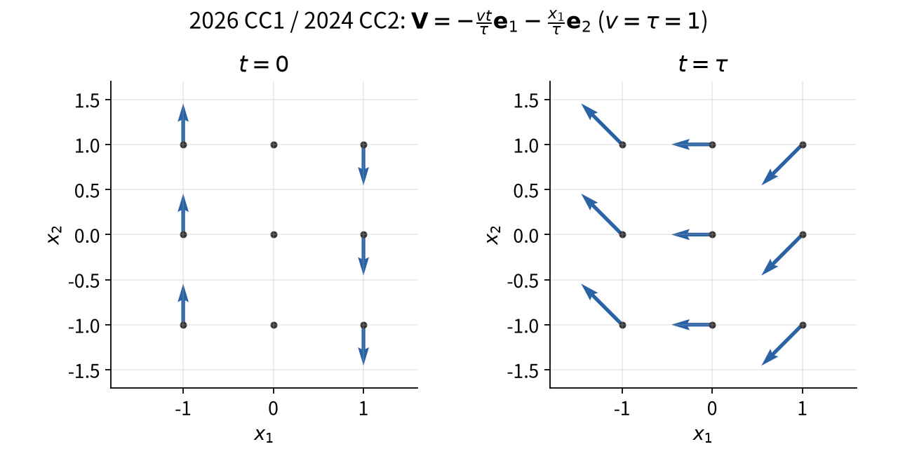
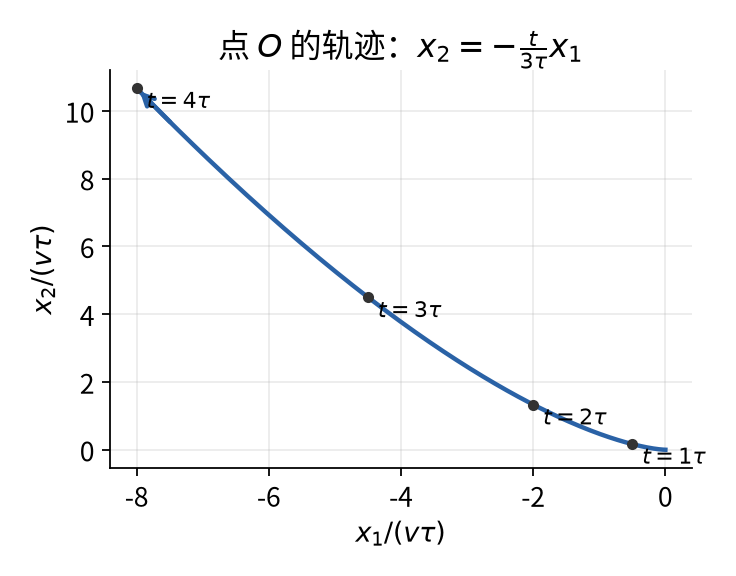

# CC1：2026 年 10 月 21 日考试题与中法对照解答

**CC1 — 21 octobre 2026. Durée : une heure.** Seuls les documents de CM et TD sont autorisés, fiches et formulaires inclus ; tout objet électronique est interdit.

原卷：[题目，5 页](../IMMC_Examen-CC1_2026-10-21_Sujet.pdf) · [教师解答，9 页](../IMMC_Examen-CC1_2026-10-21_Correction.pdf) · 其他 CC1：[2025-10-15](CC1_2025-10-15_题目与解答.md)、[2024-10-23](CC1_2024-10-23_题目与解答.md)

**查阅路线。** 练习 1 按定义逐项判断；练习 2 从欧拉速度场出发，先求 $\mathbf D$，再积分常微分方程得到拉格朗日描述、轨迹、$\mathbf F$、$\mathbf E$、体积变化和线性化应变；练习 3 由给定应力场求体力、三个面的应力向量、主应力，再用 von Mises 和 Tresca 校核。

共 22 问：选择题 10 问、运动学 7 问、应力 5 问。

**这份卷子和往年的关系（老师重复出题的证据）：**

- 练习 2 的速度场 $\mathbf V=-\frac{vt}{\tau}\mathbf e_1-\frac{x_1}{\tau}\mathbf e_2$ 与 [2024 CC2 练习 2](../cc2mc.md) **完全相同**，7 问与那里的 2.2–2.8 一一对应。
- 选择题 1.3、1.4、1.5、1.7、1.9 分别改自 [2024 CC1](CC1_2024-10-23_题目与解答.md) 的 1.3、1.4、1.5、1.7、1.9（"拉长到 2 倍"改成"压缩 10 cm"等）。

**教师解答中的错误（本文已更正）：** ① 问题 2.7 位移 $u_2$ 中 $vt^3$ 项的符号写反（不影响结果）；② 问题 3.3 的主方向写成 $\mathbf N_1=(1,1+\sqrt2,0)$、$\mathbf N_2=(-1,1+\sqrt2,0)$。代回检验不成立，且两者不正交。正确的是 $\sigma_1=-\sqrt2$ 对应 $\mathbf N_1=(1,\,1-\sqrt2,\,0)$，$\sigma_2=\sqrt2$ 对应 $\mathbf N_2=(1,\,1+\sqrt2,\,0)$。主应力数值和两个准则的结论不受影响。

**记号约定。** $X_i$ 是初始坐标，$x_i$ 是当前坐标；$\mathbf I$ 为单位张量；$\operatorname{diag}(a,b,c)$ 为对角矩阵。

---

## 练习 1：课程问题与理解（QCM）

### 问题 1.1：哪些量以欧拉描述给出？

Lister les éléments donnés en description eulérienne ($A$ et $B$ sont des constantes).

A：$\rho(t,\mathbf M)=Ax_1-Bx_2\rho_0$；B：$\mathbf V(t,\mathbf M)=Ax_1\mathbf e_1+Bt\mathbf e_2$；C：$\mathbf u(t,\mathbf M_0)=AX_2\mathbf e_1$；D：$\boldsymbol\gamma(t,\mathbf M)=x_1^2\mathbf e_1+x_2^2\mathbf e_2$。

**Réponse :** A, B, D.

**答案：A、B、D。** 自变量是当前点 $\mathbf M$（小写 $x_i$）的都是欧拉描述；C 写成 $\mathbf M_0$、$X_2$，是拉格朗日描述。A 里出现的 $\rho_0$ 只是一个常数（初始密度），不影响判断。

### 问题 1.2：$\mathbf V=k(x_1\mathbf e_1-x_2\mathbf e_2)$ 有哪些特征？

Quelles sont les caractéristiques du mouvement que décrit l’équation suivante ? $\mathbf V(t,M)=k(x_1\mathbf e_1-x_2\mathbf e_2)$, où les $x_i$ sont les coordonnées courantes et $k$ une constante.

A 无旋；B 稳态；C 不可压缩；D 刚体运动。

**Réponse :** A, B, C.

**答案：A、B、C。**

$$\operatorname{grad}\mathbf V=k\operatorname{diag}(1,-1,0).$$

- 对称 ⇒ $\boldsymbol\Omega=\mathbf O$、$\operatorname{rot}\mathbf V=\mathbf0$：无旋。
- 不显含 $t$：稳态。
- 迹为 $k-k=0$：不可压缩。
- $\mathbf D=k\operatorname{diag}(1,-1,0)\ne\mathbf O$：有变形，不是刚体运动。

这是"纯剪切式伸缩"（$\mathbf e_1$ 方向拉伸、$\mathbf e_2$ 方向等量压缩），与 2025 CC1 练习 2 的速度场同型。

### 问题 1.3：不可变形介质的运动可分解为哪些基本运动？

En quel(s) mouvement(s) élémentaire(s) peut-on décomposer le mouvement d’un milieu indéformable ?

A 平移；B 膨胀；C 转动；D 变形。

**Réponse :** A, C.

**答案：A、C。** 不可变形 = 刚体：$\mathbf x=\mathbf c(t)+\mathbf Q(t)\mathbf X$，只有平移 $\mathbf c$ 和转动 $\mathbf Q$。膨胀本身就是一种变形。对照 2024 CC1 问题 1.3（那里问的是"可变形介质"，答案多了膨胀和变形）。

### 问题 1.4：哪些运动必定保持体积？

Quel(s) mouvement(s) s’opère(nt) forcément à volume constant ?

A 单轴收缩；B 单轴拉伸；C 平移；D 简单剪切；E 膨胀；F 转动。

**Réponse :** C, D, F.

**答案：C、D、F。** 计算 $J=\det\mathbf F$：

| 运动 | $\mathbf F$ | $J$ |
|---|---|---|
| 单轴收缩/拉伸 | $\operatorname{diag}(\lambda,1,1)$，$\lambda\ne1$ | $\lambda\ne1$ |
| 平移 | $\mathbf I$ | 1 |
| 简单剪切 | $\mathbf I+\gamma\,\mathbf e_1\otimes\mathbf e_2$ | 1（三角矩阵，对角元都是 1） |
| 膨胀 | $\lambda\mathbf I$ | $\lambda^3\ne1$ |
| 转动 | 正交矩阵 $\mathbf Q$ | 1 |

### 问题 1.5：1 m 的杆沿一个方向被压缩 10 cm，该方向的应变是多少？

Si une barre de 1 m est comprimée (raccourcie) de 10 cm selon une direction, que vaut sa déformation dans cette même direction ?

A 10 cm；B −10 cm；C −0,1；D 1 %；E 10 %；F 90 %；G −10 %；H 110 %。

**Réponse :** C, G.

**答案：C、G。** 工程应变 $\varepsilon=\Delta L/L_0=-0{,}1\,\mathrm m/1\,\mathrm m=-0{,}1=-10\,\%$，无量纲，压缩为负。A、B 带长度单位，不是应变；F 的 90 % 是伸长比 $L/L_0$，不是应变。2024 CC1 的原题是"拉长到 2 倍"，那里还要区分工程应变 1 和 Green–Lagrange 应变 $(\lambda^2-1)/2=1{,}5$。

### 问题 1.6：体积相对变化等于什么？

La variation relative de volume est égale à ?

A $\mathbf F$ 的迹；B 位移梯度 $\operatorname{grad}\mathbf u$ 的迹；C 线性化应变 $\boldsymbol\varepsilon$ 的迹（HPP 下）；D $\mathbf F$ 的行列式。

**Réponse :** B, C.

**答案：B、C。** 精确关系是 $\frac{\mathrm dV-\mathrm dV_0}{\mathrm dV_0}=J-1=\det\mathbf F-1$。小扰动下 $\det(\mathbf I+\operatorname{grad}\mathbf u)\approx1+\operatorname{tr}\operatorname{grad}\mathbf u$，所以

$$\frac{\Delta V}{V_0}\approx\operatorname{tr}(\operatorname{grad}\mathbf u)=\operatorname{tr}\boldsymbol\varepsilon=\operatorname{div}\mathbf u .$$

D 错在少减了 1：$\det\mathbf F$ 是体积**比** $\mathrm dV/\mathrm dV_0$，不是相对变化。A 的 $\operatorname{tr}\mathbf F$ 在未变形时等于 3，显然不是。

### 问题 1.7：对 $\boldsymbol\sigma=\begin{pmatrix}p&\tau&0\\\tau&0&0\\0&0&0\end{pmatrix}$，哪些说法正确？

Quelles affirmations sont vraies avec le champ de contraintes suivant ?

A 法向 $\mathbf e_1$ 面上法向应力为 $p$；B 法向 $\mathbf e_1$ 面上切向应力为 $p$；C 法向 $\mathbf e_1$ 面上切向应力为零；D 法向 $\mathbf e_2$ 面上法向应力为零；E 法向 $\mathbf e_2$ 面上法向应力为 $p$；F 法向 $\mathbf e_2$ 面上切向应力为 $\tau$。

**Réponse :** A, D, F.

**答案：A、D、F。** $\mathbf T(\mathbf e_1)=p\mathbf e_1+\tau\mathbf e_2$：法向 $p$，切向 $\tau$；$\mathbf T(\mathbf e_2)=\tau\mathbf e_1$：法向 0，切向 $\tau$。同一矩阵在 2025 CC1 问题 1.7 考过。

### 问题 1.8：$\boldsymbol\sigma=\operatorname{diag}(\sigma_1,\sigma_2,0)$（$\sigma_1\ne\sigma_2$ 为常数）有哪些性质？

Que peut-on dire de ce tenseur de contraintes ?

A 纯拉伸；B 球形；C 散度为零；D 纯剪切；E 偏量；F 双轴。

**Réponse :** C, F.

**答案：C、F。** 常数场散度为零；两个非零主应力 ⇒ 双轴。A 纯拉伸只能有一个非零主应力；B 球形要求三个相等；D 纯剪切要求在某组基下只有 $\tau$（等价于主应力为 $\tau,-\tau,0$），这里没有给出 $\sigma_2=-\sigma_1$；E 偏量要求迹为零，同理不能保证。

### 问题 1.9：对称张量的偏量就是把对角元换成零？

Le déviateur d’un tenseur symétrique est un tenseur dont on a remplacé les termes diagonaux par des zéros.

**Réponse :** Faux. $\boldsymbol\sigma^D=\boldsymbol\sigma-\frac13\operatorname{tr}(\boldsymbol\sigma)\mathbf I$ : on retire la moyenne des termes diagonaux.

**答案：错。** 偏量是减去平均正应力：$\boldsymbol\sigma^D=\boldsymbol\sigma-\frac{\operatorname{tr}\boldsymbol\sigma}{3}\mathbf I$。对角元变成 $\sigma_{ii}-\bar\sigma$，一般不为零，只是三者之和为零。与 2024 CC1 问题 1.9 原题相同。

### 问题 1.10：局部质量守恒方程是哪一个？

Où retrouve-t-on l’équation (locale) de conservation de la masse ?

A：$\boldsymbol\sigma=2\mu\boldsymbol\varepsilon+\lambda\operatorname{tr}(\boldsymbol\varepsilon)\mathbf I$；B：$\frac{\mathrm d\rho}{\mathrm dt}+\rho\operatorname{div}\mathbf V=0$；C：$\operatorname{div}\boldsymbol\sigma+\mathbf f_v=\rho\boldsymbol\gamma$；D：$\frac{\partial\rho}{\partial t}+\operatorname{div}(\rho\mathbf V)=0$。

**Réponse :** B, D.

**答案：B、D。** 两式等价：$\operatorname{div}(\rho\mathbf V)=\rho\operatorname{div}\mathbf V+\operatorname{grad}\rho\cdot\mathbf V$，而 $\frac{\mathrm d\rho}{\mathrm dt}=\frac{\partial\rho}{\partial t}+\operatorname{grad}\rho\cdot\mathbf V$。B 用物质导数，D 用偏导数（守恒形式）。A 是 Hooke 定律，C 是动量方程。

---

## 练习 2：连续介质的运动学

**Cinématique.** Le champ eulérien des vitesses est $\mathbf V(M,t)=-\dfrac{vt}{\tau}\mathbf e_1-\dfrac{x_1}{\tau}\mathbf e_2$, où $v$ et $\tau$ sont des constantes positives, et $M$ a pour coordonnées $(x_1,x_2,x_3)$ dans la configuration actuelle.

> 与 [2024 CC2 练习 2](../cc2mc.md) 完全相同的速度场。那里还多问了"$v,\tau$ 的单位"（$[v]=\mathrm{m\cdot s^{-1}}$，$[\tau]=\mathrm s$）和"运动特征"（非稳态、不可压缩、有旋）。

### 问题 2.1：画 $t=0$ 与 $t=\tau$ 时的速度场

Tracer, dans le plan $(O,\mathbf e_1,\mathbf e_2)$, la forme du champ des vitesses à $t=0$ et à $t=\tau$.

**Réponse :** $\mathbf V(M,0)=-\frac{x_1}{\tau}\mathbf e_2$ (cisaillement : vitesse selon $\mathbf e_2$ proportionnelle à $x_1$) ; $\mathbf V(M,\tau)=-v\mathbf e_1-\frac{x_1}{\tau}\mathbf e_2$ (même cisaillement plus une translation uniforme selon $-\mathbf e_1$).

**答案：** $t=0$ 时速度只有 $\mathbf e_2$ 分量，大小正比于 $x_1$：$x_1<0$ 向上、$x_1>0$ 向下、$x_1=0$ 静止，是简单剪切流。$t=\tau$ 时再叠加一个均匀的 $-v\mathbf e_1$ 平移。

### 问题 2.2：变形率 $\mathbf D$ 及其单位

Calculer le tenseur du taux de déformation $\mathbf D$. Quelles sont les unités de ses composantes ?

**Réponse :** $\operatorname{grad}\mathbf V=-\frac1\tau\,\mathbf e_2\otimes\mathbf e_1$, donc $\mathbf D=-\dfrac{1}{2\tau}\begin{pmatrix}0&1&0\\1&0&0\\0&0&0\end{pmatrix}$, en $\mathrm s^{-1}$.

**答案：** 唯一非零的导数是 $\partial V_2/\partial x_1=-1/\tau$（$-vt/\tau$ 不含空间坐标，对梯度没有贡献）。$\operatorname{grad}\mathbf V$ 只有 $(2,1)$ 元；对称化后 $\mathbf D$ 的 $(1,2)$、$(2,1)$ 元都是 $-1/(2\tau)$。单位 $\mathrm s^{-1}$。

### 问题 2.3：拉格朗日描述

Déterminer la représentation lagrangienne du mouvement, i.e. les fonctions $f_i$ telles que $x_i=f_i(X_1,X_2,X_3,t)$, où les $X_i$ sont les coordonnées initiales (à $t=0$).

**Réponse :**

$$x_1=X_1-\frac{vt^2}{2\tau},\qquad x_2=X_2-\frac{X_1t}{\tau}+\frac{vt^3}{6\tau^2},\qquad x_3=X_3 .$$

**答案：** 速度场就是轨迹的时间导数，得到常微分方程组

$$\dot x_1=-\frac{vt}{\tau},\qquad \dot x_2=-\frac{x_1}{\tau},\qquad \dot x_3=0,\qquad x_i(0)=X_i .$$

**按依赖关系的顺序积分：** 先解只含 $t$ 的 $x_1$：$x_1=X_1-\frac{vt^2}{2\tau}$；把它代入 $x_2$ 的方程：$\dot x_2=-\frac{X_1}{\tau}+\frac{vt^2}{2\tau^2}$，再积分并用 $x_2(0)=X_2$ 定常数，得上式。

### 问题 2.4：原点处粒子的轨迹

En déduire l’expression, et tracer, la trajectoire du point initialement à l’origine $O$ du repère.

**Réponse :** $x_1(O,t)=-\frac{vt^2}{2\tau}$, $x_2(O,t)=\frac{vt^3}{6\tau^2}$, $x_3=0$, d’où $x_2=-\frac{t}{3\tau}x_1$.

**答案：** 令 $X_1=X_2=X_3=0$ 得参数方程。若要消去 $t$：$t=\sqrt{-2\tau x_1/v}$（$x_1\le0$），代入得 $x_2=\frac{v}{6\tau^2}\bigl(-\frac{2\tau x_1}{v}\bigr)^{3/2}$，是一条半立方抛物线，粒子向左上方运动。

### 问题 2.5：变换梯度 $\mathbf F$ 与 Green–Lagrange 应变 $\mathbf E$，及其单位

Calculer l’opérateur gradient de la transformation $\mathbf F$, ainsi que l’opérateur des déformations de Green–Lagrange $\mathbf E$. Quelles sont les unités des composantes de ces deux tenseurs ?

**Réponse :**

$$\mathbf F=\begin{pmatrix}1&0&0\\-\frac t\tau&1&0\\0&0&1\end{pmatrix},\qquad
\mathbf E=\frac12(\mathbf F^{\mathsf T}\mathbf F-\mathbf I)=\frac{t}{2\tau}\begin{pmatrix}\frac t\tau&-1&0\\-1&0&0\\0&0&0\end{pmatrix},$$

tous deux sans dimension.

**答案：** 对拉格朗日描述求 $\partial x_i/\partial X_j$，只有 $\partial x_2/\partial X_1=-t/\tau$ 不平凡。$\mathbf F^{\mathsf T}\mathbf F$ 的 $(1,1)$ 元为 $1+(t/\tau)^2$，$(1,2)$、$(2,1)$ 元为 $-t/\tau$。这是剪切量 $\gamma=-t/\tau$ 的简单剪切。

### 问题 2.6：体积相对变化

Déterminer la variation relative de volume du milieu continu au cours du temps.

**Réponse :** $\dfrac{\mathrm dV}{\mathrm dV_0}=\det\mathbf F=1$, donc $\dfrac{\mathrm dV-\mathrm dV_0}{\mathrm dV_0}=0$ : mouvement isochore.

**答案：** $\mathbf F$ 是下三角矩阵，行列式等于对角元之积 $=1$，体积不变（isochore）。与 $\operatorname{div}\mathbf V=\operatorname{tr}\mathbf D=0$ 一致。

### 问题 2.7：HPP 下的线性化应变及适用条件

En se plaçant sous l’hypothèse des petites perturbations (HPP), calculer le tenseur des déformations linéarisé $\boldsymbol\varepsilon$. À quelle condition cette hypothèse est-elle valable ? Comment cela se traduit-il ici ?

**Réponse :**

$$\mathbf u=-\frac t\tau\begin{pmatrix}\frac{vt}{2}\\X_1-\frac{vt^2}{6\tau}\\0\end{pmatrix},\quad
\operatorname{grad}\mathbf u=-\frac t\tau\,\mathbf e_2\otimes\mathbf e_1,\quad
\boldsymbol\varepsilon=-\frac{t}{2\tau}\begin{pmatrix}0&1&0\\1&0&0\\0&0&0\end{pmatrix}.$$

HPP : $\|\operatorname{grad}\mathbf u\|\ll1\Rightarrow t\ll\tau$ (transformations infinitésimales) et $\|\mathbf u\|$ petit sur $\Omega_0$ (dépend de $v$ et de la taille du domaine).

**答案：** 位移 $\mathbf u=\mathbf x-\mathbf X$，其中 $u_2=-\frac{X_1t}{\tau}+\frac{vt^3}{6\tau^2}=-\frac t\tau\bigl(X_1-\frac{vt^2}{6\tau}\bigr)$。教师解答（以及 2024 CC2 的同一问）把括号里写成 $+\frac{vt^2}{6\tau^2}+X_1$，符号不对；这一项与 $\mathbf X$ 无关，所以不影响 $\operatorname{grad}\mathbf u$ 和 $\boldsymbol\varepsilon$。

HPP 包含两个条件，教师解答都写了：

1. **小变换**：$\|\operatorname{grad}\mathbf u\|\ll1\iff|t/\tau|\ll1\iff t\ll\tau$。也可以表述为 $\mathbf E$ 中的二阶项 $\frac12\operatorname{grad}^{\mathsf T}\mathbf u\operatorname{grad}\mathbf u$（量级 $t^2/\tau^2$）远小于一阶项（量级 $t/\tau$），结论同为 $t\ll\tau$。
2. **小位移**：$\|\mathbf u\|$ 相对物体尺寸很小，这取决于 $v$ 和 $\Omega_0$ 的大小。

此时 $\mathbf E\approx\boldsymbol\varepsilon$：$\mathbf E$ 中的 $t^2/(2\tau^2)$ 项可以略去。

---

## 练习 3：连续介质中的应力

**Énoncé.** En chaque point $M$ de coordonnées $(x_1,x_2,x_3)$ :

$$\boldsymbol\sigma(M)=\begin{pmatrix}-1&x_1&2x_3\\x_1&1&x_2\\2x_3&x_2&8\end{pmatrix}_{(\mathbf e_1,\mathbf e_2,\mathbf e_3)}$$

（数值，单位按 Pa 理解。）

### 问题 3.1：静力问题中与该应力场平衡的体力

Calculer la densité d’effort volumique $\mathbf f_v$ en équilibre avec ce champ de contrainte, pour un problème de statique.

**Réponse :** $\operatorname{div}\boldsymbol\sigma+\mathbf f_v=\mathbf0\Rightarrow\mathbf f_v=-\operatorname{div}\boldsymbol\sigma=-(2,\,1,\,1)$.

**答案：** 按行求散度（第 $i$ 个分量是第 $i$ 行对相应坐标求导之和）：

$$\operatorname{div}\boldsymbol\sigma=\begin{pmatrix}\partial_1(-1)+\partial_2x_1+\partial_3(2x_3)\\\partial_1x_1+\partial_2(1)+\partial_3x_2\\\partial_1(2x_3)+\partial_2x_2+\partial_3(8)\end{pmatrix}=\begin{pmatrix}0+0+2\\1+0+0\\0+1+0\end{pmatrix},\qquad
\mathbf f_v=-\begin{pmatrix}2\\1\\1\end{pmatrix}.$$

### 问题 3.2：点 $A=(1,0,0)$ 处三个面上的应力向量及其法向、切向分量

Calculer et tracer le vecteur contrainte au point $A=(1,0,0)$, pour les facettes $a$, $b$, $c$ de normales $\mathbf e_1$, $\mathbf e_2$, $\mathbf e_3$. Dans chacun des trois cas, déterminer les composantes normale et tangentielle du vecteur contrainte.

**Réponse :** $\boldsymbol\sigma(A)=\begin{pmatrix}-1&1&0\\1&1&0\\0&0&8\end{pmatrix}$ ; $\mathbf T_a=(-1,1,0)$ : $\sigma_n=-1$, $\tau=1$ ; $\mathbf T_b=(1,1,0)$ : $\sigma_n=1$, $\tau=1$ ; $\mathbf T_c=(0,0,8)$ : $\sigma_n=8$, $\tau=0$.

**答案：** 先代入 $x_1=1$、$x_2=x_3=0$。$\mathbf T=\boldsymbol\sigma\mathbf n$ 就是第 $j$ 列；法向分量 $\sigma_n=\mathbf n\cdot\mathbf T$，切向向量 $\mathbf T_t=\mathbf T-\sigma_n\mathbf n$，其模为切向应力：

| 面 | $\mathbf n$ | $\mathbf T$ | $\sigma_n$ | $\mathbf T_t$ | $\tau$ |
|---|---|---|---|---|---|
| a | $\mathbf e_1$ | $(-1,1,0)$ | $-1$（压） | $(0,1,0)$ | 1 |
| b | $\mathbf e_2$ | $(1,1,0)$ | $1$（拉） | $(1,0,0)$ | 1 |
| c | $\mathbf e_3$ | $(0,0,8)$ | $8$（拉） | $\mathbf0$ | 0 |

面 c 上没有切应力，所以 $\mathbf e_3$ 是一个主方向，8 是一个主应力。

### 问题 3.3：点 $A$ 处的主应力与主方向及其物理意义

Calculer les contraintes principales et les directions principales au point $A$. À quoi correspondent physiquement ces directions ?

**Réponse (corrigée) :** $\det(\boldsymbol\sigma-\lambda\mathbf I)=(8-\lambda)(\lambda^2-2)=0$, d’où $\sigma_1=-\sqrt2$, $\sigma_2=\sqrt2$, $\sigma_3=8$, avec $\mathbf N_1=(1,\,1-\sqrt2,\,0)$, $\mathbf N_2=(1,\,1+\sqrt2,\,0)$, $\mathbf N_3=\mathbf e_3$. Ce sont les directions pour lesquelles le vecteur contrainte est purement normal (contrainte tangentielle nulle) ; la contrainte normale y est extrémale.

**答案：** 矩阵分块：$\mathbf e_3$ 已经独立出来（$\sigma_3=8$），只需对左上角 $2\times2$ 块求特征值：

$$\begin{vmatrix}-1-\lambda&1\\1&1-\lambda\end{vmatrix}=(\lambda+1)(\lambda-1)-1=\lambda^2-2=0\ \Rightarrow\ \lambda=\pm\sqrt2 .$$

主方向：解 $(\boldsymbol\sigma-\lambda\mathbf I)\mathbf N=\mathbf0$ 的第一行 $(-1-\lambda)N_1+N_2=0$，即 $N_2=(1+\lambda)N_1$：

- $\lambda=-\sqrt2$：$\mathbf N_1=(1,\,1-\sqrt2,\,0)$；
- $\lambda=\sqrt2$：$\mathbf N_2=(1,\,1+\sqrt2,\,0)$。

自查：$\mathbf N_1\cdot\mathbf N_2=1+(1-\sqrt2)(1+\sqrt2)=1-1=0$，正交，符合对称矩阵的性质。

> **更正：** 教师解答写的是 $\mathbf N_1=(1,1+\sqrt2,0)$、$\mathbf N_2=(-1,1+\sqrt2,0)$。前者其实是 $+\sqrt2$ 的主方向，后者代回 $\boldsymbol\sigma\mathbf N_2$ 不等于 $\pm\sqrt2\,\mathbf N_2$。

物理意义：在主方向的面上，应力向量与法向平行（没有切应力），法向应力取极值。

### 问题 3.4：在 $A$ 点用 von Mises 准则校核（$\sigma_0=10\ \mathrm{Pa}$）

On considère un matériau élastoplastique de limite élastique $\sigma_0=10$ Pa. Appliquer le critère de von Mises au point $A$. Le matériau reste-t-il dans son domaine d’élasticité ?

**Réponse :** $\sigma_{VM}=\sqrt{\frac{(\sigma_1-\sigma_2)^2+(\sigma_2-\sigma_3)^2+(\sigma_1-\sigma_3)^2}{2}}=\sqrt{\frac{8+(66-16\sqrt2)+(66+16\sqrt2)}{2}}=\sqrt{70}$. Comme $70<100$, $\sigma_{VM}<\sigma_0$ : le matériau reste élastique.

**答案：** 不用计算器的技巧：交叉项 $\pm16\sqrt2$ 正好抵消，和为 140，除以 2 得 70。比较时两边平方：$\sigma_{VM}^2=70<\sigma_0^2=100$，弹性（$\sqrt{70}\approx8{,}37$）。

### 问题 3.5：在 $A$ 点用 Tresca 准则校核

Appliquer le critère de Tresca au point $A$. Le matériau reste-t-il dans son domaine d’élasticité selon ce critère ?

**Réponse :** $\sigma_{Tr}=\max_{i,j}|\sigma_i-\sigma_j|=8+\sqrt2\approx9{,}41<10$ : élastique, avec moins de marge qu’avec von Mises (Tresca est plus conservatif).

**答案：** 最大主应力差在最大和最小之间：$8-(-\sqrt2)=8+\sqrt2\approx9{,}41<10$，仍在弹性范围，但余量比 von Mises 小。一般总有 $\sigma_{VM}\le\sigma_{Tr}\le\frac{2}{\sqrt3}\sigma_{VM}$，所以 Tresca 更保守。

---

## 原卷附录：公式表

原卷附有直角坐标下的 $\operatorname{grad}f$、$\Delta f$、$\operatorname{grad}\mathbf U$、$\operatorname{div}\mathbf U$、$\operatorname{rot}\mathbf U$、$\Delta\mathbf U$、$\operatorname{div}\mathbf A$。中文整理见 [微分算子表](../../CM/中文补充/微分算子表.md)。
