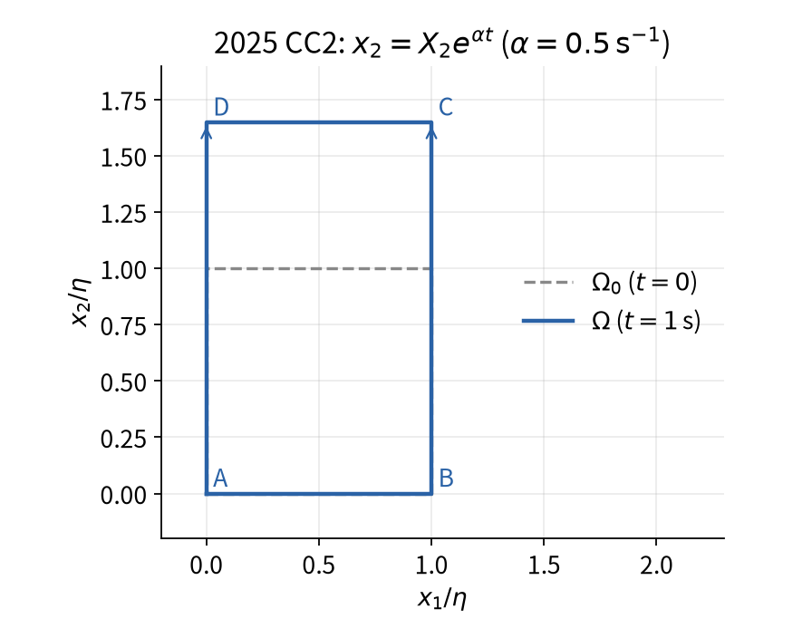
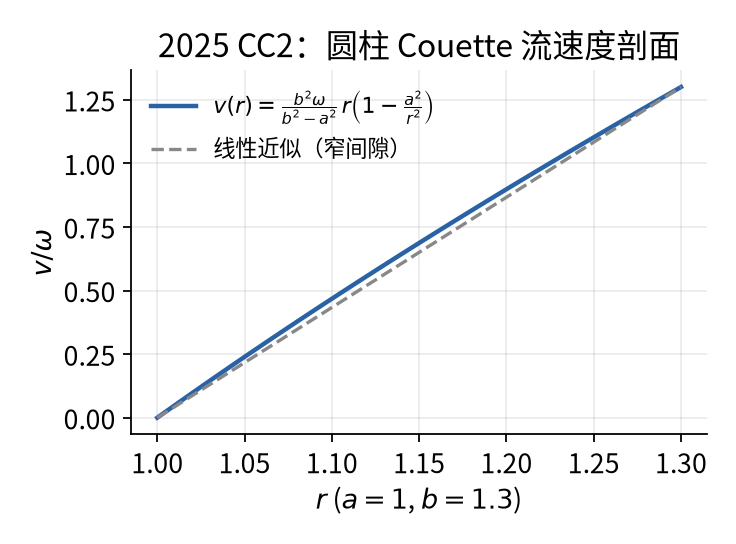

# CC2：2025 年 11 月 12 日考试题与中法对照解答

**CC2 — 12 novembre 2025. Durée : trois heures.** Tous les documents de cours et TD sont autorisés ; calculatrices et appareils électroniques interdits.

原卷：[题目，8 页](../IMMC_Examen-CC2_2025-11-12_Sujet.pdf) · [教师解答，22 页](../IMMC_Examen-CC2_2025-11-12_Correction.pdf) · 另一份 CC2：[2024-11-13](../cc2mc.md)

**查阅路线。** 练习 1 是 10 道多选；练习 2 由拉格朗日轨迹出发，依次求 $\mathbf F$、$\mathbf E$、位移、线性化应变，再反求欧拉速度和 $\mathbf D,\boldsymbol\Omega$；练习 3 是平面应力的方块剪切，先验证自由面，再用边界条件定常数，最后由局部平衡和积分求端面力旋量；练习 4 是旋转圆盘的位移法（柱坐标 Navier）；练习 5 是同轴圆柱黏度计（柱坐标 Navier–Stokes）。

共 35 问：选择题 10 问、运动学 8 问、方块剪切 5 问、涡轮转子 7 问、黏度计 5 问。与 [2024 CC2](../cc2mc.md) 的五道大题一一对应：QCM → 运动学 → 应力与平衡 → 弹性问题 → 黏性流体。原卷末尾附有直角坐标和柱坐标的微分算子公式表。

**记号约定。** $X_i$ 是粒子初始坐标，$x_i$ 是当前坐标；$\mathbf I$ 为单位张量，$\mathbf O$ 为零张量。柱坐标基为 $(\mathbf e_r,\mathbf e_\theta,\mathbf e_z)$，$u_r'=\mathrm du_r/\mathrm dr$。

**教师解答中的两处问题（本文已更正）：**

1. 练习 4 的 $(\ast4.29)$ 把 $\sigma_{zz}$ 写成 $\frac{\lambda}{2\mu+\lambda}\frac{\rho\omega^2}{4}\left(\frac{3\mu+2\lambda}{\mu+\lambda}R^2-r^2\right)$，少了一个系数 2，正确的是 $\left(\frac{3\mu+2\lambda}{\mu+\lambda}R^2-2r^2\right)$。已用符号计算核对：$\sigma_{zz}=\lambda\operatorname{tr}\boldsymbol\varepsilon=2\lambda(2C_1r^2+C_2)$，把 $C_1,C_2$ 代入即得。
2. 练习 4.7 教师只给了方法，没有算出最大值。下面补全了 Tresca 等效应力的位置和尺寸设计公式，标为"补充"。

---

## 练习 1：课程问题与理解（QCM）

在答题纸上直接勾选，不需论证；整体答错不扣分。

### 问题 1.1：哪些量以欧拉描述给出？

Lister les éléments donnés en description eulérienne ($A$, $B$ et $C$ sont des constantes).

A：$\mathbf V(t,\mathbf M_0)=AtX_1\mathbf e_2$；B：$\boldsymbol\gamma(t,\mathbf M)=A(x_1\mathbf e_1+x_2\mathbf e_2)$；C：$\mathbf u(t,\mathbf M_0)=BX_2\mathbf e_1$；D：$\rho(t,x_1,x_2)=C(x_1^2+x_2^2)$。

**Réponse :** B, D. Ils sont exprimés en fonction de la position actuelle $\mathbf M$ (coordonnées $x_i$).

**答案：B、D。** 判别只看自变量：写成当前点 $\mathbf M$ 或小写 $x_i$ 的是欧拉描述；写成初始点 $\mathbf M_0$ 或大写 $X_i$ 的是拉格朗日描述。

| 选项 | 自变量 | 判断 |
|---|---|---|
| A 速度 $\mathbf V(t,\mathbf M_0)$ | $\mathbf M_0$、$X_1$ | 拉格朗日 |
| B 加速度 $\boldsymbol\gamma(t,\mathbf M)$ | $\mathbf M$、$x_1,x_2$ | **欧拉** |
| C 位移 $\mathbf u(t,\mathbf M_0)$ | $\mathbf M_0$、$X_2$ | 拉格朗日 |
| D 密度 $\rho(t,x_1,x_2)$ | $x_1,x_2$ | **欧拉** |

这是 5 份卷子都考过的题。2024 CC2 问的是"拉格朗日"，这里反过来问"欧拉"，答案正好互补。

### 问题 1.2：哪些方程表示运动不可压缩？

Par quelle(s) équation(s) se traduit un mouvement incompressible ?

A：$\operatorname{grad}\mathbf V=\mathbf O$；B：$\mathbf V=\mathbf 0$；C：$\operatorname{div}\mathbf V=0$；D：$\operatorname{tr}\mathbf D=0$；E：$\det\mathbf F=1$；F：$\det\mathbf F=0$。

**Réponse :** C, D, E. Un mouvement incompressible conserve le volume : $J=\det\mathbf F=1$, soit $\operatorname{div}\mathbf V=\operatorname{tr}\mathbf D=0$.

**答案：C、D、E。** 三者等价：

$$\operatorname{div}\mathbf V=\operatorname{tr}(\operatorname{grad}\mathbf V)=\operatorname{tr}\mathbf D,\qquad \frac{\mathrm dJ}{\mathrm dt}=J\operatorname{div}\mathbf V,\ J(0)=1 .$$

所以 $\operatorname{div}\mathbf V\equiv0\iff J\equiv1$。A、B 是充分条件而不是"表示"：$\operatorname{grad}\mathbf V=\mathbf O$ 说的是速度均匀（整体平移），$\mathbf V=\mathbf0$ 是静止，它们当然不可压缩，但不可压缩运动远不止这些（例如简单剪切）。F 的 $\det\mathbf F=0$ 表示体积被压成零，物理上不允许（必须 $J>0$）。

### 问题 1.3：给定应力状态，哪些说法正确？

Quelles affirmations sont vraies pour cet état de contrainte ? $\boldsymbol\sigma=\begin{pmatrix}\alpha&\gamma&0\\\gamma&\beta&0\\0&0&0\end{pmatrix}$

A：法向 $\mathbf e_1$ 面上法向应力为 $\alpha$；B：法向 $\mathbf e_1$ 面上切向应力为 $\alpha$；C：法向 $\mathbf e_1$ 面上切向应力为 $\gamma$；D：法向 $\mathbf e_2$ 面上法向应力为 $\beta$；E：法向 $\mathbf e_2$ 面上法向应力为 $\gamma$；F：法向 $\mathbf e_2$ 面上切向应力为 $\beta$。

**Réponse :** A, C, D. $\mathbf T(\mathbf e_1)=\alpha\mathbf e_1+\gamma\mathbf e_2$ et $\mathbf T(\mathbf e_2)=\gamma\mathbf e_1+\beta\mathbf e_2$.

**答案：A、C、D。** 应力向量 $\mathbf T=\boldsymbol\sigma\mathbf n$ 就是矩阵的第 $j$ 列（$\mathbf n=\mathbf e_j$ 时）：

$$\mathbf T(\mathbf e_1)=\alpha\mathbf e_1+\gamma\mathbf e_2\Rightarrow\sigma_n=\alpha,\ \tau=|\gamma|;\qquad
\mathbf T(\mathbf e_2)=\gamma\mathbf e_1+\beta\mathbf e_2\Rightarrow\sigma_n=\beta,\ \tau=|\gamma|.$$

对角元是该面的法向应力，同一列的非对角元组成切向应力。严格说切向应力的大小是 $|\gamma|$，题目按"值为 $\gamma$"出题。

### 问题 1.4：$\boldsymbol\sigma=\operatorname{diag}(A,B,0)$（$A,B>0$）有哪些性质？

Quelles affirmations sont vraies concernant l’état de contrainte suivant ?

A 平面；B 球形；C 对角；D 双轴；E 偏量；F 散度为零。

**Réponse :** A, C, D, F.

**答案：A、C、D、F。**

| 选项 | 判断 | 理由 |
|---|---|---|
| A 平面（plan） | 对 | 第三行、第三列全为零：$\boldsymbol\sigma\mathbf e_3=\mathbf0$ |
| B 球形（sphérique） | 错 | 球形要求 $\boldsymbol\sigma=-p\mathbf I$，三个主应力相等，这里第三个为 0 |
| C 对角（diagonal） | 对 | 在给定基下非对角元为零 |
| D 双轴（biaxial） | 对 | 恰有两个非零主应力 |
| E 偏量（déviatorique） | 错 | 偏量要求迹为零，而 $\operatorname{tr}\boldsymbol\sigma=A+B>0$ |
| F 散度为零 | 对 | 各分量为常数，求导为零 |

### 问题 1.5：静力问题、体力为零时能推出什么？

Si un milieu solide est soumis à un chargement en statique dont la densité de force volumique est nulle, que peut-on dire ?

A 体积相对变化为零；B 加速度为零；C 应变场为零；D 应力场的散度为零。

**Réponse :** B, D. En statique $\boldsymbol\gamma=\mathbf0$, et l’équilibre local $\operatorname{div}\boldsymbol\sigma+\mathbf f_v=\mathbf0$ donne $\operatorname{div}\boldsymbol\sigma=\mathbf0$.

**答案：B、D。** "静力"就是加速度为零；代入动量方程 $\operatorname{div}\boldsymbol\sigma+\mathbf f_v=\rho\boldsymbol\gamma$，体力为零得 $\operatorname{div}\boldsymbol\sigma=\mathbf0$。A、C 不对：边界上仍可以有面力或给定位移，物体照样变形、体积照样可以变（例如受拉杆）。

### 问题 1.6：哪些本构关系对应流体？

Quelle(s) relation(s) de comportement correspondent à des milieux fluides ?

A：$\boldsymbol\sigma=2\mu\boldsymbol\varepsilon+\lambda\operatorname{tr}(\boldsymbol\varepsilon)\mathbf I$；B：$\boldsymbol\sigma=-p\mathbf I$；C：$\boldsymbol\sigma=2\mu_v\mathbf D-p\mathbf I$；D：$\boldsymbol\varepsilon=\frac{1+\nu}{E}\boldsymbol\sigma-\frac{\nu}{E}\operatorname{tr}(\boldsymbol\sigma)\mathbf I$。

**Réponse :** B (fluide parfait) et C (fluide newtonien incompressible).

**答案：B、C。** B 是理想流体（无黏性）；C 是不可压缩牛顿流体，应力与**变形率** $\mathbf D$ 成正比。A、D 是线弹性固体的 Hooke 定律（正、逆形式），应力与**应变** $\boldsymbol\varepsilon$ 相关。判别口诀：出现 $\boldsymbol\varepsilon$、$E,\nu$ 或 Lamé 的 $\lambda,\mu$ 的是固体；出现 $p$、$\mathbf D$、$\mu_v$ 的是流体。2024 CC2 的问题 1.7 问的是"牛顿流体"，只选 C。

### 问题 1.7：Navier 方程包含了哪些方程？

Quelles équations sont intégrées dans l’équation de Navier ?

A 局部平衡方程；B 质量守恒；C 本构关系；D HPP 方程（应变–位移关系）；E 边界条件；F 初始条件。

**Réponse :** A, C, D. On injecte $\boldsymbol\varepsilon(\mathbf u)$ (HPP) dans la loi de Hooke, puis dans l’équilibre local.

**答案：A、C、D。** Navier 方程的推导就是三步代入：

$$\boldsymbol\varepsilon=\tfrac12(\operatorname{grad}\mathbf u+\operatorname{grad}^{\mathsf T}\mathbf u)\ \xrightarrow{\text{Hooke}}\ \boldsymbol\sigma=\lambda\operatorname{tr}\boldsymbol\varepsilon\,\mathbf I+2\mu\boldsymbol\varepsilon\ \xrightarrow{\operatorname{div}\boldsymbol\sigma+\mathbf f=\mathbf0}\ (\lambda+\mu)\operatorname{grad}(\operatorname{div}\mathbf u)+\mu\Delta\mathbf u+\mathbf f=\mathbf0 .$$

边界条件不在方程里，要另外加上；静力弹性问题不涉及初始条件；质量守恒在小变形固体问题中不单独使用。

### 问题 1.8：哪些方程表示"滑动接触"条件？

Quelle(s) équation(s) tradui(sen)t une condition de type contact glissant en tout point $M$ de la frontière $\partial\Omega$ (immobile) d’un domaine solide $\Omega$ avec un milieu extérieur indéformable, où $\mathbf n$ est la normale sortante et $\mathbf t$ tout vecteur tangent ?

A：$\boldsymbol\sigma\mathbf n=\mathbf0$；B：$\boldsymbol\sigma\mathbf t=\mathbf0$；C：$(\boldsymbol\sigma\mathbf n)\cdot\mathbf n=0$；D：$(\boldsymbol\sigma\mathbf n)\cdot\mathbf t=0$；E：$\sigma_{ij}=0$；F：$\mathbf u=\mathbf0$；G：$\mathbf u\cdot\mathbf n=0$；H：$\mathbf u\cdot\mathbf t=0$。

**Réponse :** D, G. Déplacement normal nul (contact maintenu), contrainte tangentielle nulle (sans frottement).

**答案：D、G。** 滑动接触（无摩擦、持续接触、刚性外部）给出**一条运动学 + 两条静力学**条件：

- 法向：不能穿透也不分离，$\mathbf u\cdot\mathbf n=0$（G）。
- 切向：可以自由滑动，没有摩擦力，$(\boldsymbol\sigma\mathbf n)\cdot\mathbf t=0$（D，对两个切向都成立）。
- 法向应力 $(\boldsymbol\sigma\mathbf n)\cdot\mathbf n$ 是未知的接触反力，**不**为零，所以 C 错；A 是自由面；F 是固定（粘住）；H 会阻止滑动。

同一类条件出现在 2024 CC2 练习 4（底面可滑动）和本卷练习 4（上下底面）。

### 问题 1.9：两种互不相溶的黏性流体在界面上哪些量连续？

Deux fluides visqueux différents en contact s’écoulent côte à côte, sans se mélanger. Pour quelle(s) quantité(s) a-t-on continuité à l’interface $\Sigma$ ?

A 法向速度；B 切向速度；C 密度；D 应力张量；E 切向应力；F 法向应力。

**Réponse :** A, B, E, F. Vitesse continue (imperméabilité et adhérence visqueuse) et vecteur contrainte continu (action–réaction) ; le tenseur complet et la masse volumique peuvent sauter.

**答案：A、B、E、F。**

- 速度整体连续：法向连续是因为两种流体不相混、互不穿透；切向连续是黏性流体的粘附条件。
- 应力**向量** $\boldsymbol\sigma\mathbf n$ 连续（作用力与反作用力），它的法向分量和切向分量分别连续。
- 应力**张量**整体不必连续：平行于界面的分量（例如 $\sigma_{tt}$）可以跳跃，所以 D 错。
- 密度是两种不同流体各自的性质，C 错。

### 问题 1.10：无面力、无体力的弹性体，在精确解处势能 $E_p(\mathbf u_{ex})$ 是什么？

Si un solide élastique n’est soumis à aucun effort surfacique ou volumique, son énergie potentielle à la solution exacte $E_p(\mathbf u_{ex})$ est :

A 最大；B 最小；C 负；D 零；E 正；F 无所谓。

**Réponse (corrigé) :** B, E.

**答案（按教师解答）：B、E。** 势能定理：精确解使势能在所有运动学可容（CA）位移场中**最小**，所以 B 一定对。无外力时 $E_p(\mathbf u)=\frac12\int_\Omega\boldsymbol\varepsilon(\mathbf u):\mathbf K:\boldsymbol\varepsilon(\mathbf u)\,\mathrm dV\ge0$。

注意：没有任何载荷（且无非零给定位移）时，精确解是 $\mathbf u_{ex}=\mathbf0$（或一个刚体运动），此时 $E_p(\mathbf u_{ex})=0$。教师勾的是 E"positive"，没勾 D"nulle"。在法语里 *positif* 通常指"$\ge0$"，所以 E 与"等于零"并不矛盾；考场上若再遇到这题，按教师答案选 B、E。2024 CC2 问题 1.10 考的是同一个定理的另一面（CA 场势能为零 ⇒ 应变能与外力功相抵）。

---

## 练习 2：可变形连续介质的运动学

**Cinématique d’un milieu continu déformable.** Le mouvement, pour $t\ge0$, est donné par les équations de trajectoires $x_1=X_1$, $x_2=X_2\exp(\alpha t)$, $x_3=X_3$, où $\alpha>0$ est une constante et $(X_1,X_2,X_3)$ sont les coordonnées initiales à $t=0$.

运动由拉格朗日轨迹方程给出：

$$x_1=X_1,\qquad x_2=X_2e^{\alpha t},\qquad x_3=X_3,\qquad \alpha>0 .$$

### 问题 2.1：正方形四个角的像，画初始与当前构形（$t=1\,$s）

Soit le carré de côté $\eta$, défini à $t=0$ par $0\le X_1\le\eta$, $0\le X_2\le\eta$, $X_3=0$. Calculer les transformées des points correspondant à ses coins. Tracer ses configurations initiale $\Omega_0$ et courante $\Omega$ (à $t=1$ s).

**Réponse :** $A=\mathbf0$, $B=\eta\mathbf e_1$, $C=\eta(\mathbf e_1+e^{\alpha}\mathbf e_2)$, $D=\eta e^{\alpha}\mathbf e_2$ : le carré devient un rectangle étiré selon $\mathbf e_2$.

**答案：** 把四个角代入运动映射（$t=1$）：

| 初始点 | 坐标 $(X_1,X_2)$ | 当前点 |
|---|---|---|
| $A_0$ | $(0,0)$ | $A=(0,0)$ |
| $B_0$ | $(\eta,0)$ | $B=(\eta,0)$ |
| $C_0$ | $(\eta,\eta)$ | $C=(\eta,\eta e^{\alpha})$ |
| $D_0$ | $(0,\eta)$ | $D=(0,\eta e^{\alpha})$ |

正方形沿 $\mathbf e_2$ 拉长为 $\eta\times\eta e^{\alpha}$ 的矩形，$\mathbf e_1$ 方向尺寸不变，直角保持为直角。

### 问题 2.2：求 $\mathbf F$ 与 Green–Lagrange 应变 $\mathbf E$

Calculer le tenseur gradient de transformation $\mathbf F$, puis le tenseur des déformations de Green–Lagrange $\mathbf E$.

**Réponse :**

$$\mathbf F=\frac{\partial\mathbf x}{\partial\mathbf X}=\operatorname{diag}(1,e^{\alpha t},1),\qquad
\mathbf E=\tfrac12(\mathbf F^{\mathsf T}\mathbf F-\mathbf I)=\frac{e^{2\alpha t}-1}{2}\begin{pmatrix}0&0&0\\0&1&0\\0&0&0\end{pmatrix}.$$

**答案：** $\mathbf F$ 的第 $i$ 行第 $j$ 列是 $\partial x_i/\partial X_j$。只有 $\partial x_2/\partial X_2=e^{\alpha t}$ 不是 1。$\mathbf F$ 对角，所以 $\mathbf F^{\mathsf T}\mathbf F=\operatorname{diag}(1,e^{2\alpha t},1)$，减去 $\mathbf I$ 再除以 2 即得 $\mathbf E$。两者都无量纲。$E_{22}$ 与伸长比 $\lambda_2=e^{\alpha t}$ 的关系是 $E_{22}=(\lambda_2^2-1)/2$。

### 问题 2.3：求位移向量 $\mathbf u$ 及其梯度

Calculer le vecteur déplacement $\mathbf u$ et son gradient.

**Réponse :**

$$\mathbf u=\mathbf{OM}-\mathbf{OM}_0=X_2\,(e^{\alpha t}-1)\,\mathbf e_2,\qquad
\operatorname{grad}\mathbf u=\frac{\partial\mathbf u}{\partial\mathbf X}=(e^{\alpha t}-1)\begin{pmatrix}0&0&0\\0&1&0\\0&0&0\end{pmatrix}=\mathbf F-\mathbf I .$$

**答案：** 位移是"当前位置减初始位置"，用拉格朗日变量写出；对 $\mathbf X$ 求导得到拉格朗日位移梯度，恒有 $\operatorname{grad}_X\mathbf u=\mathbf F-\mathbf I$，可用来检查。

### 问题 2.4：线性化应变 $\boldsymbol\varepsilon$ 及其适用条件

Calculer le tenseur des déformations linéarisées $\boldsymbol\varepsilon$ puis préciser dans quelles conditions ce dernier est valide.

**Réponse :** $\boldsymbol\varepsilon=\frac12(\operatorname{grad}\mathbf u+\operatorname{grad}^{\mathsf T}\mathbf u)=(e^{\alpha t}-1)\,\mathbf e_2\otimes\mathbf e_2$. Valable sous l’HPP : $\|\operatorname{grad}\mathbf u\|\ll1$, soit $|e^{\alpha t}-1|\ll1$, i.e. $\alpha t\ll1$.

**答案：**

$$\boldsymbol\varepsilon=(e^{\alpha t}-1)\begin{pmatrix}0&0&0\\0&1&0\\0&0&0\end{pmatrix}.$$

条件是小扰动（HPP）：$\|\operatorname{grad}\mathbf u\|\ll1$，即 $|e^{\alpha t}-1|\ll1$。因为 $e^{\alpha t}-1\approx\alpha t$，所以等价于 $\alpha t\ll1$，即 $t\ll1/\alpha$。此时 $E_{22}=\frac{e^{2\alpha t}-1}{2}\approx\alpha t\approx\varepsilon_{22}$，两种应变一致。

教师解答把条件推导成 $t\ll\ln 2/\alpha$（由 $e^{\alpha t}-1\ll1$ 写成 $e^{\alpha t}\ll2$）。这和 $t\ll1/\alpha$ 是同一个量级（$\ln2\approx0.69$），考场上写 $\alpha t\ll1$ 更直接。

### 问题 2.5：运动类型和 $\alpha$ 的单位

De quel type de mouvement s’agit-il ? Quelle est l’unité de $\alpha$ ?

**Réponse :** Il s’agit d’une dilatation (extension) d’un facteur $\exp(\alpha t)$ selon $\mathbf e_2$. L’exposant est sans dimension, donc $\alpha$ s’exprime en $\mathrm s^{-1}$.

**答案：** 沿 $\mathbf e_2$ 的单轴伸长（extension / dilatation），伸长比 $e^{\alpha t}$；指数必须无量纲，故 $[\alpha]=\mathrm s^{-1}$。

### 问题 2.6：欧拉描述

Déterminer la description eulérienne de ce mouvement.

**Réponse :** $V_2=\dot x_2=\alpha X_2e^{\alpha t}=\alpha x_2$, donc $\mathbf V(t,\mathbf M)=\alpha x_2\,\mathbf e_2$.

**答案：** 先对时间求导得拉格朗日速度 $\dot x_1=0$、$\dot x_2=\alpha X_2e^{\alpha t}$、$\dot x_3=0$，再用 $X_2=x_2e^{-\alpha t}$ 反解消去初始坐标：

$$\mathbf V(t,\mathbf M)=\alpha x_2\,\mathbf e_2 .$$

这是"拉格朗日 → 欧拉"方向的标准做法：**先求导、后反解**。与 2024 CC2 练习 2 相反，那里是"欧拉 → 拉格朗日"，要**解常微分方程**。

### 问题 2.7：变形率 $\mathbf D$ 与旋转率 $\boldsymbol\Omega$

Calculer le tenseur des taux de déformation $\mathbf D$ et de rotation $\boldsymbol\Omega$. Commenter.

**Réponse :** $\operatorname{grad}\mathbf V=\alpha\,\mathbf e_2\otimes\mathbf e_2$ est symétrique : $\mathbf D=\alpha\,\mathbf e_2\otimes\mathbf e_2$ et $\boldsymbol\Omega=\mathbf O$. Le milieu se déforme sans rotation.

**答案：**

$$\operatorname{grad}\mathbf V=\alpha\begin{pmatrix}0&0&0\\0&1&0\\0&0&0\end{pmatrix},\qquad \mathbf D=\operatorname{grad}\mathbf V,\qquad \boldsymbol\Omega=\mathbf O .$$

速度梯度本身对称，所以对称部分就是它自己，反对称部分为零：介质有变形、无旋转。$\mathbf D$ 的单位是 $\mathrm s^{-1}$。

### 问题 2.8：运动特征（不可压缩？稳态？无旋？）

Préciser les caractéristiques de ce mouvement (incompressible, stationnaire, irrotationnel).

**Réponse :**
- $\operatorname{div}\mathbf V=\alpha\ne0$ : pas incompressible ;
- $\mathbf V$ ne dépend pas de $t$ en eulérien : stationnaire ;
- $\operatorname{rot}\mathbf V=\mathbf0$ : irrotationnel.

**答案：** 可压缩（体积按 $J=e^{\alpha t}$ 增大）、**稳态**（欧拉速度场不显含 $t$，虽然每个粒子的速度 $\alpha X_2e^{\alpha t}$ 在变）、无旋。"稳态"一定要用欧拉场判断，这是常见陷阱。

---

## 练习 3：方块的剪切（Cisaillement d’un plot）

**Énoncé.** Un plot parallélépipédique de longueur $L$ (selon $\mathbf e_x$), de section carrée de côté $a$ ($L<a$), est statique. $O$ est le centre de la face $S_0$ ($x=0$) ; $S_L$ est la face $x=L$ ; $S_1,S_2$ sont les faces $y=\mp a/2$ et $S_3,S_4$ les faces $z=\pm a/2$. $S_L$ porte une densité surfacique $\mathbf f_s=f(y)\mathbf e_y$ ; l’action sur $S_0$ se réduit au torseur $\{\mathbf R_0,\mathbf M_{0/O}\}_O$ ; $S_1$ à $S_4$ sont libres ; on néglige les forces volumiques et la pression atmosphérique. Le tenseur solution est plan :

$$\boldsymbol\sigma=\begin{pmatrix}\sigma_{xx}&\sigma_{xy}&0\\\sigma_{xy}&\sigma_{yy}&0\\0&0&0\end{pmatrix},\quad\text{composantes indépendantes de }z.$$

方块沿 $x$ 长 $L$，截面是边长 $a$ 的正方形，静止。$x=L$ 的面 $S_L$ 上作用沿 $\mathbf e_y$ 的面力 $f(y)$；$x=0$ 的面 $S_0$ 上的作用力合成为一个力旋量；其余四个面自由；忽略体力和大气压。应力为上面的平面形式，且与 $z$ 无关。

### 问题 3.1：验证 $S_3$、$S_4$ 上的边界条件

Montrer que le tenseur des contraintes vérifie les conditions aux limites sur les surfaces $S_3$ et $S_4$.

**Réponse :** Sur $z=\pm a/2$, $\mathbf n=\pm\mathbf e_z$ et $\boldsymbol\sigma\mathbf e_z=\mathbf0$ (troisième colonne nulle) : les faces sont bien libres.

**答案：** $S_3,S_4$ 的外法向为 $\pm\mathbf e_z$，$\boldsymbol\sigma\mathbf n=\pm(\sigma_{xz},\sigma_{yz},\sigma_{zz})=\mathbf0$，因为第三列全为零。所以这两个面自动满足"自由面"条件，这正是平面应力形式的意义。

### 问题 3.2：写出 $S_1$、$S_2$、$S_L$ 上的边界条件方程

On choisit $\sigma_{xy}=K(A+By+y^2)$, avec $K>0$ connu, dans tout le volume. Exprimer les équations issues de la vérification des conditions aux limites sur $S_1$, $S_2$ et $S_L$.

**Réponse :**
- $S_2$ ($y=a/2$, $\mathbf n=\mathbf e_y$) : $\sigma_{xy}(a/2)=0\Rightarrow A+B\frac a2+\frac{a^2}4=0$, et $\sigma_{yy}(a/2)=0$ ;
- $S_1$ ($y=-a/2$, $\mathbf n=-\mathbf e_y$) : $A-B\frac a2+\frac{a^2}4=0$, et $\sigma_{yy}(-a/2)=0$ ;
- $S_L$ ($x=L$, $\mathbf n=\mathbf e_x$) : $\sigma_{xx}(L,y)=0$ et $K(A+By+y^2)=f(y)$.

**答案：** 逐面写 $\boldsymbol\sigma\mathbf n=\mathbf T_d$：

| 面 | 外法向 | $\boldsymbol\sigma\mathbf n$ | 条件 |
|---|---|---|---|
| $S_2$：$y=a/2$ | $\mathbf e_y$ | $(\sigma_{xy},\sigma_{yy},0)$ | $\sigma_{xy}(a/2)=0$，$\sigma_{yy}(a/2)=0$ |
| $S_1$：$y=-a/2$ | $-\mathbf e_y$ | $-(\sigma_{xy},\sigma_{yy},0)$ | $\sigma_{xy}(-a/2)=0$，$\sigma_{yy}(-a/2)=0$ |
| $S_L$：$x=L$ | $\mathbf e_x$ | $(\sigma_{xx},\sigma_{xy},0)$ | $\sigma_{xx}(L,y)=0$，$\sigma_{xy}(L,y)=f(y)$ |

代入 $\sigma_{xy}$ 的形式即得上面三组方程。

### 问题 3.3：求 $A$、$B$ 与 $f(y)$

En déduire l’expression de $A$, $B$ et $f(y)$.

**Réponse :** En soustrayant et en ajoutant les deux conditions : $B=0$, $A=-a^2/4$, d’où $\sigma_{xy}=K\left(y^2-\frac{a^2}4\right)$ et $f(y)=K\left(y^2-\frac{a^2}4\right)$.

**答案：** 两式相减得 $Ba=0\Rightarrow B=0$；两式相加得 $2A+a^2/2=0\Rightarrow A=-a^2/4$。于是

$$\sigma_{xy}=K\Bigl(y^2-\frac{a^2}{4}\Bigr),\qquad f(y)=K\Bigl(y^2-\frac{a^2}{4}\Bigr)\le0 .$$

剪应力在上下自由面为零、在中面 $y=0$ 达到最大绝对值 $Ka^2/4$，是抛物线分布（与梁理论中矩形截面的剪应力分布相同）。

### 问题 3.4：局部平衡，求 $\sigma_{xx}$ 与 $\sigma_{yy}$

Appliquer l’équation d’équilibre local. En déduire $\sigma_{xx}$ et $\sigma_{yy}$.

**Réponse :** $\operatorname{div}\boldsymbol\sigma=\mathbf0$ donne $\partial_x\sigma_{xx}=-\partial_y\sigma_{xy}=-2Ky$ et $\partial_y\sigma_{yy}=-\partial_x\sigma_{xy}=0$. Avec $\sigma_{xx}(L)=0$ et $\sigma_{yy}(\pm a/2)=0$ : $\sigma_{xx}=2Ky(L-x)$, $\sigma_{yy}=0$.

**答案：** 无体力的静力平衡 $\operatorname{div}\boldsymbol\sigma=\mathbf0$，按直角坐标展开（与 $z$ 无关、第三列为零）：

$$\begin{cases}\partial_x\sigma_{xx}+\partial_y\sigma_{xy}=0\\ \partial_x\sigma_{xy}+\partial_y\sigma_{yy}=0\end{cases}
\Rightarrow
\begin{cases}\partial_x\sigma_{xx}=-2Ky\ \Rightarrow\ \sigma_{xx}=-2Kxy+C_1(y)\\ \partial_y\sigma_{yy}=0\ \Rightarrow\ \sigma_{yy}=C_2(x)\end{cases}$$

用 $\sigma_{xx}(L,y)=0$ 得 $C_1(y)=2KLy$；用 $\sigma_{yy}(x,\pm a/2)=0$ 得 $C_2=0$。最终

$$\boldsymbol\sigma=K\begin{pmatrix}2y(L-x)&y^2-a^2/4&0\\y^2-a^2/4&0&0\\0&0&0\end{pmatrix}.$$

$\sigma_{xx}$ 关于 $y$ 线性、在 $x=0$ 处最大，这就是悬臂梁的弯曲正应力。

### 问题 3.5：$S_0$ 上力旋量的约化元素

Déduire de ce résultat les éléments de réduction du torseur d’action $\mathcal T_0$.

**Réponse :** Sur $S_0$, $\mathbf n=-\mathbf e_x$ et $\mathbf T=-(\sigma_{xx},\sigma_{xy},0)|_{x=0}=\bigl(-2KLy,\ K(\frac{a^2}4-y^2),\ 0\bigr)$. D’où $\mathbf R_0=\frac{Ka^4}{6}\mathbf e_y$ et $\mathbf M_{0/O}=\frac{KLa^4}{6}\mathbf e_z$.

**答案：** $S_0$ 的外法向是 $-\mathbf e_x$，面上点 $\mathbf{OM}=(0,y,z)$。

合力：

$$\mathbf R_0=\int_{S_0}\boldsymbol\sigma\mathbf n\,\mathrm dS
=\int_{-a/2}^{a/2}\!\!\int_{-a/2}^{a/2}\begin{pmatrix}-2KLy\\K(a^2/4-y^2)\\0\end{pmatrix}\mathrm dy\,\mathrm dz
=aK\begin{pmatrix}0\\a^3/4-a^3/12\\0\end{pmatrix}=\frac{Ka^4}{6}\mathbf e_y .$$

$x$ 分量是 $y$ 的奇函数，积分为零。

力矩：

$$\mathbf{OM}\wedge\mathbf T=\begin{pmatrix}0\\y\\z\end{pmatrix}\wedge\begin{pmatrix}-2KLy\\K(a^2/4-y^2)\\0\end{pmatrix}
=\begin{pmatrix}-zK(a^2/4-y^2)\\-2KLyz\\2KLy^2\end{pmatrix},$$

前两项是 $z$ 的奇函数，积分为零；第三项

$$M_z=2KLa\int_{-a/2}^{a/2}y^2\,\mathrm dy=2KLa\cdot\frac{a^3}{12}=\frac{KLa^4}{6}.$$

**检查整体平衡：** $S_L$ 上的合力 $\int f\,\mathrm dS=-\frac{Ka^4}{6}\mathbf e_y$，与 $\mathbf R_0$ 抵消；$S_L$ 上的面力对 $O$ 的力矩 $L\mathbf e_x\wedge(-\frac{Ka^4}6\mathbf e_y)=-\frac{KLa^4}{6}\mathbf e_z$，与 $\mathbf M_{0/O}$ 抵消。$S_0$ 是固定端（嵌固），既要提供剪力又要提供弯矩。

---

## 练习 4：涡轮转子（Rotor de turbine）

**Énoncé.** Un rotor en régime permanent est modélisé par un disque d’axe $\mathbf e_z$, de rayon $R$ et d’épaisseur $h\ll R$, en matériau homogène élastique linéaire isotrope (coefficients de Lamé $\lambda,\mu$, masse volumique $\rho$). La surface latérale $r=R$ est libre, le déplacement axial des bases est négligeable. Dans le repère du disque, qui tourne à vitesse $\omega$ constante, le problème est statique avec la densité volumique $\mathbf f_d=\rho\omega^2r\,\mathbf e_r$ (effets d’inertie). On cherche $\mathbf u=u_r(r)\,\mathbf e_r$.

圆盘半径 $R$、厚度 $h\ll R$，均匀各向同性线弹性（Lamé 常数 $\lambda,\mu$，密度 $\rho$），以角速度 $\omega$ 匀速旋转。随盘一起转的参考系里，惯性力表现为离心体力 $\mathbf f_d=\rho\omega^2r\,\mathbf e_r$，问题变成静力问题。侧面 $r=R$ 自由；上下底面轴向位移可忽略。假设 $\mathbf u=u_r(r)\mathbf e_r$。

### 问题 4.1：建立问题（区分 CA 与 SA）

Poser le problème en écrivant les équations et conditions aux limites en précisant si elles portent sur l’admissibilité cinématique ou statique.

**Réponse :** Sur $\Omega=\{r\in[0,R],\theta\in[0,2\pi],z\in[0,h]\}$ :
- **CA** : $\boldsymbol\varepsilon(\mathbf u)=\frac12(\operatorname{grad}\mathbf u+\operatorname{grad}^{\mathsf T}\mathbf u)$, $\mathbf u$ continu et régulier ; $\mathbf u\cdot\mathbf e_z=0$ en $z=0$ et $z=h$.
- **SA** : $\operatorname{div}\boldsymbol\sigma+\rho\omega^2r\,\mathbf e_r=\mathbf0$ dans $\Omega$ ; $\boldsymbol\sigma\mathbf n=\mathbf0$ en $r=R$ ; $(\boldsymbol\sigma\mathbf n)\cdot\mathbf e_r=(\boldsymbol\sigma\mathbf n)\cdot\mathbf e_\theta=0$ en $z=0,h$.
- **Comportement** : $\boldsymbol\sigma=2\mu\boldsymbol\varepsilon+\lambda\operatorname{tr}(\boldsymbol\varepsilon)\mathbf I$.

**答案：** 按"三类方程"写：

| 类别 | 方程 | 本题 |
|---|---|---|
| CA：应变–位移（HPP） | $\boldsymbol\varepsilon=\frac12(\operatorname{grad}\mathbf u+\operatorname{grad}^{\mathsf T}\mathbf u)$，$\mathbf u$ 连续、正则 | 区域内处处成立 |
| CA：位移边界 | $\mathbf u=\mathbf u_d$ 于 $\partial\Omega_u$ | $z=0$ 和 $z=h$：$u_z=0$ |
| SA：局部平衡 | $\operatorname{div}\boldsymbol\sigma+\mathbf f_d=\mathbf0$ | $\mathbf f_d=\rho\omega^2r\mathbf e_r$ |
| SA：力边界 | $\boldsymbol\sigma\mathbf n=\mathbf T_d$ 于 $\partial\Omega_T$ | $r=R$：$\boldsymbol\sigma\mathbf e_r=\mathbf0$；$z=0,h$：两个切向分量为零（可自由滑动） |
| 本构 | Hooke | $\boldsymbol\sigma=2\mu\boldsymbol\varepsilon+\lambda\operatorname{tr}\boldsymbol\varepsilon\,\mathbf I$ |

上下底面是**滑动接触**：法向位移给定（CA），切向面力为零（SA），与 QCM 1.8 是同一个条件。

### 问题 4.2：解释位移场的形式

Justifier la forme du champ de déplacement $\mathbf u$ proposé.

**Réponse :** Géométrie et chargement axisymétriques : $\partial_\theta(\cdot)=0$ et $u_\theta=0$ (chargement purement radial) ; déplacement axial des bases négligeable et disque mince : $u_z=0$ et $\partial_z(\cdot)=0$. Donc $\mathbf u=u_r(r)\,\mathbf e_r$.

**答案：** 四条理由逐一消去：

1. 几何和载荷都轴对称 ⇒ 与 $\theta$ 无关。
2. 载荷只有径向分量，没有使圆盘扭转的原因 ⇒ $u_\theta=0$。
3. 底面轴向位移可忽略 ⇒ $u_z=0$。
4. 圆盘很薄 ⇒ 与 $z$ 无关。

所以 $\mathbf u=u_r(r,\theta,z)\mathbf e_r+u_\theta\mathbf e_\theta+u_z\mathbf e_z$ 化为 $u_r(r)\mathbf e_r$。

### 问题 4.3：$\boldsymbol\varepsilon$ 用 $u_r$ 表示

Calculer la forme du tenseur de déformation $\boldsymbol\varepsilon$ en fonction de $u_r$.

**Réponse :** $\boldsymbol\varepsilon=\operatorname{diag}\left(u_r',\ \frac{u_r}{r},\ 0\right)_{(\mathbf e_r,\mathbf e_\theta,\mathbf e_z)}$.

**答案：** 用柱坐标位移梯度（考卷公式表给出）：$\operatorname{grad}\mathbf u$ 中只有 $\partial u_r/\partial r=u_r'$ 和 $(\partial_\theta u_\theta+u_r)/r=u_r/r$ 两项非零，已经对称，故

$$\boldsymbol\varepsilon=\begin{pmatrix}u_r'&0&0\\0&u_r/r&0\\0&0&0\end{pmatrix}.$$

$u_r/r$ 是环向应变：半径为 $r$ 的圆周长从 $2\pi r$ 变成 $2\pi(r+u_r)$，相对伸长就是 $u_r/r$。

### 问题 4.4：$\boldsymbol\sigma$ 用 $u_r$ 表示

Calculer la forme du tenseur de contraintes $\boldsymbol\sigma$ en fonction de $u_r$.

**Réponse :** Avec $\operatorname{tr}\boldsymbol\varepsilon=u_r'+u_r/r$ :

$$\boldsymbol\sigma=\begin{pmatrix}(2\mu+\lambda)u_r'+\lambda\frac{u_r}{r}&0&0\\0&\lambda u_r'+(2\mu+\lambda)\frac{u_r}{r}&0\\0&0&\lambda\left(u_r'+\frac{u_r}{r}\right)\end{pmatrix}.$$

**答案：** 直接代入 $\boldsymbol\sigma=2\mu\boldsymbol\varepsilon+\lambda\operatorname{tr}\boldsymbol\varepsilon\,\mathbf I$。注意 $\varepsilon_{zz}=0$ 但 $\sigma_{zz}=\lambda\operatorname{tr}\boldsymbol\varepsilon\ne0$：轴向位移被挡住，所以出现轴向应力。这是**平面应变**的特征（见第 6 章：平面应变 $\varepsilon_{33}=0$ 时 $\sigma_{33}$ 一般不为零）。

### 问题 4.5：证明 $u_r=C_1r^3+C_2r+C_3/r$，并给出 $C_1$

Montrer que la solution peut se mettre sous la forme $u_r(r)=C_1r^3+C_2r+\frac{C_3}{r}$. Préciser la forme de $C_1$.

**Réponse :** La projection radiale de $\operatorname{div}\boldsymbol\sigma+\rho\omega^2r\mathbf e_r=\mathbf0$ donne

$$(2\mu+\lambda)\left(u_r''+\frac{u_r'}{r}-\frac{u_r}{r^2}\right)=-\rho\omega^2r
\iff\frac{\mathrm d}{\mathrm dr}\left[\frac1r\frac{\mathrm d}{\mathrm dr}(ru_r)\right]=-\frac{\rho\omega^2}{2\mu+\lambda}r .$$

En intégrant deux fois : $u_r=C_1r^3+C_2r+\frac{C_3}{r}$ avec $C_1=-\dfrac{\rho\omega^2}{8(2\mu+\lambda)}$.

**答案：** 柱坐标散度的径向分量（$\sigma_{r\theta}=\sigma_{rz}=0$，与 $\theta,z$ 无关）：

$$\frac{\mathrm d\sigma_{rr}}{\mathrm dr}+\frac{\sigma_{rr}-\sigma_{\theta\theta}}{r}+\rho\omega^2r=0 .$$

代入上一问，$\sigma_{rr}-\sigma_{\theta\theta}=2\mu(u_r'-u_r/r)$，整理得

$$(2\mu+\lambda)\Bigl(u_r''+\frac{u_r'}{r}-\frac{u_r}{r^2}\Bigr)=-\rho\omega^2r .$$

**关键技巧：** 左边括号可以写成 $\dfrac{\mathrm d}{\mathrm dr}\Bigl[\dfrac1r\dfrac{\mathrm d}{\mathrm dr}(ru_r)\Bigr]$，于是能逐次积分。令 $K_1=-\rho\omega^2/(2\mu+\lambda)$：

$$\frac1r(ru_r)'=\frac{K_1}{2}r^2+K_2\ \Rightarrow\ ru_r=\frac{K_1}{8}r^4+\frac{K_2}{2}r^2+K_3\ \Rightarrow\ u_r=\frac{K_1}{8}r^3+\frac{K_2}{2}r+\frac{K_3}{r}.$$

所以 $C_1=K_1/8=-\dfrac{\rho\omega^2}{8(2\mu+\lambda)}$。齐次部分 $C_2r+C_3/r$ 与受压厚壁管（TD6 练习 1）的 $K_2r+K_1/r$ 完全相同；离心力只多出一个特解 $C_1r^3$。

教师备注：也可以从 Navier 方程 $(\lambda+2\mu)\operatorname{grad}(\operatorname{div}\mathbf u)-\mu\operatorname{rot}\operatorname{rot}\mathbf u+\mathbf f=\mathbf0$ 出发，这里 $\operatorname{rot}\mathbf u=\mathbf0$，更快。

### 问题 4.6：用边界条件定 $C_2$、$C_3$，写出完整的 $\mathbf u$ 与 $\boldsymbol\sigma$

Déterminer l’expression complète des constantes $C_2$ et $C_3$, en utilisant (notamment) les conditions aux limites. En déduire la forme complète des champs $\mathbf u$ et $\boldsymbol\sigma$.

**Réponse :** Le centre $r=0$ appartient au domaine : $C_3=0$ (sinon $u_r\to\infty$). Puis $\sigma_{rr}(R)=0$ donne $(6\mu+4\lambda)C_1R^2+(2\mu+2\lambda)C_2=0$, d’où

$$C_2=-\frac{3\mu+2\lambda}{\mu+\lambda}C_1R^2=\frac{(3\mu+2\lambda)\rho\omega^2R^2}{8(\mu+\lambda)(2\mu+\lambda)}.$$

**答案：**

1. **有界性：** 圆盘是实心的，$r=0$ 在区域内，$C_3/r$ 在中心发散，必须 $C_3=0$。（空心圆盘才保留 $C_3$，用内外两个边界条件定 $C_2,C_3$。）
2. **侧面自由：** $\boldsymbol\sigma\mathbf e_r=\mathbf0\Rightarrow\sigma_{rr}(R)=0$。由 $u_r'=3C_1r^2+C_2$、$u_r/r=C_1r^2+C_2$：

$$\sigma_{rr}=(2\mu+\lambda)(3C_1r^2+C_2)+\lambda(C_1r^2+C_2)=2\bigl[(3\mu+2\lambda)C_1r^2+(\mu+\lambda)C_2\bigr],$$

令 $r=R$ 时为零即得 $C_2$。

最终结果（$\sigma_{zz}$ 已更正）：

$$\mathbf u=\frac{\rho\omega^2}{8(2\mu+\lambda)}\Bigl(\frac{3\mu+2\lambda}{\mu+\lambda}R^2r-r^3\Bigr)\mathbf e_r,$$

$$\sigma_{rr}=\frac{(3\mu+2\lambda)\rho\omega^2}{4(2\mu+\lambda)}(R^2-r^2),\qquad
\sigma_{\theta\theta}=\frac{(3\mu+2\lambda)\rho\omega^2}{4(2\mu+\lambda)}\Bigl(R^2-\frac{\mu+2\lambda}{3\mu+2\lambda}r^2\Bigr),$$

$$\sigma_{zz}=\lambda\operatorname{tr}\boldsymbol\varepsilon=\frac{\lambda\rho\omega^2}{4(2\mu+\lambda)}\Bigl(\frac{3\mu+2\lambda}{\mu+\lambda}R^2-2r^2\Bigr),\qquad\text{其余分量为零。}$$

> **更正：** 教师解答 $(\ast4.29)$ 括号里写的是 $-r^2$，应为 $-2r^2$。可以这样自查：$\operatorname{tr}\boldsymbol\varepsilon=u_r'+u_r/r=4C_1r^2+2C_2$，所以 $\sigma_{zz}=2\lambda(2C_1r^2+C_2)$，$r^2$ 项系数是 $4\lambda C_1=-\frac{\lambda\rho\omega^2}{2(2\mu+\lambda)}$，提出 $\frac{\lambda\rho\omega^2}{4(2\mu+\lambda)}$ 后剩 $-2$。

### 问题 4.7：Tresca 等效应力与尺寸设计方法

Donner l’expression générale de la contrainte équivalente de Tresca $\sigma_{Tr}$, les étapes de calcul. Détailler ensuite la méthode pour dimensionner le rayon du rotor vis-à-vis de ce critère, pour une vitesse de rotation fixée, sachant que le matériau a une limite élastique en traction notée $\sigma_e$.

**Réponse (corrigé) :** $\sigma_{Tr}=\max_{i,j}|\sigma_i-\sigma_j|$. Le tenseur est déjà diagonal dans $(\mathbf e_r,\mathbf e_\theta,\mathbf e_z)$ : ses composantes diagonales sont les contraintes principales. On cherche le point où $\sigma_{Tr}$ est maximal, puis le rayon $R_0$ tel que $\max_r\sigma_{Tr}=\sigma_e/k_s$, avec $k_s\ge1$ le coefficient de sécurité.

**答案（教师给出的方法）：**

1. 求主应力：这里 $\boldsymbol\sigma$ 在柱坐标基下已经对角，主应力就是 $\sigma_{rr},\sigma_{\theta\theta},\sigma_{zz}$。
2. $\sigma_{Tr}(r)=\max|\sigma_i-\sigma_j|$。
3. 找出 $\sigma_{Tr}$ 在哪一点最大。
4. 令 $\max_r\sigma_{Tr}=\sigma_e/k_s$（$k_s\ge1$ 为安全系数），解出允许的最大半径 $R_0$。

**补充：把最大值算出来（教师解答没有给出）。** 比较三个主应力：

$$\sigma_{\theta\theta}-\sigma_{rr}=\frac{\mu\rho\omega^2r^2}{2(2\mu+\lambda)}\ge0,\qquad
\sigma_{\theta\theta}-\sigma_{zz}=\frac{\mu\rho\omega^2}{4(\mu+\lambda)(2\mu+\lambda)}\bigl[(3\mu+2\lambda)R^2-(\mu+\lambda)r^2\bigr]>0 .$$

所以 $\sigma_{\theta\theta}$ 处处最大，$\sigma_{Tr}=\sigma_{\theta\theta}-\min(\sigma_{rr},\sigma_{zz})$：

- 靠近中心 $\sigma_{zz}<\sigma_{rr}$，$\sigma_{Tr}=\sigma_{\theta\theta}-\sigma_{zz}$，随 $r$ 递减；
- 靠近边缘 $\sigma_{rr}<\sigma_{zz}$（$r=R$ 处 $\sigma_{rr}=0$），$\sigma_{Tr}=\sigma_{\theta\theta}-\sigma_{rr}$，随 $r$ 递增，在 $r=R$ 取 $\frac{\mu\rho\omega^2R^2}{2(2\mu+\lambda)}$。

两者相比，中心值更大（比值 $\frac{3\mu+2\lambda}{2(\mu+\lambda)}>1$），所以**最大值在圆心**：

$$\max_r\sigma_{Tr}=\sigma_{Tr}(0)=\frac{\mu(3\mu+2\lambda)\rho\omega^2R^2}{4(\mu+\lambda)(2\mu+\lambda)} .$$

令其等于 $\sigma_e/k_s$：

$$R_0=\sqrt{\frac{4(\mu+\lambda)(2\mu+\lambda)\,\sigma_e}{k_s\,\mu(3\mu+2\lambda)\,\rho\,\omega^2}}\quad\Bigl(R_0\propto\frac1\omega\Bigr).$$

转速加倍，允许半径减半。以上补充推导已用符号计算核对。

---

## 练习 5：旋转黏度计（Viscosimètre rotatif）

**Énoncé.** Deux cylindres coaxiaux : le cylindre extérieur (rayon $b$) tourne à $\omega$ constante autour de $O\mathbf e_z$ ; le cylindre intérieur (rayon $a$) est maintenu fixe par un couple $\mathbf C=C\mathbf e_z$. Le liquide, incompressible ($\rho$, $\mu$), a un mouvement de symétrie axiale. On néglige le couple transmis sur la base inférieure. Dans la zone de hauteur $h$ entre les deux surfaces verticales, $\mathbf V=v(r)\,\mathbf e_\theta$.

外圆柱（半径 $b$）以 $\omega$ 匀速转动，内圆柱（半径 $a$）被力偶 $C\mathbf e_z$ 固定住。不可压缩液体（$\rho,\mu$）在两圆柱之间、高度 $h$ 的区域内流动，速度只有环向分量 $v(r)\mathbf e_\theta$。底面传递的力矩忽略不计。

### 问题 5.1：假设、守恒方程与边界条件

Énoncer les hypothèses qui régissent l’écoulement puis écrire les équations scalaires déduites des lois de conservation et des conditions aux limites.

**Réponse :**
(H1) rotation constante : écoulement stationnaire, $\partial_t(\cdot)=0$ ; (H2) fluide incompressible : $\operatorname{div}\mathbf V=0$ ; (H3) fluide pesant : $\mathbf f_d=-\rho g\mathbf e_z$ ; (H4) fluide newtonien : $\boldsymbol\sigma=2\mu\mathbf D-p\mathbf I$ ; (H5) symétrie axiale : $\partial_\theta(\cdot)=0$ ; (H6) $\mathbf V=v(r)\mathbf e_\theta$ ; (H7) couple transmis par les faces latérales seulement ; (H8) surface libre supposée plane.
Équations : continuité, Navier–Stokes $\mu\Delta\mathbf V-\operatorname{grad}p+\mathbf f_d=\rho(\operatorname{grad}\mathbf V)\mathbf V$. Conditions : $\mathbf V(a)=\mathbf0$, $\mathbf V(b)=\omega b\,\mathbf e_\theta$ (adhérence), $p(z=h)=P_a$.

**答案：** 教师列出 8 条假设：

| 编号 | 假设 | 推出 |
|---|---|---|
| H1 | 转速恒定 | 定常，$\partial_t=0$ |
| H2 | 不可压缩 | $\operatorname{div}\mathbf V=0$ |
| H3 | 有重量 | $\mathbf f_d=-\rho g\mathbf e_z$ |
| H4 | 牛顿黏性流体 | $\boldsymbol\sigma=2\mu\mathbf D-p\mathbf I$ |
| H5 | 轴对称 | $\partial_\theta=0$ |
| H6 | 速度形式 | $\mathbf V=v(r)\mathbf e_\theta$，$z\in[0,h]$ |
| H7 | 只有侧面传递力矩 | 底面力矩忽略 |
| H8 | 自由面视为平面 | 上表面在 $z=h$ |

方程：质量守恒 $\partial_t\rho+\operatorname{div}(\rho\mathbf V)=0$；动量守恒 $\operatorname{div}\boldsymbol\sigma+\mathbf f_d=\rho\bigl(\partial_t\mathbf V+(\operatorname{grad}\mathbf V)\mathbf V\bigr)$；本构 H4。合并得 Navier–Stokes 方程。

边界条件：内壁 $\mathbf V(r=a)=\mathbf0$，外壁 $\mathbf V(r=b)=\omega b\,\mathbf e_\theta$（黏性粘附，速度等于壁面速度）；自由面 $p(z=h)=P_a$。

### 问题 5.2：速度与压力分布

Déterminer les distributions de vitesse et de pression.

**Réponse :** La continuité est automatiquement vérifiée. La projection de Navier–Stokes sur $\mathbf e_\theta$ donne $\frac{\mathrm d}{\mathrm dr}\left[\frac1r\frac{\mathrm d}{\mathrm dr}(rv)\right]=0$, d’où $v=Ar+\frac Br$, et avec les conditions d’adhérence :

$$v(r)=\frac{b^2\omega}{b^2-a^2}\,r\left(1-\frac{a^2}{r^2}\right).$$

Sur $\mathbf e_z$ : $\partial_zp=-\rho g$ ; sur $\mathbf e_r$ : $\partial_rp=\rho v^2/r$ (pression centrifuge).

**答案：**

**质量守恒：** $\operatorname{div}\mathbf V=\frac1r\partial_\theta v=0$，自动满足，说明假设的速度形式与不可压缩相容。

**两个预备计算：**

$$\Delta\mathbf V=\Bigl(\Delta v-\frac{v}{r^2}\Bigr)\mathbf e_\theta=\frac{\mathrm d}{\mathrm dr}\Bigl[\frac1r\frac{\mathrm d}{\mathrm dr}(rv)\Bigr]\mathbf e_\theta,\qquad
(\operatorname{grad}\mathbf V)\mathbf V=-\frac{v^2}{r}\mathbf e_r .$$

第二式是向心加速度：粒子做圆周运动，加速度指向圆心。

**Navier–Stokes 的三个分量：**

$$\mathbf e_r:\ \frac{\partial p}{\partial r}=\rho\frac{v^2}{r};\qquad
\mathbf e_\theta:\ \frac{\mathrm d}{\mathrm dr}\Bigl[\frac1r\frac{\mathrm d}{\mathrm dr}(rv)\Bigr]=0;\qquad
\mathbf e_z:\ \frac{\partial p}{\partial z}=-\rho g .$$

**速度：** 积分 $\mathbf e_\theta$ 方程：$\frac1r(rv)'=2A\Rightarrow rv=Ar^2+B\Rightarrow v=Ar+B/r$。代入 $v(a)=0$、$v(b)=\omega b$：

$$A=\frac{b^2\omega}{b^2-a^2},\qquad B=-\frac{a^2b^2\omega}{b^2-a^2},\qquad
v(r)=\frac{b^2\omega}{b^2-a^2}\Bigl(r-\frac{a^2}{r}\Bigr).$$

$Ar$ 是刚体转动，$B/r$ 是"势涡"，两者的组合正是圆柱 Couette 流。间隙很窄（$b-a\ll a$）时，剖面接近直线，退化为平面 Couette 流。

**压力：** 由 $\mathbf e_z$ 方程和 $p(z=h)=P_a$：$p=\rho g(h-z)+P_a$（静水压）。若再积分 $\mathbf e_r$ 方程，压力还多出一个随 $r$ 增大的离心项：

$$p(r,z)=\rho\Bigl(\frac{b^2\omega}{b^2-a^2}\Bigr)^2\Bigl[\frac{r^2}{2}-2a^2\ln\frac ra-\frac{a^4}{2r^2}\Bigr]+\rho g(h-z)+P_a .$$

教师指出，这一项严格说与"自由面是平面"（H8）不相容（真实自由面会因离心力略微凹下），但方程上是自洽的。

### 问题 5.3：$\mathbf D$、黏性应力与作用在内圆柱上的力矩

Donner les expressions des opérateurs des taux de déformation et des contraintes visqueuses. En déduire le moment selon $O\mathbf e_z$ des contraintes exercées par le fluide sur le cylindre intérieur.

**Réponse :**

$$\mathbf D=-\frac{B}{r^2}\begin{pmatrix}0&1&0\\1&0&0\\0&0&0\end{pmatrix},\qquad
\boldsymbol\tau=2\mu\mathbf D=-\frac{2\mu B}{r^2}\begin{pmatrix}0&1&0\\1&0&0\\0&0&0\end{pmatrix},\qquad
C=4\pi h\mu\frac{a^2b^2}{b^2-a^2}\,\omega .$$

**答案：**

**变形率：** 柱坐标速度梯度中非零的是 $\partial_rv=A-B/r^2$ 和 $-v/r=-(A+B/r^2)$，对称化后

$$D_{r\theta}=\frac12\Bigl(\frac{\mathrm dv}{\mathrm dr}-\frac vr\Bigr)=\frac r2\frac{\mathrm d}{\mathrm dr}\Bigl(\frac vr\Bigr)=-\frac{B}{r^2}.$$

刚体转动部分 $Ar$ 对 $\mathbf D$ 没有贡献（刚体运动不变形），只有 $B/r$ 产生剪切。$B<0$，所以 $D_{r\theta}>0$。

**力矩，方法一：功率平衡（较快）。** 外圆柱上施加的力偶为 $-C\mathbf e_z$（整体平衡），外力功率 $P_e=-C\omega$。内力功率密度 $p_i=-\boldsymbol\sigma:\mathbf D=-2\mu\mathbf D:\mathbf D=-4\mu B^2/r^4$（压力项因 $\operatorname{tr}\mathbf D=0$ 消失）。积分：

$$P_i=-4\mu B^2\int_0^h\!\!\int_0^{2\pi}\!\!\int_a^b\frac{r\,\mathrm dr\,\mathrm d\theta\,\mathrm dz}{r^4}
=-8\pi h\mu B^2\Bigl[-\frac1{2r^2}\Bigr]_a^b=-4\pi h\mu\frac{a^2b^2}{b^2-a^2}\omega^2 .$$

定常时动能不变，$P_e+P_i=0$，得

$$C=4\pi h\mu\frac{a^2b^2}{b^2-a^2}\,\omega .$$

**方法二：直接积分力矩。** 在内壁 $r=a$，流体的外法向是 $-\mathbf e_r$，壁面上的剪应力 $\tau_{r\theta}(a)=-2\mu B/a^2$，力臂为 $a$，面积 $2\pi ah$：

$$|M|=a\cdot\frac{2\mu|B|}{a^2}\cdot2\pi ah=4\pi h\mu|B|=4\pi h\mu\frac{a^2b^2\omega}{b^2-a^2}.$$

$z\mathbf e_r$ 那一项绕轴积分为零（轴对称）。由作用力与反作用力，流体作用在内圆柱上的力矩与维持其不动的力偶 $C$ 大小相等。

### 问题 5.4：用 $a,b,h$、每分钟转数 $N$ 和 $C$ 表示 $\mu$

Déterminer la viscosité $\mu$ en fonction des paramètres $a$, $b$, $h$, du nombre $N$ de tours/minute du moteur et du couple $C$.

**Réponse :** $\omega=\dfrac{2\pi N}{60}$, donc $\mu=\dfrac{|C|}{N}\,K$ avec $K=\dfrac{15}{2\pi^2h}\dfrac{b^2-a^2}{a^2b^2}$.

**答案：** 由 $C=4\pi h\mu\frac{a^2b^2}{b^2-a^2}\omega$ 反解，再把转速换成角速度 $\omega=2\pi N/60$：

$$\mu=\frac{|C|(b^2-a^2)}{4\pi\omega h\,a^2b^2}=\frac{|C|}{N}\cdot\underbrace{\frac{15}{2\pi^2h}\frac{b^2-a^2}{a^2b^2}}_{K\ \text{仪器常数}} .$$

$K$ 只与仪器几何有关，所以只要用一种已知黏度的液体标定一次即可。

### 问题 5.5：数值计算

Déterminer la viscosité d’une huile pour laquelle $C=6000\ \mathrm{N\cdot m}$ et $N=120$, sachant que pour l’eau : $\mu=1{,}14\times10^{-3}\ \mathrm{Pa\cdot s}$, $C=30\ \mathrm{N\cdot m}$ et $N=720$.

**Réponse :** $K=\dfrac{\mu_{eau}N_{eau}}{C_{eau}}=\dfrac{1{,}14\times10^{-3}\times720}{30}=2{,}736\times10^{-2}$, puis $\mu_{huile}=\dfrac{6000}{120}\times2{,}736\times10^{-2}=1{,}368\ \mathrm{Pa\cdot s}$.

**答案：** 不用计算器的算法——用比例，不必算出 $K$：

$$\frac{\mu_{huile}}{\mu_{eau}}=\frac{C_{huile}}{C_{eau}}\cdot\frac{N_{eau}}{N_{huile}}=\frac{6000}{30}\cdot\frac{720}{120}=200\times6=1200,$$

$$\mu_{huile}=1200\times1{,}14\times10^{-3}=1{,}368\ \mathrm{Pa\cdot s}.$$

约为 20 °C 甘油的黏度。

---

## 原卷附录：公式表

原卷末尾附有直角坐标和柱坐标下的 $\operatorname{grad}f$、$\Delta f$、$\operatorname{grad}\mathbf U$、$\operatorname{div}\mathbf U$、$\operatorname{rot}\mathbf U$、$\Delta\mathbf U$、$\operatorname{div}\mathbf T$（对称二阶张量）。中文整理见 [微分算子表](../../CM/中文补充/微分算子表.md)。本卷练习 4、5 需要的柱坐标式子都在其中；**没有**给出的是应变–位移的柱坐标分量和 $\Delta\mathbf V$ 的化简技巧 $\Delta v-v/r^2=\frac{\mathrm d}{\mathrm dr}\bigl[\frac1r\frac{\mathrm d}{\mathrm dr}(rv)\bigr]$，要自己带。
