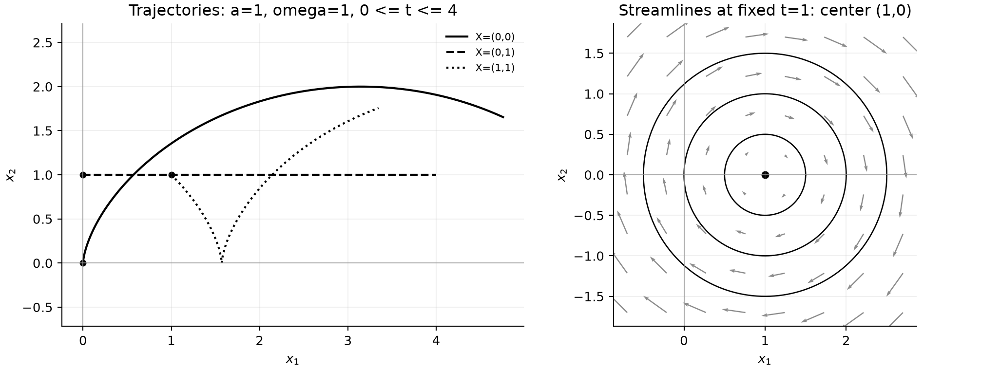

# TD1：连续介质运动学（2024–2025）

原题：[TD1 PDF](../IMMC_TD1_Sujet_2024-2025.pdf) · 教师解答：[练习 1](../IMMC_TD1_Ex1_Correction_2024-2025.pdf)、[练习 2](../IMMC_TD1_Ex2_Correction_2024-2025.pdf) · [详细推导](../第一章TDMC.md)

**查阅路线。** 练习 1.1–1.3：由速度积分运动映射；1.4：区分轨迹与流线；1.5：物质导数；1.6：运动性质；练习 2：刚体旋转。$[a]=\mathrm m$，$[\omega]=\mathrm{s^{-1}}$，三维延拓时取 $x_3=X_3$、$V_3=0$。

## 练习 1：大气涡旋的运动学

**Cinématique d’un tourbillon atmosphérique.** Dans un repère cartésien, le mouvement est donné par $V_1=\omega x_2$ et $V_2=-\omega x_1+a\omega^2t$. Les paramètres $a,\omega$ sont constants et $\omega\ne0$. Les coordonnées $X_i$ repèrent la position initiale de chaque particule ; les $x_i$ sa position courante.

在直角坐标中，$V_1=\omega x_2$、$V_2=-\omega x_1+a\omega^2t$，其中 $a,\omega$ 为常量，$\omega\ne0$。

### 问题 1.1：回顾欧拉与拉格朗日描述，以及相互转换方法

Rappeler les définitions des descriptions eulérienne et lagrangienne et la démarche permettant de passer de l’une à l’autre.

欧拉描述在固定空间点观察场；拉格朗日描述跟踪初始坐标 $\mathbf X$ 对应的物质粒子。由速度场积分 $\dot{\mathbf x}=\mathbf V(t,\mathbf x)$ 并给定 $\mathbf x(0)=\mathbf X$ 得运动映射；反向转换则对映射按时间求导，再用逆映射消去 $\mathbf X$。

### 问题 1.2：给出欧拉描述

Donner la description eulérienne de ce mouvement.

题给的 $\mathbf V(t,\mathbf x)=(\omega x_2,-\omega x_1+a\omega^2t)$ 已是欧拉速度场。

### 问题 1.3：给出拉格朗日描述

Donner la description lagrangienne de ce mouvement.

先对 $\dot x_2=-\omega x_1+a\omega^2t$ 求导，代入 $\dot x_1=\omega x_2$，得到

$$\ddot x_2+\omega^2x_2=a\omega^2.$$

常数特解是 $a$，故 $x_2=A\cos\omega t+B\sin\omega t+a$。由初始条件 $x_2(0)=X_2$、$\dot x_2(0)=-\omega X_1$ 得 $A=X_2-a$、$B=-X_1$，再从原方程恢复 $x_1$。令 $c=\cos\omega t$、$s=\sin\omega t$：

$$x_1=X_1c+(X_2-a)s+a\omega t,\qquad
x_2=-X_1s+(X_2-a)c+a.$$

将 $t=0$ 代入可恢复初始位置；按时间求导可恢复题给速度。

### 问题 1.4：给出并画出流线与轨迹

Donner et tracer les lignes de courant et les trajectoires.

在固定时刻 $t$，流线满足

$$\frac{dx_2}{dx_1}=\frac{-x_1+a\omega t}{x_2}
\quad\Longrightarrow\quad(x_1-a\omega t)^2+x_2^2=C.$$

它们是以 $(a\omega t,0)$ 为中心的圆。轨迹按上一问的参数方程作图；$a\ne0$ 时通常不与固定时刻的流线重合。注意：移动的流线中心不代表某个粒子的轨迹。

示意图取 $a=1\ \mathrm m$、$\omega=1\ \mathrm{s^{-1}}$。左图各曲线属于不同粒子的轨迹；右图的圆属于固定时刻 $t=1\ \mathrm s$ 的流线，不能把左右两图当作同一种曲线。

### 问题 1.5：回顾并计算欧拉、拉格朗日加速度

Rappeler et calculer l’expression des accélérations eulérienne et lagrangienne.

先分成局部项和对流项，不能因为写的是欧拉场就只算 $\partial_t\mathbf V$：

$$\partial_t\mathbf V=(0,a\omega^2),\qquad
(\nabla_x\mathbf V)\mathbf V=(-\omega^2x_1+a\omega^3t,-\omega^2x_2).$$

$$\mathbf a^E=\partial_t\mathbf V+(\mathbf V\cdot\nabla)\mathbf V
=(-\omega^2x_1+a\omega^3t,\ -\omega^2x_2+a\omega^2).$$

拉格朗日加速度为 $\ddot{\mathbf x}(t,\mathbf X)$，即

$$\mathbf a^L=\left(-\omega^2[X_1c+(X_2-a)s],\ \omega^2[X_1s-(X_2-a)c]\right).$$

### 问题 1.6：运动是否稳态、有旋、不可压缩？

Le mouvement est-il stationnaire ? Rotationnel ? Incompressible ?

$\partial_t\mathbf V=(0,a\omega^2)$，故当 $a\ne0$ 时非稳态（若 $a=0$ 则稳态）。旋度为 $-2\omega\mathbf e_3$，有旋；散度为零，不可压缩。

## 练习 2：刚体旋转的运动学

**Rotation rigide.** Un cylindre tourne à vitesse angulaire constante $\omega$ autour de $(O,\mathbf e_3)$. L’angle est $\theta=\omega t$ ; la transformation des positions de référence vers les positions courantes est donnée par la matrice de rotation ci-dessous.

圆柱以恒角速度 $\omega$ 绕 $(O,\mathbf e_3)$ 转动，$\theta=\omega t$：

$$x_1=X_1\cos\theta-X_2\sin\theta,\quad
x_2=X_1\sin\theta+X_2\cos\theta,\quad x_3=X_3.$$

### 问题 2.1：给出拉格朗日与欧拉描述

Donner les descriptions lagrangienne et eulérienne de ce mouvement.

拉格朗日描述就是上述映射；欧拉速度与加速度为

$$\mathbf V=(-\omega x_2,\omega x_1,0),\qquad
\mathbf a=(-\omega^2x_1,-\omega^2x_2,0).$$

这与练习 1 的旋转方向符号不同，不能直接把两题速度公式互换。
