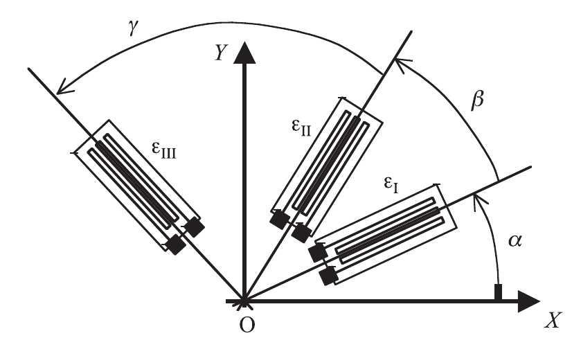
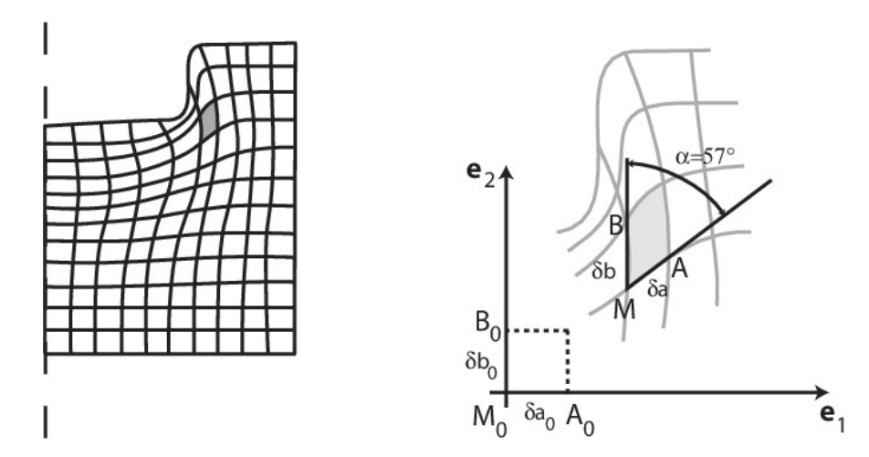

# TD2：连续介质的变形（2026–2027）

原题：[TD2 PDF](../IMMC_TD2_Sujet_2026-2027.pdf) · 教师解答：[练习 1](../IMMC_TD2_Ex1_Correction_2026-2027.pdf)、[练习 2](../IMMC_TD2_Ex2_Correction_2026-2027.pdf)、[练习 3](../IMMC_TD2_Ex3_Correction_2026-2027.pdf)（练习 4–5 没有教师解答） · [详细推导](../第二章TDCM.md)（旧版，前两题顺序与今年相反）

**查阅路线。** 练习 1：简单剪切，按 $\mathbf V\to\mathbf x\to\mathbf F\to\mathbf E$ 计算；练习 2：用刚体旋转检查 HPP 的适用条件；练习 3–4：由测量重建应变；练习 5：检查应变是否能积分成位移。主应变无量纲，变形率才有 $\mathrm{s^{-1}}$ 的单位。

## 练习 1：简单剪切运动（Mouvement de glissement simple）

**Glissement simple.** Dans une base cartésienne fixe, on considère le champ $\mathbf V=\alpha x_2\mathbf e_1$, avec $\alpha>0$ constant. On suit les particules à partir de leurs coordonnées initiales $\mathbf X$. Les figures décrivent la transformation d’un carré puis d’un cube de côté $\eta$.

在固定正交基底中，速度为 $\mathbf V=\alpha x_2\mathbf e_1$，$\alpha>0$ 为常量。令 $k=\alpha t$，初始坐标为 $\mathbf X$。

### 问题 1.1：轨迹与流线是什么？

Quelles sont les trajectoires et lignes de courant de ce mouvement ?

积分 $\dot x_1=\alpha x_2,\dot x_2=\dot x_3=0$：

$$x_1=X_1+kX_2,\qquad x_2=X_2,\qquad x_3=X_3.$$

轨迹和流线均平行于 $\mathbf e_1$；$x_2=0$ 上的点静止。速度场不随时间变化，所以两类曲线在这里重合。

### 问题 1.2：边长为 $\eta$ 的初始正方形如何变换？

On considère à l’instant $t=0$ le carré $OA_0B_0C_0$, de côté $\eta$, avec $\overrightarrow{OA_0}=\eta\mathbf e_1$ et $\overrightarrow{OB_0}=\eta\mathbf e_2$. Quelle est la transformée de ce carré à l’instant $t$ ?

原题用 $O,A_0,B_0,C_0$ 表示四个顶点，其中 $A_0=\eta\mathbf e_1$、$B_0=\eta\mathbf e_2$。变形后对应坐标为

$$O=(0,0),\quad A=(\eta,0),\quad B=(k\eta,\eta),\quad C=((1+k)\eta,\eta).$$

正方形变成平行四边形，底边长度与高度均不变，斜边长度变为 $\eta\sqrt{1+k^2}$。

### 问题 1.3：以上述正方形为一面的立方体如何变换？

On considère à l’instant t = 0, un cube dont une face correspond au carré OA0 B0 C0 . Quelle est la transformée de ce cube à l’instant t ?

沿 $\mathbf e_3$ 的棱不变，立方体成为斜平行六面体；体积仍为 $\eta^3$。

### 问题 1.4：定义并计算变换梯度

Rappeler la définition du tenseur de transformation et donner son expression.

$$F_{ij}=\frac{\partial x_i}{\partial X_j},\qquad
\mathbf F=\begin{pmatrix}1&k&0\\0&1&0\\0&0&1\end{pmatrix}.$$

### 问题 1.5：计算 Green–Lagrange 应变及其主值、主方向

Rappeler la définition du tenseur de déformation de Green-Lagrange et calculer son expression. Déterminer les déformations principales et les directions principales de déformation.

$$\mathbf E=\tfrac12(\mathbf F^{\mathsf T}\mathbf F-\mathbf I)
=\tfrac12\begin{pmatrix}0&k&0\\k&k^2&0\\0&0&0\end{pmatrix}.$$

主应变满足 $\det(\mathbf E-\lambda\mathbf I)=0$。第三方向先给出零特征值，面内的 $2\times2$ 方程为

$$\lambda^2-\frac{k^2}{2}\lambda-\frac{k^2}{4}=0.$$

所以主应变为

$$E_\pm=\frac{k^2\pm\sqrt{k^4+4k^2}}4,\qquad E_3=0.$$

当 $k\ne0$，可取主方向 $\mathbf n_\pm\propto(k,2E_\pm,0)$，归一化后使用；第三个方向为 $\mathbf e_3$。$k=0$ 时三个主值均为零，任何正交基均可。

### 问题 1.6：给定方向线元的长度平方增量

Calculer l’accroissement du carré de la longueur de $d\mathbf M_0=dl_0\boldsymbol\tau$, où $\boldsymbol\tau$ est un vecteur unitaire du plan $(\mathbf e_1,\mathbf e_2)$ faisant un angle $\varphi$ avec $\mathbf e_1$.

初始线元 $d\mathbf M_0=dl_0\boldsymbol\tau$，其中 $\boldsymbol\tau=(\cos\varphi,\sin\varphi,0)$。于是

$$dl^2-dl_0^2=2dl_0^2\boldsymbol\tau\cdot\mathbf E\boldsymbol\tau
=dl_0^2\left(k\sin2\varphi+k^2\sin^2\varphi\right).$$

### 问题 1.7：微元的体积变化

Soit un cube élémentaire de côtés $d\mathbf a_0,d\mathbf b_0,d\mathbf c_0$. Déterminer la variation de volume entre l’état non déformé et l’état déformé.

$$dv=J\,dV,\qquad J=\det\mathbf F=1,\qquad dv-dV=0.$$

有形状变化，但没有体积变化。

### 问题 1.8：描述速度 $\mathbf V=\alpha x_2\mathbf e_1-\alpha x_1\mathbf e_2$

Décrire le mouvement dont le champ des vitesses est $\mathbf V=\alpha x_2\mathbf e_1-\alpha x_1\mathbf e_2$.

这是绕 $\mathbf e_3$ 的刚体转动，角速度为 $-\alpha\mathbf e_3$。轨迹是圆；$\nabla\mathbf V$ 反对称，$\mathbf D=0$，没有变形。

教师解答：[练习 1](../IMMC_TD2_Ex1_Correction_2026-2027.pdf)。

## 练习 2：刚体旋转与变形（Mouvement de rotation）

**Rotation et déformation.** Un cylindre effectue une rotation rigide d’angle $\theta=\omega t$ autour de $(O,\mathbf e_3)$. On compare la mesure exacte de Green–Lagrange à la mesure linéarisée, puis on précise les restrictions imposées par l’HPP.

圆柱绕 $(O,\mathbf e_3)$ 以角速度 $\omega$ 旋转，$\theta=\omega t$：

$$x_1=X_1\cos\theta-X_2\sin\theta,\quad
x_2=X_1\sin\theta+X_2\cos\theta,\quad x_3=X_3.$$

### 问题 2.1：给出拉格朗日与欧拉描述

Donner les descriptions lagrangienne et eulérienne de ce mouvement (déjà abordé dans le TD1).

拉格朗日描述即上述运动映射。对固定 $\mathbf X$ 求导得到速度，再以 $\mathbf X=\mathbf Q^{\mathsf T}\mathbf x$ 代入：

$$\mathbf V(t,\mathbf x)=\omega(-x_2\mathbf e_1+x_1\mathbf e_2),\qquad
\mathbf a=-\omega^2(x_1\mathbf e_1+x_2\mathbf e_2).$$

### 问题 2.2：计算 $\mathbf F$ 与 $\mathbf E$，并解释

Calculer le tenseur gradient de la transformation F, puis le tenseur des déformations de Green-Lagrange E. Commenter le résultat obtenu.

$$\mathbf F=\mathbf Q=\begin{pmatrix}\cos\theta&-\sin\theta&0\\\sin\theta&\cos\theta&0\\0&0&1\end{pmatrix},
\qquad\mathbf E=\tfrac12(\mathbf Q^{\mathsf T}\mathbf Q-\mathbf I)=0.$$

刚体旋转保持长度和夹角，因此有限应变必须为零。

### 问题 2.3：形式上计算线性化应变

En faisant l’hypothèse des petites perturbations, donner le tenseur des déformations linéarisées $\boldsymbol\varepsilon$.

$$\nabla_X\mathbf u=\mathbf Q-\mathbf I,\qquad
\boldsymbol\varepsilon=\operatorname{sym}(\mathbf Q-\mathbf I)
=\operatorname{diag}(\cos\theta-1,\cos\theta-1,0).$$

这在有限转角时会给出非零值，说明小扰动公式超出了适用范围，不能据此宣称刚体发生变形。

### 问题 2.4：小扰动假设对转角的条件

Quelle est l’hypothèse à formuler sur θ pour que l’hypothèse HPP soit effectivement vérifiée ?

要求 $\|\mathbf Q-\mathbf I\|\ll1$，即相对参考构形的转角足够小（模 $2\pi$）。在 $|\theta|\ll1$ 时，$\cos\theta-1=O(\theta^2)$ 可在一阶近似中舍去。

教师解答：[练习 2](../IMMC_TD2_Ex2_Correction_2026-2027.pdf)。

## 练习 3：用应变计测量变形

**Mesure par jauges de déformation.** Les trois jauges d’une rosette mesurent l’allongement unitaire suivant leurs propres directions. Les angles successifs indiqués sur la figure sont des angles entre jauges : il faut reconstruire les orientations absolues avant de projeter le tenseur des déformations.

三个应变计在自由表面一点组成相邻方向间隔 $120^\circ$ 的应变花，测得

$$\varepsilon_I=0.5\times10^{-4},\qquad
\varepsilon_{II}=\varepsilon_{III}=2\times10^{-4}.$$

原图的 $\beta,\gamma$ 为相邻夹角，三个方向相对 $x$ 轴为 $0^\circ,120^\circ,240^\circ$，不能将后两个方向都读成 $120^\circ$。

### 问题 3.1：求平面应变分量、最大伸长率及其方向

Calculer les composantes du tenseur des déformations $\boldsymbol\varepsilon$ au point $O$ dans le repère $(O,\mathbf e_x,\mathbf e_y)$. Déterminer la direction du plan pour laquelle l’allongement unitaire est maximal et donner sa valeur.

沿 $\mathbf n=(\cos\phi,\sin\phi)$ 的测量值为

$$\varepsilon(\phi)=\varepsilon_{xx}\cos^2\phi+
2\varepsilon_{xy}\sin\phi\cos\phi+\varepsilon_{yy}\sin^2\phi.$$

三个方向分别代入，得到

$$\begin{aligned}
\varepsilon_I&=\varepsilon_{xx},\\
\varepsilon_{II}&=\tfrac14\varepsilon_{xx}-\tfrac{\sqrt3}{2}\varepsilon_{xy}+\tfrac34\varepsilon_{yy},\\
\varepsilon_{III}&=\tfrac14\varepsilon_{xx}+\tfrac{\sqrt3}{2}\varepsilon_{xy}+\tfrac34\varepsilon_{yy}.
\end{aligned}$$

第二、三式相减得 $\varepsilon_{xy}=(\varepsilon_{III}-\varepsilon_{II})/\sqrt3=0$；相加再求出 $\varepsilon_{yy}=2.5\times10^{-4}$，第一式给出 $\varepsilon_{xx}=0.5\times10^{-4}$。因此

$$\boldsymbol\varepsilon=10^{-4}\begin{pmatrix}0.5&0\\0&2.5\end{pmatrix}.$$

最大伸长率为 $2.5\times10^{-4}$，方向为 $y$ 轴。三次表面测量只确定面内分量，不能直接确定全部三维分量。

### 问题 3.2：若改为相邻间隔 $45^\circ$，会测得什么？

Que mesurerait-on si les jauges étaient disposées avec un angle de $45^\circ$ entre elles ($\alpha=0^\circ$, $\beta=45^\circ$, $\gamma=45^\circ$) ?

方向为 $0^\circ,45^\circ,90^\circ$，分别测得 $0.5\times10^{-4},1.5\times10^{-4},2.5\times10^{-4}$。

教师解答：[练习 3](../IMMC_TD2_Ex3_Correction_2026-2027.pdf)。

## 练习 4：网格法（Méthode des grilles）

**Mesure sur une grille déformée.** Les longueurs et les angles avant et après transformation sont donnés sur la figure originale. On en déduit les composantes de Green–Lagrange au point de référence $M_0$, sans confondre allongement relatif et déformation finie.

通过网格法测量钢坯的变形。原图给出了 $M_0$ 附近变形前后的线元。

### 问题 4.1：由长度与夹角求 $\mathbf E$ 的面内分量

À partir des mesures de longueurs et d’angles, calculer les composantes de l’opérateur des déformations de Green-Lagrange E, relatif au point M0 dans la base ($\mathbf e_1$ , $\mathbf e_2$ ).

令初始正交边长为 $\delta a_0,\delta b_0$，变形后长为 $\delta a,\delta b$，夹角为 $\alpha=57^\circ$。记 $\lambda_a=\delta a/\delta a_0$、$\lambda_b=\delta b/\delta b_0$。利用 $\mathbf C=\mathbf F^{\mathsf T}\mathbf F$ 的几何意义：

$$E_{11}=\tfrac12(\lambda_a^2-1),\quad
E_{22}=\tfrac12(\lambda_b^2-1),\quad
E_{12}=E_{21}=\tfrac12\lambda_a\lambda_b\cos57^\circ.$$

原图未给出边长比的具体数值，因此保留长度测量量，不从示意图像素推造数值。

## 练习 5：应变协调性（Compatibilité）

**Intégration des déformations.** On cherche un déplacement compatible avec les deux champs de déformation symétriques donnés. Il faut vérifier la compatibilité locale et, si nécessaire, les conditions globales d’intégrabilité ; le déplacement peut rester défini à un mouvement rigide près.

### 问题 5.1：如何由应变求位移，何时存在解？以下两个场是否可积？

Donner la démarche permettant de déterminer un champ de déplacement associé à un état de déformation. À quelles conditions cette démarche peut-elle être menée à terme ? Pour les deux champs de déformation donnés ci-dessous, existe-t-il un déplacement associé ? Si oui, le calculer.

$$\boldsymbol\varepsilon^{(1)}=\operatorname{diag}(ax_1^2,0,0),\qquad
\boldsymbol\varepsilon^{(2)}=\operatorname{diag}(0,ax_1^2,0).$$

须解 $\varepsilon_{ij}=(u_{i,j}+u_{j,i})/2$。在单连通区域、场足够光滑时，Saint-Venant 协调条件给出存在位移的条件：

$$\varepsilon_{ij,kl}+\varepsilon_{kl,ij}-\varepsilon_{ik,jl}-\varepsilon_{jl,ik}=0.$$

第一个场由 $u_{1,1}=ax_1^2$ 积分得 $u_1=ax_1^3/3$，取 $u_2=u_3=0$ 即可同时满足其余五个分量。因此一个解为 $\mathbf u=(ax_1^3/3,0,0)$，通解可叠加任意刚体平移和无穷小转动：

$$\mathbf u=\left(ax_1^3/3,0,0\right)+\mathbf c+\boldsymbol\omega_0\times\mathbf x.$$

这里 $\mathbf c$、$\boldsymbol\omega_0$ 为常向量；因为应变无量纲，$a$ 的单位为 $\mathrm{m^{-2}}$。

第二个场在 $a\ne0$ 时不满足
$\varepsilon_{11,22}+\varepsilon_{22,11}=2\varepsilon_{12,12}$，因为左侧为 $2a$，右侧为零，所以不存在相应的光滑位移场。$a=0$ 时退化为零应变。

原题第 6 页是积分填写表，中文步骤见 [应变积分表](../../CM/中文补充/应变到位移_积分表.md)。
