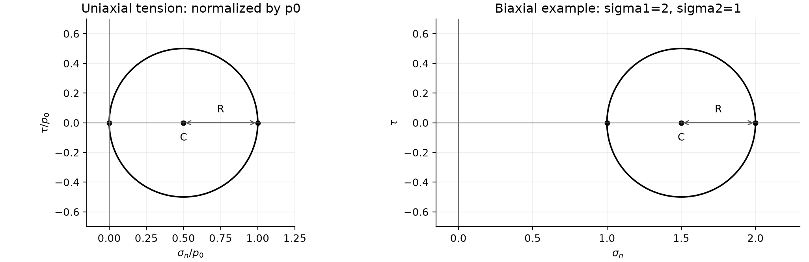

# TD3：内力与应力（2026–2027）

原题：[TD3 PDF](../IMMC_TD3_Sujet_2026-2027.pdf) · 教师解答：[练习 1](../IMMC_TD3_Ex1_Correction_2026-2027.pdf)、[练习 3](../IMMC_TD3_Ex3_Correction_2026-2027.pdf)（练习 2 没有教师解答） · [详细推导](../第三章MCTD.md)

**查阅路线。** 练习 1：矩阵、牵引、主应力和 von Mises；练习 2：单轴拉伸与换基；练习 3：双轴拉伸的 Mohr 圆。约定 $\mathbf T=\boldsymbol\sigma\mathbf n$，$\sigma_n=\mathbf n\cdot\mathbf T$，$\tau=\mathbf t\cdot\mathbf T$；切应力的有符号分量与大小 $|\tau|$ 要区分。

练习 1 的数值单位为 MPa；其余练习中的应力参数须使用一致单位。拉应力取正。

## 练习 1：简单应力计算

**Calculs simples sur les contraintes.** Dans la base orthonormée $(\mathbf e_1,\mathbf e_2,\mathbf e_3)$, les composantes supérieures du tenseur des contraintes au point $A$ sont données ci-dessous, en MPa. Le tenseur de Cauchy est symétrique dans le modèle considéré.

给定点 $A$ 处应力的上三角分量：$\sigma_{11}=2,\sigma_{12}=0,\sigma_{13}=3,\sigma_{22}=1,\sigma_{23}=0,\sigma_{33}=0$。

### 问题 1.1：补全应力张量

Compléter l’expression du tenseur des contraintes.

普通连续介质不含偶应力时，由角动量平衡有 $\sigma_{ij}=\sigma_{ji}$，所以

$$\boldsymbol\sigma=\begin{pmatrix}2&0&3\\0&1&0\\3&0&0\end{pmatrix}.$$

### 问题 1.2：求法向为 $\mathbf e_1,-\mathbf e_1,\mathbf e_2$ 的面上的应力向量

Calculer le vecteur contrainte $\mathbf T$ dans la base ($\mathbf e_1$ , $\mathbf e_2$ , $\mathbf e_3$ ) pour les facettes centrées en A de normales $\mathbf e_1$ , −$\mathbf e_1$ , et $\mathbf e_2$ .

按 $\mathbf T(\mathbf n)=\boldsymbol\sigma\mathbf n$：分别为 $(2,0,3)$、$(-2,0,-3)$、$(0,1,0)$。

### 问题 1.3：表示法向与切向分量

Représenter graphiquement les composantes du vecteur contrainte pour la facette de normale $\mathbf e_1$ et celle de normale $\mathbf e_2$ .

在 $\mathbf e_1$ 面上，法向部分为 $2\mathbf e_1$，切向部分为 $3\mathbf e_3$；在 $\mathbf e_2$ 面上，法向部分为 $\mathbf e_2$，切向为零。可在原图对应面上沿这些方向画箭头。

### 问题 1.4：主应力与主基

Calculer les contraintes principales de $\boldsymbol\sigma$ en $A$ et donner le tenseur des contraintes dans la base principale.

$$\det(\boldsymbol\sigma-s\mathbf I)=(1-s)(s^2-2s-9),$$

故主应力为 $1+\sqrt{10},1,1-\sqrt{10}$。对于 $s=1\pm\sqrt{10}$，可取特征向量 $(s,0,3)$ 并归一化；另一个主方向为 $\mathbf e_2$。主基中的应力矩阵为这三个主应力组成的对角阵。

### 问题 1.5：von Mises 等效应力

Déterminer au point $A$ la contrainte équivalente de von Mises $\sigma_{VM}=\sqrt{\frac32\operatorname{tr}(\boldsymbol\sigma^D\boldsymbol\sigma^D)}$.

$$\boldsymbol s=\boldsymbol\sigma-\frac{\operatorname{tr}\boldsymbol\sigma}{3}\mathbf I
=\begin{pmatrix}1&0&3\\0&0&0\\3&0&-1\end{pmatrix},\qquad
\sigma_{VM}=\sqrt{\frac32\boldsymbol s:\boldsymbol s}=\sqrt{30}\ \mathrm{MPa}.$$

教师解答：[练习 1](../IMMC_TD3_Ex1_Correction_2026-2027.pdf)。

## 练习 2：单轴拉伸试样

**Traction uniaxiale.** La zone utile d’une éprouvette est soumise à des tractions uniformes $-p_0\mathbf e_1$ et $p_0\mathbf e_1$ sur ses deux extrémités ; sa surface latérale est libre. On étudie le vecteur contrainte sur une facette de normale quelconque, ses projections et le cercle de Mohr.

原题假设有效段内应力均匀。试样受均匀拉伸：左端 $S_0$ 上力密度为 $-p_0\mathbf e_1$，右端 $S_1$ 上为 $p_0\mathbf e_1$，侧表面自由。设面法向 $\mathbf n=\cos\alpha\mathbf e_1+\sin\alpha\mathbf e_2$，切向 $\mathbf t=-\sin\alpha\mathbf e_1+\cos\alpha\mathbf e_2$。

### 问题 2.1：求任意截面的应力向量

Soit P un point d’une section S quelconque de normale n. Calculer le vecteur contrainte en P relatif à la direction n.

$$\boldsymbol\sigma=p_0\mathbf e_1\otimes\mathbf e_1,\qquad
\mathbf T=p_0\cos\alpha\mathbf e_1.$$

法向应力与有符号切向应力分别为
$\sigma_n=p_0\cos^2\alpha$、$\tau=-p_0\sin\alpha\cos\alpha$。

### 问题 2.2：画切应力与正应力的关系

Tracer la contrainte tangentielle de cisaillement en fonction de la contrainte normale.

$$\left(\sigma_n-\frac{p_0}{2}\right)^2+\tau^2=\left(\frac{p_0}{2}\right)^2.$$

这是横轴为正应力、纵轴为**有符号切应力** 的 Mohr 圆，圆心 $(p_0/2,0)$，半径 $|p_0|/2$。若纵轴只画切应力大小 $|\tau|$，得到的是上半圆。

左图为单轴拉伸，坐标以 $p_0>0$ 归一化。右图用 $\sigma_1=2$、$\sigma_2=1$ 的示例画出圆心和半径；该数值只用于示意，不是练习 3 的额外已知条件。

### 问题 2.3：拉伸到屈服极限 $\sigma_e$ 时切应力是多少？

On se place à la limite d’élasticité en traction σe . Que vaut alors la contrainte de cisaillement ?

任意面上 $\tau=-\sigma_e\sin\alpha\cos\alpha$；最大绝对值为 $\sigma_e/2$，出现在与轴线成 $45^\circ$ 的面。不能把每个面的切应力都写成该最大值。

### 问题 2.4：在两组基底中写应力矩阵

Écrire l’opérateur des contraintes dans la base ($\mathbf e_1$ , $\mathbf e_2$ , $\mathbf e_3$ ) puis dans la base (n, t, $\mathbf e_3$ ).

原基底中是 $\operatorname{diag}(p_0,0,0)$。令 $\mathbf Q$ 的各列依次为新基向量在原基底中的坐标，则

$$\mathbf Q=\begin{pmatrix}\cos\alpha&-\sin\alpha&0\\\sin\alpha&\cos\alpha&0\\0&0&1\end{pmatrix},
\qquad [\boldsymbol\sigma]_{\rm new}=\mathbf Q^T[\boldsymbol\sigma]_{\rm old}\mathbf Q.$$

因此在 $(\mathbf n,\mathbf t,\mathbf e_3)$ 中为

$$p_0\begin{pmatrix}\cos^2\alpha&-\sin\alpha\cos\alpha&0\\-\sin\alpha\cos\alpha&\sin^2\alpha&0\\0&0&0\end{pmatrix}.$$

### 问题 2.5：验证所有表面边界条件

Vérifier que les conditions aux limites imposées sur toute la surface de la zone utile sont vérifiées.

端面外法向为 $\pm\mathbf e_1$，故 $\boldsymbol\sigma\mathbf n=\pm p_0\mathbf e_1$。侧面法向满足 $n_1=0$，于是牵引力为零。

## 练习 3：双轴拉伸试样

**Traction biaxiale.** La zone utile présente un état de contrainte plan diagonal, de composantes principales $\sigma_1,\sigma_2,0$. La normale de la facette tourne dans le plan $(\mathbf e_1,\mathbf e_2)$ ; on représente la contrainte tangentielle en fonction de la contrainte normale.

有效区内 $\boldsymbol\sigma=\operatorname{diag}(\sigma_1,\sigma_2,0)$，法向 $\mathbf n=(\cos\alpha,\sin\alpha,0)$。

### 问题 3.1：求应力向量

Soit une facette de normale n du plan ($\mathbf e_1$ , $\mathbf e_2$ ) et M un point de cette facette, exprimer le vecteur contrainte $\mathbf T$ (M, n).

$$\mathbf T=(\sigma_1\cos\alpha,\sigma_2\sin\alpha,0).$$

### 问题 3.2：法向转过一周时，正应力—切应力平面上的轨迹

Soit α l’angle ($\mathbf e_1$ , n). Tracer le lieu des contraintes T (M, n) lorsque la facette réalise un tour complet autour de M (soit α allant de 0 à 2π), dans un repère où les axes horizontal et vertical représentent respectivement l’amplitude de la contrainte normale et l’amplitude de la contrainte tangentielle.

$$\sigma_n=\frac{\sigma_1+\sigma_2}{2}+\frac{\sigma_1-\sigma_2}{2}\cos2\alpha,
\qquad \tau=\frac{\sigma_2-\sigma_1}{2}\sin2\alpha.$$

$$\left(\sigma_n-\frac{\sigma_1+\sigma_2}{2}\right)^2+\tau^2
=\left(\frac{\sigma_1-\sigma_2}{2}\right)^2.$$

当 $\alpha$ 从 $0$ 变化至 $2\pi$ 时，同一个 Mohr 圆被走过两次。这里限定法向在 $(\mathbf e_1,\mathbf e_2)$ 平面中；任意三维法向的问题还涉及第三主应力零。

教师解答：[练习 3](../IMMC_TD3_Ex3_Correction_2026-2027.pdf)。
